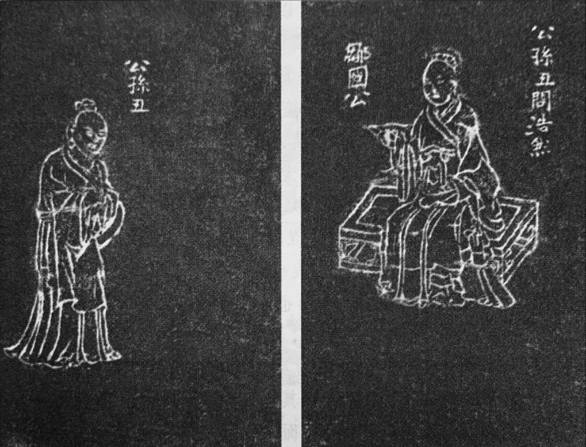
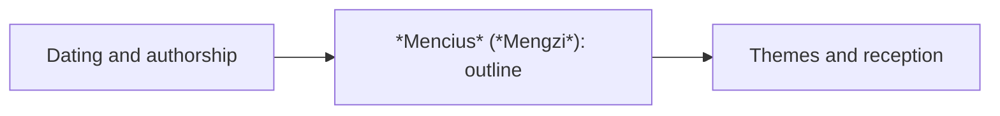

# *Mencius* (*Mengzi*)

**Prerequisites:** [*Analects*](analects.md) and [Mencius](../thinkers/mencius.md)

*Gongsun Chou Wen Hao Ran (公孫丑問浩然), depicted the portrait of Mencius (right) and his student Gongsun, Chou (left). The illustration was a rubbing of a stone… Credit: Unknown authorUnknown author. License: Public domain. Source: [File:Gongsun Chou Wen Hao Ran, Heritage Illustrations for Descent of Mencius.jpg](https://commons.wikimedia.org/wiki/File:Gongsun_Chou_Wen_Hao_Ran,_Heritage_Illustrations_for_Descent_of_Mencius.jpg).*
## Dating and authorship

A book of dialogues and speeches attributed to [Mencius](../thinkers/mencius.md), compiled by disciples, in seven books each split into two parts. It is more argumentative and oratorical than the *Analects*. Traditional reading takes it as the master's teaching; scholarship allows for editorial history without losing a consistent voice. Under [Zhu Xi](../../../imperial/chinese/thinkers/zhu-xi.md) it became one of the Four Books.

## Outline and key ideas

Mencius debates kings about profit versus *ren* and rightness, defends the goodness of [nature](../../../../concepts/ethics/human-nature-xing.md) with the child-and-the-well and the four sprouts, insists on the people's livelihood, and allows the removal of a ruler who has lost the Mandate. He attacks [Mohist](../thinkers/mozi.md) impartial care and the egoism associated with Yang Zhu. The "flood-like *qi*" and the unmoved mind are part of a cultivated inner power, not only a theory of nature. D. C. Lau and Bryan Van Norden are standard English starting points.

## Reception

Orthodox Confucianism, especially after the Song, reads Confucius through this book. [Xunzi](../thinkers/xunzi.md) is the great contemporary dissent. Together they are a better introduction to "Confucianism" as an argument than either is alone.

## How to read it

Read the *Mencius* as a book of arguments, not as a looser *Analects*. The long dialogues — with King Hui of Liang, with Gaozi on human nature, with the agricultural utopians, on the duty (and limits) of remonstrating with a king — are where the philosophy is. Watch how an analogy is introduced (the child at the well, Ox Mountain, barley on different slopes) and then tested. Mencius is trying to show that the heart's sprouts are real and that politics should be judged by whether the people can live, not only by whether a ritual form has been kept.

The text is later than Confucius and already in a world of rival schools. It is more explicit about *xing*, about the people, and about the conditions under which a ruler may be set aside. Traditional ascription to Mencius and his disciples is the starting point; scholarly work discusses layers and later shaping. Use a complete translation (D. C. Lau, or Bloom, or Van Norden's reader for first orientation) and do not skip the passages that seem like court anecdote: they are often the ethics in action. After this, Xunzi's contrary view of nature will make more sense as a reply, not as a random opposite.

## Key ideas

- Dialogues defending the goodness of nature, righteous politics, and graded love.
- The four sprouts and the child at the well are the ethical core.
- A Four Books classic, and a foil to Xunzi and to Mozi.

## Where this leads

- [*Xunzi*](xunzi.md), [*Analects*](analects.md)
- Thinker: [Mencius](../thinkers/mencius.md)
