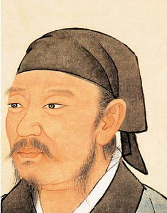
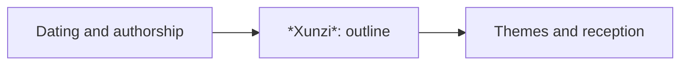

# *Xunzi*

**Prerequisites:** [Xunzi](../thinkers/xunzi.md) and [*Mencius*](mencius.md)

*Xun Zi (simplified Chinese: 荀子; traditional Chinese: 荀子; pinyin: Xún Zǐ; Wade–Giles: Hsün Tzu, ca. 312–230 BC) was a Chinese Confucian philosopher who lived… Credit: Unknown authorUnknown author. License: Public domain. Source: [File:Xun zi.jpg](https://commons.wikimedia.org/wiki/File:Xun_zi.jpg).*
## Dating and authorship

A collection of themed essays attributed to [Xunzi](../thinkers/xunzi.md), more treatise-like than the *Analects* or *Mencius*. A substantial core is widely accepted as his; some chapters may be later school material. Eric Hutton's complete translation and Burton Watson's selection are the usual English entries.

## Outline and key ideas

Read first the chapters on Heaven, on ritual, on human nature, on "an exhortation to learning," and on "dispelling obsession." Nature is raw; [artifice](../../../../glossary/chinese/wei-artifice.md), ritual, and teaching make people good. Heaven is a regular order, not a moral intervener. Names must be carefully regulated. Music and ritual are defended against [Mozi](../thinkers/mozi.md). The prose is proud, organized, and sometimes caustic.

## Reception

Sidelined by later Mencian orthodoxy, the book was recovered by modern readers as a major systematic Confucian work and as background to [Legalism](../thinkers/han-feizi.md) (with the caution that Xunzi is not Han Feizi).

## How to read it

The *Xunzi* is the most essay-like of the early Confucian books, and it rewards being read as a set of treatises rather than as a collection of sayings. Start with "An Exhortation to Learning," "A Discussion of Heaven," "A Discussion of Ritual," "A Discussion of Music," "Human Nature Is Bad," and "Dispelling Obsession." Then take the chapters on names, on the gentleman, and on the way of a true king. Xunzi is arguing, repeatedly, that nature is not a moral seed-bed and that culture — ritual, music, law, teachers, the right use of names — is a deliberate, arduous artifice.

That can sound grim. In fact the book is often warm about learning and about the beauty of ritual, and it is intellectually ambitious in a way that later Confucians sometimes found uncomfortable (Heaven as regular order rather than as a moral intervener; a human nature that does not start good). A substantial core is widely accepted as his; some chapters may be school material. Eric Hutton's complete translation is the best first English full text. Read Mencius first or soon after, so that the disagreement about *xing* is a real disagreement, not two slogans. Han Fei and Li Si were said to have studied with Xunzi: the Legalist turn is not written in this book, but you can see why a harsher student might have left it.

## Key ideas

- Essays, not sayings: nature, ritual, Heaven, names, learning.
- A Confucian systematizer, not a Legalist.
- Best read as a pair with the *Mencius*.

The later reception of the *Xunzi* is itself part of the story. For much of imperial Confucianism, Mencius, not Xunzi, became the orthodox partner of Confucius, and Xunzi's darker view of nature and his more naturalistic Heaven were sometimes treated as a slide toward Legalism. Modern readers have often reversed the slight, finding in him a rigorous theory of ritual, language, and education. Reading him well means letting that later quarrel be heard without reducing the book to a verdict on it.

## Where this leads

- Thinker: [Xunzi](../thinkers/xunzi.md)
- Contrast: [*Mencius*](mencius.md), [*Han Feizi*](han-feizi.md)
