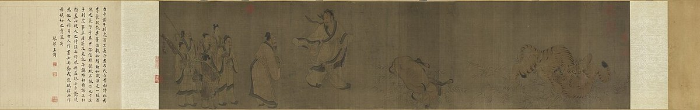
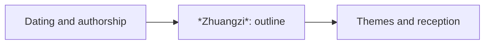

# *Zhuangzi*

**Prerequisites:** [*Daodejing*](daodejing.md) and [Zhuangzi](../thinkers/zhuangzi.md)

*Bian Zhuangzi Killing Tigers Credit: Unknown authorUnknown author. License: Public domain. Source: [File:卞庄子刺虎图卷.宋人绘.绢本浅设色.台北故宫博物院藏.jpg](https://commons.wikimedia.org/wiki/File:卞庄子刺虎图卷.宋人绘.绢本浅设色.台北故宫博物院藏.jpg).*
## Dating and authorship

A large, layered book. Many scholars treat the Inner Chapters (1–7) as closest to Zhuang Zhou; the Outer and Miscellaneous chapters include later hands. Guo Xiang's recension (third–fourth century CE) is the received form. Burton Watson, A. C. Graham, and Brook Ziporyn are major English versions, sometimes quite different in the contested chapters.

## Outline and key ideas

Start with the Inner Chapters: the "Free and Easy Wandering," the "Sorting of Things" (including the butterfly dream and the debates on "this" and "that"), the "Secret of Caring for Life" (Cook Ding), the "Human World," "The Sign of Virtue Complete," "The Great Ancestral Teacher," and "The Face-King." Stories do the philosophical work: perspective, skillful spontaneity, the usefulness of the useless, death as transformation, a distrust of disputation even while the book is philosophically acute. The later chapters extend, sometimes repeat, and sometimes shift the voice (including more "Laozi-like" political counsel, or more frankly primitivist passages).

## Reception

A classic of Chinese literature as well as of philosophy, and a long-term partner and irritant to Confucian seriousness. Read it as stories first, then as argument.

## How to read it

The *Zhuangzi* should be read as literature that does philosophy, not as a bag of paradoxes with a doctrine hidden underneath. Begin with the inner chapters (1–7 in the traditional division), especially the opening on the great bird Peng, the "Qiwulun" (discussion of the equalization of things), the story of Cook Ding, and the butterfly dream. Watch how a joke, a sudden shift of scale, or a conversation with a skull can do the work a Greek treatise might do with a distinction. Hui Shi appears as friend and foil: useful, limited, and finally not quite able to walk Zhuangzi's path.

The book is layered. Few scholars treat the whole thirty-three chapters as one author's voice; the inner chapters are the usual core, with outer and miscellaneous chapters of various dates and schools, including some more "Laozian" political material. That is a reason to note where you are in the book, not a reason to skip the later chapters (the death of Zhuangzi's wife, the useful and useless trees, the debate on the Joy of Fish). A complete translation (Watson, or Ziporyn, or others with good notes) is worth owning. After a first pass, try comparing one inner-chapter story with a *Daodejing* chapter on *wu wei*: the family resemblance is real, the tone and the picture of the sage are not the same.

## Key ideas

- A layered book; Inner Chapters are the usual core.
- Perspective, skill, uselessness, and death are the leading themes.
- Guo Xiang's edition and modern translations shape what "the *Zhuangzi*" is.

## Where this leads

- Thinker: [Zhuangzi](../thinkers/zhuangzi.md)
- Rivals in the use of language: [*Gongsun Longzi*](gongsun-longzi.md), [*Mozi*](mozi.md)
