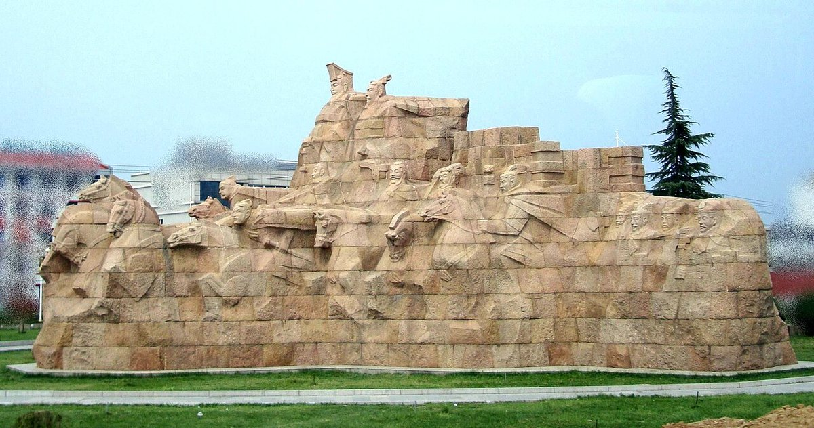
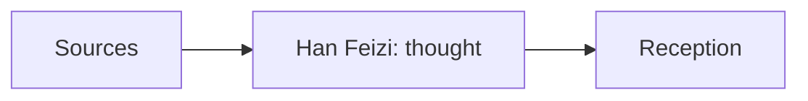

# Han Feizi

**Prerequisites:** [Xunzi](xunzi.md), [Shang Yang](shang-yang.md), and the survey [Legalism](../07-legalism.md)

*A modern statue of the First Emperor and his attendants, on display at Xian. Credit: GwydionM at English Wikipedia. License: Public domain. Source: [File:First Emperor.jpg](https://commons.wikimedia.org/wiki/File:First_Emperor.jpg).*
## Name and dates

Han Feizi (d. 233 BCE) was a prince of the state of Han, traditionally a student of [Xunzi](xunzi.md), and the great synthesizer of the tradition later called Legalism (*fajia*). He presented his ideas at the Qin court and, in the traditional story, died in prison at the instigation of Li Si, a former fellow student. The story may be embroidered; the book is the main fact.

## Sources

The [*Han Feizi*](../texts/han-feizi.md) is a large collection of essays, some likely by him, some possibly by later hands in his vein. It is rhetorically brilliant, full of anecdotes of failed ministers and credulous rulers, and more readable than its reputation as "harsh statecraft" suggests. Burton Watson's selection and more complete recent translations are the usual entries.

## Thought

Han Feizi gathers three tools associated with earlier figures. **[*Fa*](../../../../glossary/chinese/fa.md)** (law, public standards): rewards and punishments should be clear, relatively impersonal, and actually applied, so that even a mediocre ruler can govern. **[*Shi*](../../../../glossary/chinese/shi-positional-power.md)** (positional power): authority should come from the seat, not from the occupant's charisma or virtue — a theme associated with Shen Dao. **[*Shu*](../../../../glossary/chinese/shu-technique.md)** (administrative technique): the methods a ruler uses to appoint, monitor, and assess officials, often quietly, so that ministers cannot capture the state — a theme associated with Shen Buhai.

Human beings, on this picture, reliably follow interest. You design for the people you have, not for the people [Mencius](mencius.md) hopes to grow. Moral example is fragile: affection and virtue do not consistently control a household, let alone a state. The ruler may appear still, but this is not [Daoist *wu wei*](../../../../concepts/ethics/wu-wei.md) as attunement to the Way. It is the stillness of someone who uses machinery.

This is **not** liberal [rule of law](../../../../concepts/political/fa-shi-shu.md). Law is an instrument of the state's strength; the ruler stands at the apex. There is little room for a Mencian removal of a tyrant, or for a Mohist appeal to Heaven against an unjust campaign, except insofar as failure itself is the verdict. The Qin state adopted much of this program, unified China in 221 BCE, and collapsed within a generation — a history that has colored the tradition ever since.

## Reception

Confucian memory treated Legalism as the philosophy of a short, cruel dynasty. The administrative achievement (clear standards, weakened hereditary nobility, a centralized state) is real, and so is the human cost. Han Feizi sometimes borrows Daoist language of emptiness for the ruler and fills it with surveillance. Shared words do not mean a shared project.

## Key ideas

- *Fa*, *shi*, and *shu* are a toolkit for ruling without relying on sagehood.
- People follow interest; institutions must be designed accordingly.
- Legalism is rule *by* law as an instrument of power, not liberal rule of law.

## Where this leads

- Text: the [*Han Feizi*](../texts/han-feizi.md)
- Predecessor in Qin reform: [Shang Yang](shang-yang.md)
- Concept: [fa, shi, and shu](../../../../concepts/political/fa-shi-shu.md)
