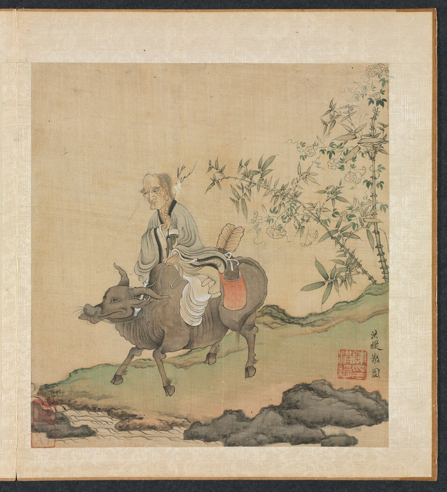
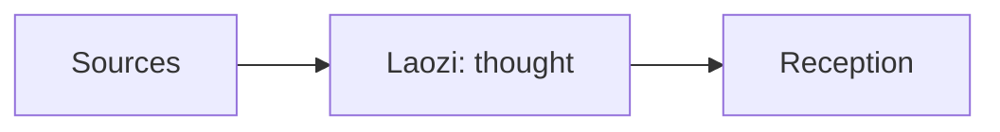

# Laozi

**Prerequisites:** [Foundational concepts](../01-foundational-concepts.md) and the survey [Laozi and the *Daodejing*](../04-laozi-and-the-daodejing.md)

*Paintings after Ancient Masters: Laozi Riding an Ox title QS:P1476,en:"Paintings after Ancient Masters: Laozi Riding an Ox "label QS:Len,"Paintings after… Credit: Chen Hongshou. License: Public domain. Source: [File:Chen Hongshou - Paintings after Ancient Masters, Laozi Riding an Ox - 1979.27.1.2 - Cleveland Museum of Art.tiff](https://commons.wikimedia.org/wiki/File:Chen_Hongshou_-_Paintings_after_Ancient_Masters,_Laozi_Riding_an_Ox_-_1979.27.1.2_-_Cleveland_Museum_of_Art.tiff).*
## Name and dates

"Laozi" names both a legendary figure (the "Old Master," sometimes identified with a Zhou archivist, Li Er or Lao Dan) and the short book also called the [*Daodejing*](../texts/daodejing.md). Traditional stories have [Confucius](confucius.md) consulting him and the old man departing west, leaving the text with a gatekeeper. These stories are late relative to the Warring States, and they should be read as a way a tradition imagined its founder, not as a biography we can date.

## Sources

Modern scholarship generally treats the *Daodejing* as a composite text that took shape over the Warring States period, with a received version later standardized (the "Wang Bi" text is the most famous received edition). Late-fourth- and early-second-century BCE finds at Guodian and Mawangdui show earlier, different arrangements and wordings. The author is less a single person than a tradition. This overview still uses "Laozi" as the conventional name of that voice.

## Thought

The opening move is a warning about language: the *Dao* that can be told is not the constant *Dao*; the name that can be named is not the constant name. The Way is prior to the named, like water, an uncarved block, a valley, the emptiness in a hub — useful because it is not filled up. **[*De*](../../../../glossary/chinese/de.md)** here is the potency of what stays close to that Way, often described through softness: water wears down stone; the infant and the female are images of vitality.

**[*Wu wei*](../../../../glossary/chinese/wu-wei.md)** is not laziness. It is non-forcing, non-contrived action: ruling and living in a way that does not fight the grain of things. The book is full of political counsel. A state is best when people are settled and not inflamed by luxury, weapons, and moral advertising. "When the great *Dao* is abandoned, there is *ren* and rightness" is a direct jab at Confucian (and Mohist) campaigns of virtue. Public moralism can be a symptom of lost simplicity.

A pattern of **reversal** runs through the text: the soft wins, the full tips over, to arrive you leave space. Sharp tools and clever cutting of the world are suspect. Whether this is quietism, a critique of striving, or a hard-headed recipe for ruling by not provoking resistance is a real interpretive fork. The book supports more than one reading. Keep the political edge visible; this is not only poetry about streams.

## Reception

Later "Daoism" develops in several directions: philosophical commentary (Wang Bi), religious movements, and a long role as the official other of Confucianism. [Zhuangzi](zhuangzi.md) shares vocabulary and is stranger, funnier, and less interested in advising a throne. For this path, "Laozi" is the name of a short, layered classic that made *Dao*, *De*, and *wu wei* inexhaustible terms.

## Key ideas

- The constant *Dao* is prior to names; language is already a thinning.
- *Wu wei* is non-forcing action, including a style of government.
- The "author" is largely legendary; the text is composite and well attested in early finds.

## Where this leads

- Text: the [*Daodejing*](../texts/daodejing.md)
- Next voice: [Zhuangzi](zhuangzi.md)
- Concept: [wu wei](../../../../concepts/ethics/wu-wei.md), [Dao as way and source](../../../../concepts/metaphysics/dao-as-way-and-source.md)
