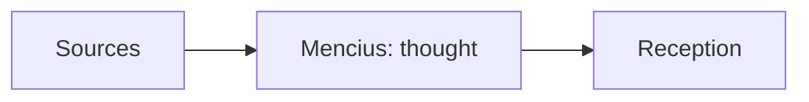

# Mencius

**Prerequisites:** [Confucius](confucius.md) and the survey [Mencius and Xunzi](../03-mencius-and-xunzi.md)

## Name and dates

Mengzi (Mencius, fourth century BCE; traditional dates often given as c. 372–289) was a later Confucian who traveled among Warring States courts arguing for a politics of *ren* and rightness, and against what he took to be the errors of [Mozi](mozi.md) and Yang Zhu. He is the most eloquent early defender of the claim that human nature (*[xing](../../../../glossary/chinese/xing.md)*) is good.

## Sources

The book [*Mencius*](../texts/mencius.md) is a collection of dialogues, debates, and sayings, longer and more argumentative than the *Analects*. Traditional attribution treats it as the master's teaching, recorded by disciples. Modern scholarship discusses layers and editorial history, but the work has a recognizable voice and a consistent set of positions. It became, under [Zhu Xi](../../../imperial/chinese/thinkers/zhu-xi.md), one of the Four Books.

## Thought

Mencius does not claim that people always behave well. He claims that the *direction* of our nature, if not starved, is toward the virtues. The child-and-the-well thought-experiment is the classic illustration: anyone would feel a surge of alarm and compassion, not for pay or praise. From such reactions he describes **[four sprouts](../../../../glossary/chinese/si-duan.md)** (*siduan*): compassion as the sprout of *ren*, shame of rightness (*yi*), courtesy of ritual, a sense of right and wrong of wisdom. The sprouts must be nourished, not pulled to make them grow faster. Environment and bad government can wither them.

The politics follows. If people have these resources, oppressive rule is a betrayal of what Heaven has given. Mencius is clearer than the *Analects* that a ruler who destroys *ren* and rightness has lost the [Mandate](../../../../glossary/chinese/tianming.md) and may be removed. He also insists on material conditions: it is hard to have a "constant heart" without a "constant livelihood." Ethics is not only inner work.

He argues against Mohist [impartial care](../../../../concepts/ethics/impartial-care.md) as psychologically unrealistic and as undermining the family feeling from which moral life actually grows. Graded love, starting at home and extending, is for him the true path to a humane order, not a defect of partiality.

## Reception

In the long run Mencius became the orthodox Confucian ancestor, especially after the Song. [Xunzi](xunzi.md) was often treated as wayward for saying nature is raw or bad. Modern readers sometimes find Mencius closer to a moral-sense theory, and sometimes too confident about nature. For this path, he is one half of the most important argument inside Confucianism, and the thinker who most explicitly ties human nature, Heaven, and the right to resist tyranny.

## Key ideas

- Human nature is good in the sense that virtue has native sprouts, which need nourishing.
- Politics must protect livelihood and may unseat a ruler who destroys *ren*.
- Impartial care, as Mozi teaches it, starts in the wrong place.

## Where this leads

- Text: the [*Mencius*](../texts/mencius.md)
- The other Confucian pole: [Xunzi](xunzi.md)
- Concept: [human nature (*xing*)](../../../../concepts/ethics/human-nature-xing.md)
