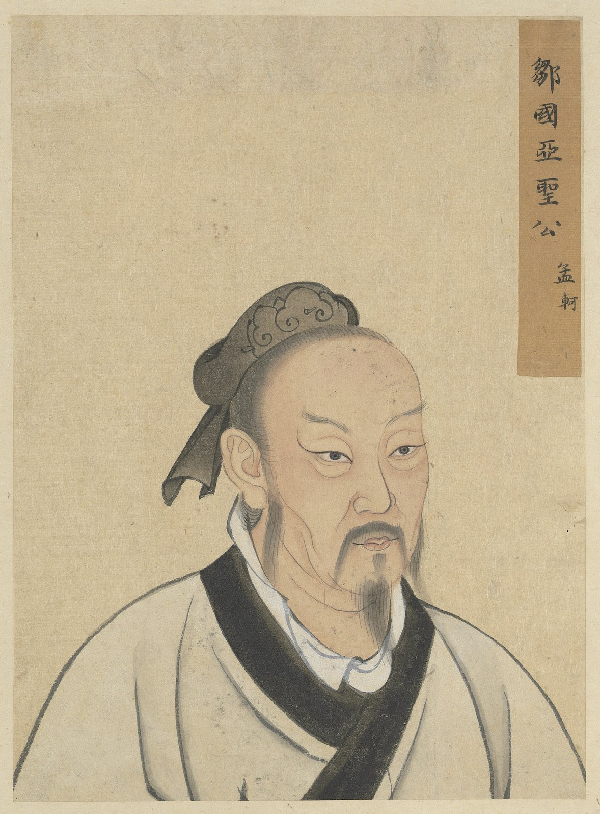

# Mozi

**Prerequisites:** [Foundational concepts](../01-foundational-concepts.md), [Confucius](confucius.md), and the survey [Mohism](../06-mohism.md)

*This depicts Meng Ke (孟軻), also known as Mencius. Credit: anonymous. License: Public domain. Source: [File:Half Portraits of the Great Sage and Virtuous Men of Old - Meng Ke (孟軻).jpg](https://commons.wikimedia.org/wiki/File:Half_Portraits_of_the_Great_Sage_and_Virtuous_Men_of_Old_-_Meng_Ke_(孟軻).jpg).*
## Name and dates

Mo Di, called Mozi (fifth to early fourth century BCE), founded the most organized early rival to the Confucian school. Mohists were known as a disciplined community, sometimes involved in the defense of cities under siege. Their ethics is one of the most explicit first-principle systems in early China: a standard, a test, and a set of practical campaigns.

## Sources

The [*Mozi*](../texts/mozi.md) is a corpus of essays, later "canons" on language and inference, and chapters on defensive warfare. Not all of it is from one hand or one generation. The ethical-political essays (on impartial care, against aggression, against lavish funerals and music, on Heaven's will, against fatalism) are the place to start. The later Mohist canons are technically difficult and fragmentary, and they matter for [logic and names](../../../../concepts/logic/later-mohist-canons.md).

## Thought

The signature doctrine is **[*jian ai*](../../../../glossary/chinese/jian-ai.md)**, impartial care (sometimes translated "universal love"). Disorder comes from partiality: I care for my circle and harm others to benefit it. The remedy is to care for others' families and states as one cares for one's own. This is a direct challenge to Confucian graded love and filial starting points. [Mencius](mencius.md) will say impartial care is psychologically unrealistic and undermines the family. Mozi thinks the family starting point licenses nepotism and war.

A doctrine is to be tested by its benefit to the world — population, wealth, and order — and by the model of the sage-kings and the will of [Heaven](../../../../glossary/chinese/tian.md). Heaven itself cares impartially, so impartial care is not a whim. This gives Mohism a more explicit theology than much Confucianism, and one [Xunzi](xunzi.md) will later reject in this interventional form.

Practical campaigns follow: **against aggressive war** (though not against defensive war), **against lavish funerals and music** as wastes of the people's resources, and **against fatalism**, which saps effort. The later canons try to make standards of names, kinds, and inference public and precise — an epistemology and a logic that should end the cartoon of "the Chinese" as uninterested in argument.

## Reception

Mohism as an organized movement fades after Qin and early Han, while Confucianism becomes state orthodoxy. The questions did not fade. Every time a tradition argues about impartiality versus loyalty, or about wasteful ritual versus social benefit, it is on Mohist terrain.

## Going further

Mozi's religious frame — Heaven's will, the ghosts and spirits as enforcers, a cosmos that is not morally silent — is not an optional preface to a secular ethics of benefit. It is how the standard of inclusive care is supposed to bind a ruler who might otherwise favor his own. A modern reader who keeps only the "utilitarian" sounding arguments and drops Heaven has changed the theory. When you read the [Mozi](../texts/mozi.md), keep the theological essays and the political ones in the same file. Then decide, with Mencius' objections in view, whether graded love or impartial care is being asked to do work the other cannot.

## Key ideas

- Impartial care is the ethical first principle, tested by benefit and by Heaven's will.
- Aggressive war and lavish ritual are condemned as waste and as partiality scaled up.
- Later Mohists developed technical work on language and inference.

## Where this leads

- Text: the [*Mozi*](../texts/mozi.md)
- Confucian replies: [Mencius](mencius.md), [Xunzi](xunzi.md)
- Concepts: [impartial care](../../../../concepts/ethics/impartial-care.md), [later Mohist canons](../../../../concepts/logic/later-mohist-canons.md)
