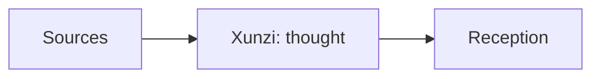

# Xunzi

**Prerequisites:** [Confucius](confucius.md) and [Mencius](mencius.md)

## Name and dates

Xunzi (Xun Kuang, third century BCE) is the great late Warring States Confucian systematizer, a generation or more after Mencius, teaching at the Jixia academy and elsewhere in a world already close to Qin's wars of unification. Traditional accounts make him the teacher of Han Feizi and of Li Si, Qin's chancellor — a lineage that later damaged his reputation, fairly or not.

## Sources

The book [*Xunzi*](../texts/xunzi.md) consists of themed essays, much closer to a treatise style than the *Analects* or even the *Mencius*. Most scholars take a substantial core as his, with some later chapters and some possible school additions. Burton Watson's and Eric Hutton's English translations are the usual starting points.

## Thought

**Human nature is *e*** — a word often translated "bad" or "evil," though "raw," "disorderly," or "bent toward desire" often captures his point better than a doctrine of original sin would. We are born with desires for gain and with envy that, if followed, produce chaos. Goodness is the product of **artifice** (*[wei](../../../../glossary/chinese/wei-artifice.md)*): teachers, ritual, law, and deliberate effort. A board is straightened against a frame; metal is shaped on a stone; people become good by *li* and learning, not by following their first impulses.

This is a defense of Confucius, not a rejection. It explains why ritual is necessary, and why [Zhengming](../../../../concepts/epistemology/names-and-actuality.md) and distinctions (names, ranks, roles) matter so much. [Heaven](../../../../glossary/chinese/tian.md), for Xunzi, is a regular natural order. It does not step in to reward and punish; prayer will not make the harvest. Moral and political order is our work. That naturalism is one of his most modern-feeling moves, and it is easy to see how students could take "nature will not save us" in a [Legalist](han-feizi.md) direction he himself does not take. He still wants a ritual-moral community, not only a machine of rewards and punishments.

He is also a fierce critic of [Mencius](mencius.md) on nature, of [Mozi](mozi.md) on frugality and music, and of some [School of Names](gongsun-long-and-hui-shi.md) paradoxes, while being himself a careful theorist of names and kinds. The essays on ritual, on Heaven, on human nature, and on "dispelling obsession" are the core of a first reading.

## Reception

The imperial Confucian canon, especially after the Song, preferred Mencius. Xunzi was often sidelined as too harsh, too close to Qin. Twentieth-century and later scholars have recovered him as a major philosopher of artifice, education, and naturalized Heaven. For this path, you need both him and Mencius: cultivation assumes something that can be cultivated, and it also assumes that without practice we do not arrive.

## Key ideas

- Nature is raw or bad; ritual and teaching make people good.
- Heaven is regular, not a moral intervener; order is a human product.
- The later Legalist use of "nature is not enough" is a possible misuse, not his own politics.

## Where this leads

- Text: the [*Xunzi*](../texts/xunzi.md)
- Contrast: [Mencius](mencius.md); a harsher institutional turn: [Han Feizi](han-feizi.md)
- Concepts: [human nature](../../../../concepts/ethics/human-nature-xing.md), [cultivation and habit](../../../../concepts/ethics/cultivation-and-habit.md)
