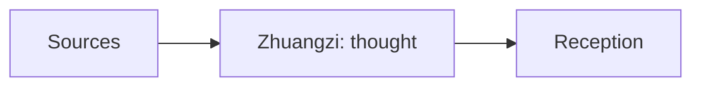

# Zhuangzi

**Prerequisites:** [Laozi](laozi.md) and the survey [Zhuangzi](../05-zhuangzi.md)

## Name and dates

Zhuang Zhou (fourth century BCE), called Zhuangzi, is the name attached to the most imaginative book of early Chinese philosophy. He is a slightly less legendary figure than Laozi — a person from the state of Song, in later anecdote a minor official who refused high office — but the anecdotes are still stories. The voice of the book is what we have.

## Sources

The [*Zhuangzi*](../texts/zhuangzi.md) is layered. Many scholars treat the "Inner Chapters" (1–7) as closest to a historical Zhuangzi, with the Outer and Miscellaneous chapters including later hands in a related spirit. The received text was edited by Guo Xiang (third–fourth century CE), who also wrote the most influential commentary and may have trimmed the corpus. Translations by Burton Watson, A.C. Graham, and more recent hands give somewhat different books, especially in the contested chapters.

## Thought

If the *Daodejing* often sounds like counsel to a sage-ruler, the *Zhuangzi* is more interested in how a person might move through a world of forced distinctions without being broken by them. **Perspective** is the first tool. The huge Peng bird and the little cicada do not share a sense of what is far; "right" and "wrong" may be a monkey's irrelevance; the butterfly dream loosens the authority of a single standpoint. This is not always "every view is equally true." It is a therapy for vocabularies of use, honor, and debate that have forgotten they are vocabularies.

**Skillful spontaneity** is *wu wei* in another key. Cook Ding carves an ox by moving through the spaces, after years of practice, rather than by imposing a theory. Knowledge here is embodied and situational, closer to a craft than to a definition. The **usefulness of the useless** — a gnarled tree that is not cut down — has a political edge in a century when states were hungry for bodies and talent.

On death, Zhuangzi is startlingly calm. When his wife dies, he drums on a tub: she has gone back into the transformations of things. Grief has a moment; treating death as a unique insult may be a failure of perspective. This is not exactly [Epicurean](../../greek/thinkers/epicurus.md) atomism or [Stoic](../../greek/thinkers/zeno-of-citium.md) assent to a rational cosmos. It is a trust in transformation.

## Reception

The book became a classic of literary Chinese as well as of philosophy, a resource for later poets, Chan Buddhist writers, and critics of Confucian stiffness. It can also be read as quietist. As with the *Daodejing*, the first step is to let the stories work, then to ask what kind of life they make possible — and what kind of injustice they might decline to name.

## Key ideas

- Perspective, skillful spontaneity, and the usefulness of the useless are the central therapies.
- The book is layered; Inner Chapters are the usual core.
- Death and transformation are to be met without panic, not explained away by a single doctrine.

## Where this leads

- Text: the [*Zhuangzi*](../texts/zhuangzi.md)
- Rival demand for standards: [Mozi](mozi.md), [the School of Names](gongsun-long-and-hui-shi.md)
- Comparison: [Hellenistic ethics](../../greek/thinkers/epicurus.md), [skepticism](../../greek/thinkers/pyrrho.md)
