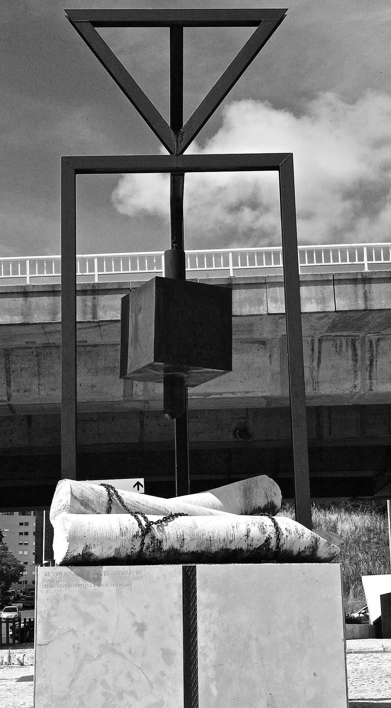
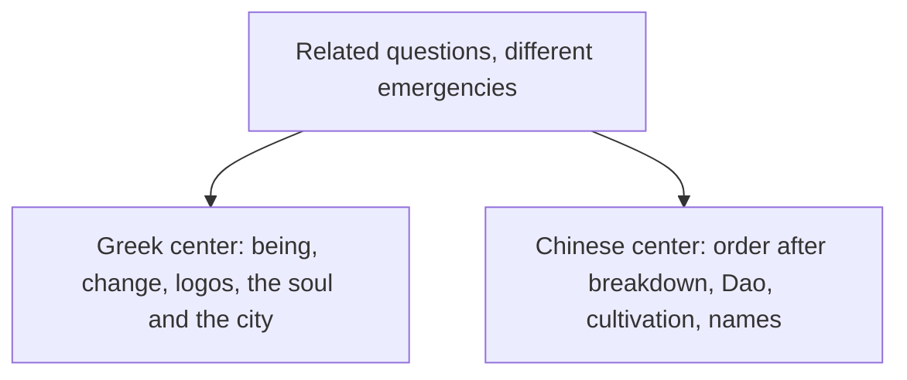

# Greek and Chinese compared

**Prerequisites:** At least [Greek foundational concepts](greek/01-foundational-concepts.md) and [Chinese foundational concepts](chinese/01-foundational-concepts.md). The comparison is richer after both reading paths.
**Key ideas:** related questions, different starting problems and vocabularies; substance and being versus process and relation; the soul and the city versus cultivation, family, and the Way; argument as demonstration versus argument as diagnosis and persuasion; resist the cartoon of "rational West" and "spiritual East."

*Alto dos Moinhos, Lisbon, Portugal FREE TRANSLATION: "FREEING THEMSELVES FROM THE DEATH LAW" Author: Year: 1991 in Wikipedia Luís Vaz de Camões (Portuguese… Credit: Pedro Ribeiro Simões from Lisboa, Portugal. License: [CC BY 2.0](https://creativecommons.org/licenses/by/2.0). Source: [File:"Se vão da lei da morte libertando" (Luis de Camões) (14358994550).jpg](https://commons.wikimedia.org/wiki/File:"Se_vão_da_lei_da_morte_libertando"_(Luis_de_Camões)_(14358994550).jpg).*
It is tempting to turn this into a contest, or into a pair of essences: Greeks think, Chinese feel; Greeks are atomists of the self, Chinese are holists; Greeks love being, Chinese love becoming. Some of those contrasts point at real tendencies. As essences, they fail. The Greek tradition includes Heraclitus and the Skeptics; the Chinese tradition includes later Mohist canons and Han Feizi's hard proceduralism. What follows are patterns, with exceptions built in.

## Different emergencies

Early Greek philosophy, as we usually tell it, is gripped first by nature and intelligibility: what is the *arche*, whether change is real, how thought can track what-is. Ethics and politics become central with the Sophists and Socrates, but the "problem of change" never quite leaves.

Early Chinese philosophy is gripped first by a breakdown of political and ritual order. The master question is how to restore a viable Way for persons and states. Metaphysics and epistemology are there, but they often arrive as support for a diagnosis of disorder.

This difference in emergency shapes what a "first principle" looks like. A Greek first principle often answers "what is fundamentally real?" A Chinese first principle often answers "what standard or path actually produces order?" The branches named in the [philosophy overview](../../README.md) still apply to both. They are weighted differently.

## Being and process

Greek debates repeatedly return to being, substance, and form. Parmenides makes "what-is" the only possible object of genuine thought. Plato locates stability in Forms. Aristotle relocates it in substances and in the actualizing of potentials. Even the atomists save change by giving being to unchanging bits and to the void.

Classical Chinese texts more often describe a world of processes, phases, and relations: *Dao* as way and source, yin and yang as complementary turns, the Five Phases as cycles of generation and overcoming, *qi* as active stuff in later systematizations. The question "is change real?" is less of a crisis if the world is assumed to be transformational from the start.

Do not overstate this. Aristotle's biology is deeply processual. The *Daodejing*'s *Dao* can sound like a source "behind" the ten thousand things. The contrast is about center of gravity, not about two species of mind.

## Self, cultivation, and community

Socratic care of the soul, Plato's tripartite psyche, and Aristotle's virtuous character all assume an interior that can be ordered, often in analogy with a city. The Hellenistic schools then perfect techniques for that interior in a world where the old *polis* is less reliable.

Confucian thought starts the work in family roles and ritual practice, and treats the person as grown in relationships. The *junzi* is an achievement of cultivation, not a given soul-substance. Daoist texts criticize the strain of that cultivation and look for a more unforced attunement. Neither picture is "the individual versus the group" in modern slogans. Greeks are obsessed with the city; Confucians are obsessed with persons. The difference is how the person is composed — through *logos* and a soul's parts, or through roles, ritual, and a Way.

On human nature, Mencius and Xunzi are as explicit as anyone in the Greek canon, and they split. That split is a better comparison-point to Aristotle or the Stoics than any claim that "the Chinese" believed nature was good.

## How arguments work

Greek philosophy, especially after Parmenides and Aristotle, prizes explicit demonstration, definition, and the detection of contradiction. Dialogue and rhetoric never disappear (Plato is a dramatist; the Sophists and Stoics know this), but the ideal of a binding *logos* is strong.

Chinese masters argue too — Mozi and Xunzi are often pointedly argumentative; the later Mohists are technical about inference — but much of the tradition works by models, analogies, historical precedent, and the correction of names in practice. The *Zhuangzi* weaponizes story and humor against the dream of a final standard. This is not the absence of reason. It is a different sense of what a reason is *for*: sometimes to compel a conclusion, sometimes to shift a way of life.

## Politics

Plato bets on education and philosophic rule; Aristotle on constitutions and the political animal; the Stoics on an inner citadel and a cosmic citizenship. Confucius bets on moral power and ritual; Mozi on impartial standards and anti-aggression; the Legalists on law, position, and technique; the *Daodejing* on ruling lightly.

The useful comparison is not "democracy versus autocracy." Classical Greek democracy is not modern liberalism, and Chinese thought is not one authoritarian script. It is where each tradition places its trust when order fails: the formed soul, the law, Heaven's will, the unforced Way, or the machinery of the state. Those options exist on both sides of the map, in different proportions.

## How to use this comparison

When you meet a new text, try two questions. What problem is it answering first? And which of the five branches is it mainly working in? Then ask how it would sound in the other tradition's words. Sometimes a translation will click (*logos* and *Dao*, virtue and *De*). Sometimes the click is a false friend. Noticing the difference is the point of having both paths in the same tree.

## Where this leads

- Revisit a specific pair with this in mind: [Plato](greek/04-plato.md) and [Confucius](chinese/02-confucius-and-the-analects.md); [Aristotle](greek/05-aristotle.md) and [Xunzi](chinese/03-mencius-and-xunzi.md); [Hellenistic ethics](greek/06-hellenistic-schools.md) and [Zhuangzi](chinese/05-zhuangzi.md)
- A neighboring ancient library, with its own first principles: [the Bible](../../../religion/abrahamic/christianity/bible/README.md)
- Back to [ancient philosophy](README.md)
