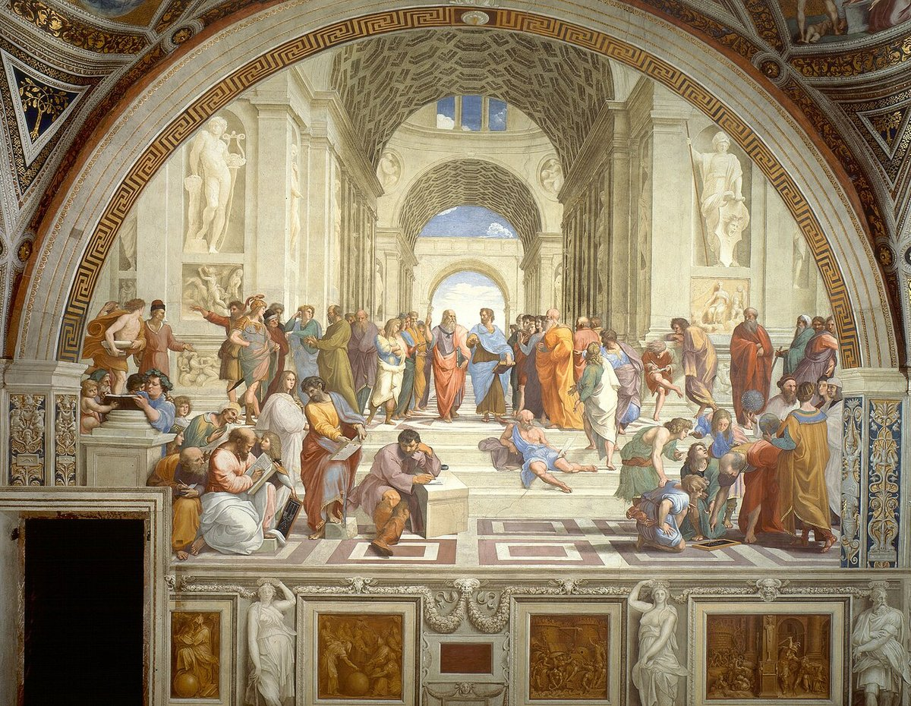
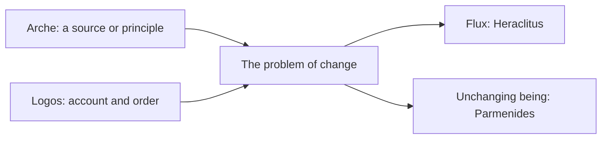

# Foundational concepts: *arche*, *logos*, and the problem of change

**Prerequisites:** [Ancient Greek philosophy](README.md)
**Key ideas:** *arche* as originating principle; *logos* as account, reason, and (in Heraclitus) the world's intelligible structure; the problem of change as the tension between flux and stable being.

*Scuola di AteneThe School of Athenslabel… Credit: Raphael. License: Public domain. Source: [File:"The School of Athens" by Raffaello Sanzio da Urbino.jpg](https://commons.wikimedia.org/wiki/File:"The_School_of_Athens"_by_Raffaello_Sanzio_da_Urbino.jpg).*
Before the famous names, three concepts do most of the work.

## *Arche*

*Arche* (plural *archai*) means a beginning, a source, or a ruling principle. In early Greek natural philosophy it names whatever you take to be fundamental: the stuff or structure from which the ordered world (*cosmos*) arises and to which change can be referred.

To look for an *arche* is already a philosophical move. It says that the world's variety might be intelligible if we can find the right starting point. Thales is remembered for saying that the *arche* is water; Anaximander, for an indefinite *apeiron*; Anaximenes, for air. The particular answers matter less, at first, than the form of the question. Myth had already offered genealogies of gods. The new style looks for a principle that can be discussed, compared, and (in principle) revised.

An *arche* can be material (water, air, atoms) or more formal (number, for the Pythagoreans; *logos*, in one reading of Heraclitus). Later metaphysics never really drops the question. It just gives it more sophisticated names: substance, form, matter, God, the One.

## *Logos*

*Logos* is one of the most overloaded words in Greek. It can mean word, speech, story, proportion, reason, or an explanatory account. In philosophy it often means the kind of account you can give *and defend*. To "give a *logos*" of something is to say what it is, and why.

Heraclitus uses *logos* in a stronger sense: there is a common structure or measure to things, even though people live as if they had a private understanding. The world is not a heap of episodes. It is ordered, and that order can be spoken — though speaking it well is hard.

This is why *logos* later sits so close to logic and to science. Aristotle's logic is a discipline for inspecting accounts. When the Gospel of John opens with "In the beginning was the *Logos*," it is using a word already thick with philosophical history (see [the four Gospels](../../../../religion/abrahamic/christianity/bible/new-testament/02-the-four-gospels.md)). You do not need to collapse John into Heraclitus. You do need to hear that the word was not empty.

## The problem of change

Everyday life is full of change: a seed becomes a tree, a person grows old, fire consumes wood. The philosophical problem is not that change happens. It is how change is possible without contradiction, and how knowledge is possible if things will not stay put.

Two pressures pull in opposite directions.

If you emphasize flux, you get something like the slogan associated with Heraclitus: you cannot step into the same river twice. The world is process. But then what is the "river"? What do our words latch onto? How can there be knowledge, as opposed to a snapshot of something already gone?

If you emphasize stability, you get something like Parmenides' challenge. What *is* is, and cannot not be. Coming-to-be and passing-away look, under that pressure, like confusion. Change and plurality become hard to think without talking about what-is-not, which Parmenides treats as impossible. The world of the senses starts to look like mere opinion.

This is the problem of change. It is not a historical curiosity. Any time you ask whether a person is the same person over a lifetime, whether a law can persist through amendments, or whether a scientific object is a thing or a process, you are on the same terrain.

Plato's Forms are one attempt to give knowledge a stable object while still having a changing world that "participates" in those objects. Aristotle's distinction between potentiality and actuality is another: a seed *is* a tree in potential, so becoming a tree is not a leap from being to non-being. You will meet both answers soon. They are much easier to see once the problem is in view.

## Where this leads

- Next: [The Presocratics](02-presocratics.md), who first put these concepts to work
- Later resolutions: [Plato](04-plato.md), [Aristotle](05-aristotle.md)
- A different vocabulary for process and order: [Chinese foundational concepts](../chinese/01-foundational-concepts.md)
