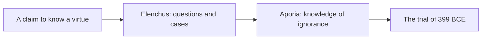

# Socrates

**Prerequisites:** [The Presocratics](02-presocratics.md)
**Key ideas:** we meet Socrates mainly through others; the *elenchus* as a method of testing claims; "knowledge of ignorance"; virtue and the care of the soul; the trial of 399 BCE as a political and philosophical event.

Socrates of Athens (c. 470–399 BCE) wrote nothing that survives. That is the first fact to hold onto. Almost everything we "know" about him comes from other people, who wanted different things from him.

## The problem of sources

Aristophanes' comedy *Clouds* (423 BCE) makes Socrates a Sophist-like impresario of a "Thinkery," hanging in a basket and teaching dishonest rhetoric. It is satire, but it shows that Socrates was already a public figure, and already easy to confuse with the paid teachers of argument.

Xenophon portrays a more practical, pious, advice-giving Socrates. Plato, especially in the early dialogues, portrays a restless questioner who claims not to teach, only to inquire. Most philosophical portraits of Socrates are built from Plato, with the caution that Plato also used "Socrates" as a character in later works that almost certainly go beyond the historical man (the Theory of Forms, the philosopher-king). A common teaching distinction: early Platonic dialogues are our best window on Socrates' method; middle and late dialogues are Plato thinking.

There is no neutral transcript. The honest starting point is that "Socrates" is already an interpretation.

## The *elenchus*

The method associated with him is the *elenchus*: a cross-examination. Someone claims to know what piety, courage, or justice is. Socrates asks for a definition, then tests it with cases and consequences until the claim breaks. The conversation often ends in *aporia* — puzzlement — rather than a finished theory.

This looks negative, and it irritated people. But the point is not merely to win. If a person cannot survive questions about the thing they claim to know, they do not know it in the way they thought. The famous stance, reported in Plato's *Apology*, is that Socrates is wiser than others only in this: he does not think he knows what he does not know.

Two ethical claims usually travel with the method. First, **virtue is a kind of knowledge**. If you really understood the good, you would not willingly choose the bad; wrongdoing is a kind of ignorance. This is controversial (Aristotle will deny that it is that simple), but it explains why Socrates treats definition as a moral task. Second, **the soul is the thing to care for**. Reputation, money, and even life rank lower than not doing injustice. In the *Crito* and *Phaedo* (Platonic dramatizations), he would rather die than betray the principles he has reasoned to.

## The trial

In 399 BCE Socrates was tried on charges of impiety and of corrupting the young, and he was executed by drinking hemlock. The political background matters. Athens had lost the Peloponnesian War, suffered oligarchic coups (including the Thirty Tyrants, among them relatives and associates of Socrates), and recovered a fragile democracy. A man who questioned civic pieties, associated with dubious aristocrats, and declined the usual political path could be read as a threat.

Plato's *Apology* presents the defense as a refusal to flatter the jury or to stop philosophizing. Whether or not that speech is historical, it fixed an image: philosophy as a public risk, not a hobby. Socrates becomes, for the later tradition, the model of a life examined — and the warning that a city may not want such a life in its marketplace.

He also marks a turn in the Greek story. The Presocratics had argued about nature and being. Socrates, as Cicero later put it, "called philosophy down from the heavens" and asked about human life. Plato will put the heavens back in, but he will do it in a way that still answers Socrates' question: how should one live, and what is it to know the good?

## Where this leads

- Next: [Plato](04-plato.md), who turns Socratic inquiry into a full metaphysics and politics
- Contrast in method and moral psychology: [Aristotle](05-aristotle.md)
- A different teacher-student genre, also built from recorded sayings: [Confucius and the *Analects*](../chinese/02-confucius-and-the-analects.md)
