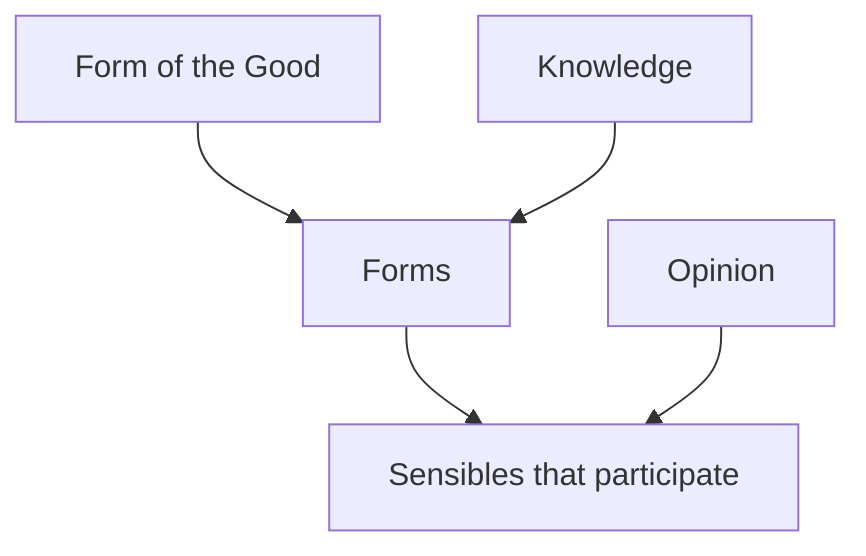

# Plato

**Prerequisites:** [Socrates](03-socrates.md)
**Key ideas:** dialogues as a form, not a defect; Forms as stable objects of knowledge; the Cave and the divided line; the tripartite soul; the *Republic*'s political wager; knowledge versus opinion.

*Plato, copy of the portrait made by Silanion ca. 370 BC for the Academia in Athens Credit: Marie-Lan Nguyen. License: [CC BY 2.5](https://creativecommons.org/licenses/by/2.5). Source: [File:Plato Silanion Musei Capitolini MC1377.jpg](https://commons.wikimedia.org/wiki/File:Plato_Silanion_Musei_Capitolini_MC1377.jpg).*
Plato (c. 427–347 BCE) was an Athenian, a student of Socrates, and the founder of the Academy. He is the first Greek philosopher whose works survive complete, and they survive as **dialogues** — dramatized conversations, not treatises. That form is part of the philosophy. A dialogue can test a view, withdraw it, surround it with myth, or leave it unresolved. Reading Plato well means watching the argument *and* the dramatic situation (who is speaking, to whom, after what political disaster).

## Forms

The Theory of Forms (or Ideas: *eide*) is Plato's most famous metaphysical claim, developed especially in middle dialogues such as the *Phaedo*, *Symposium*, *Republic*, and *Phaedrus*.

The rough idea: the many beautiful things we see are variable, mixed with ugliness, and perishable. Yet we speak of beauty itself, and we can judge particular things as more or less beautiful. What makes that possible, Plato suggests, is Beauty — a stable, intelligible reality that particulars "participate in" or "imitate." There are Forms of justice, equality, and (most controversially in the *Republic*) the Form of the Good, which plays a role for intelligible things somewhat like the sun's role for visible ones.

This is a reply to the [problem of change](01-foundational-concepts.md). Heraclitean flux threatens knowledge; Parmenidean being threatens to erase the sensible world. Forms give knowledge an unchanging object, while the sensible world remains real enough to be a world of appearances and approximations. Epistemology follows: **knowledge** (*episteme*) grasps Forms; **opinion** (*doxa*) tracks the changing sensibles. The "divided line" in *Republic* VI ranks images, ordinary objects, mathematical thought, and dialectical understanding of Forms.

Whether Plato always held one tidy theory is debated. Later dialogues such as the *Parmenides* and *Sophist* press hard on difficulties (the "third man" problem, the being of difference and not-being). It is safer to treat "the Theory of Forms" as a family of attempts than as a single dogma.

## The Cave

*Republic* VII's allegory of the Cave is the picture most people remember. Prisoners chained in a cave take shadows on a wall for reality. One is dragged out, first into the firelight (painful, disorienting), then into the sun. If he returns, the prisoners think he is ruined, and they may kill him.

The allegory is about education, illusion, and politics at once. Education is not pouring facts into a soul; it is a turning of the soul toward what is more real. The returned prisoner is hard not to read as a Socratic figure. The allegory also carries a political warning: a city organized around shadows may punish the person who has seen otherwise.

## Soul and city

In the *Republic*, Plato draws a structural analogy between city and soul. A just city has a three-part order: rulers (wisdom), auxiliaries (courage), and producers (moderation in their place), with justice as each part doing its work. The soul likewise has reason, spirit (*thumos*), and appetite. Justice in a person is a similar harmony, with reason ruling.

The political proposal is famous and easy to caricature: philosopher-rulers, a severe educational program, a "noble lie," and (in the guardian class) radical communism of property and family. Read it first as a thought-experiment about what justice would require if we took it with maximal seriousness, and as a critique of existing Athenian politics after the war and Socrates' death. Whether Plato meant it as a blueprint is a live scholarly question. The ethical core is less ambiguous: a disordered soul cannot live well, and a city that flatters appetite will not be just.

Love (*eros*) gets its own treatment in the *Symposium* and *Phaedrus*: desire can be educated, climbing from attraction to beautiful bodies toward Beauty itself. Ethics, here, is not only rule-following. It is the shaping of desire.

## Where this leads

- Next: [Aristotle](05-aristotle.md), who accepts Plato's questions and rejects separate Forms
- Harmony of soul and cosmos, in a different key: [Hellenistic Stoics](06-hellenistic-schools.md)
- A different picture of educating desire and order: [Confucius](../chinese/02-confucius-and-the-analects.md)
