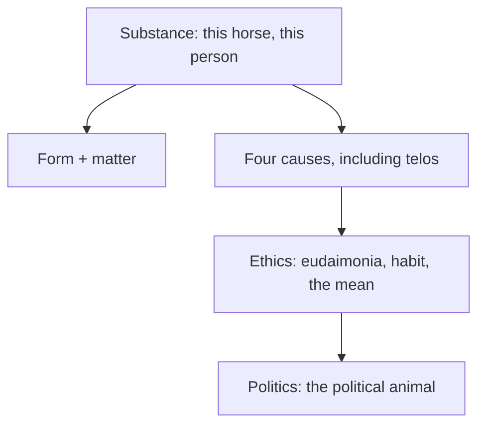

# Aristotle

**Prerequisites:** [Plato](04-plato.md)
**Key ideas:** substances in a changing world; the four causes; potentiality and actuality; syllogistic logic; virtue as a mean acquired by habit; humans as political animals.

Aristotle (384–322 BCE) studied in Plato's Academy for about twenty years, tutored Alexander the Great, and founded the Lyceum in Athens. Where Plato wrote dialogues, Aristotle's surviving works are mainly lecture-style treatises, often dense and apparently compiled from teaching materials. He is the first great systematizer in the Greek tradition: logic, nature, the soul, ethics, politics, rhetoric, and poetics are all treated as parts of one intellectual project.

## Being, change, and the four causes

Aristotle agrees with Plato that knowledge needs stable objects, and he agrees that the Presocratic problem of change is real. He disagrees that the stable objects must be Forms existing separately from the things around us. What is primarily real, for him, is **substance** (*ousia*): this horse, this person, this tree — a "this" that can bear properties and persist through change. Form and matter are principles *of* substances (the form of a bronze statue is its shape; the matter is the bronze), not a second world.

To explain something fully is to give its **four causes** (better: four kinds of "because"):

- **Material:** what it is made of
- **Formal:** what it is, its structure or definition
- **Efficient:** what brought it about
- **Final:** what it is for, its end (*telos*)

Natural things, in this picture, are thoroughly teleological. An acorn is intelligible as something on the way to being an oak. That is the point of **potentiality and actuality**: change is the actualizing of a potential already in the thing. The seed does not leap from non-being to being. It becomes what it already was able to be. This is Aristotle's most direct reply to Parmenides, and it is why biology is not a side interest for him. Living things display form, function, and development together.

## Logic

Aristotle is the first to formalize a large body of valid inference. In the works later called the *Organon*, he analyzes terms, propositions, and the **syllogism**: if all As are Bs and all Bs are Cs, then all As are Cs, and so on through the figures. He also studies informal argument, definition, and the avoidance of fallacies.

This is not the whole of logic as we now know it (it is term logic, not a modern propositional or predicate calculus). It is the beginning of making "this follows" a public, teachable standard. When later traditions talk about logic as a branch of philosophy, they are often starting from this toolkit.

## Ethics and politics

The *Nicomachean Ethics* asks what the human good is. Aristotle's answer is *eudaimonia* — often translated "happiness," better understood as flourishing or living well over a complete life. The distinctive human function is activity of the soul in accordance with reason. Virtue (*arete*, excellence) is a **mean** between extremes, relative to us, and found by practical wisdom (*phronesis*): courage between cowardice and rashness, generosity between stinginess and wastefulness.

Two points are easy to miss. First, virtues are acquired by **habit**. You become just by doing just acts, under guidance, until the disposition is yours. Knowing is not enough — a direct pushback against the Socratic tendency to treat virtue as knowledge alone. Second, the mean is not mediocrity. It is hitting the right mark, which can be demanding.

Because flourishing requires a certain kind of community, ethics opens onto politics. The human being is a **political animal** (*zoon politikon*): we are the animals who live in a *polis* and who have *logos*, speech about the advantageous and the just. The *Politics* studies households, citizenship, constitutions, and the conditions of a good city. Some of it is acute; some of it, including the defense of natural slavery and the treatment of women, is bound to his time and is rightly challenged. Read him as a resource and as a historical author, not as an oracle.

His influence is hard to overstate: Islamic and Christian medieval philosophy, the vocabulary of substance and cause, and large stretches of ethics still argue with him. You do not have to be an Aristotelian to need to know what you are refusing.

## Where this leads

- Next: [Hellenistic schools](06-hellenistic-schools.md), which often start from ethics as a way of life
- Human nature as an ethical hinge, in another tradition: [Mencius and Xunzi](../chinese/03-mencius-and-xunzi.md)
- Comparison of systematic ambitions: [Greek and Chinese compared](../greek-and-chinese-compared.md)
