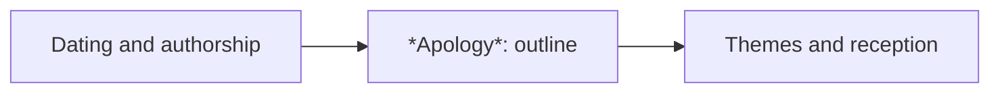

# *Apology*

**Prerequisites:** [Socrates](../thinkers/socrates.md); helpful: [*Euthyphro*](euthyphro.md)

## Dating and authorship

Plato's dramatization of Socrates' defense speech at the trial of 399 BCE, usually classed among the early dialogues. It is not a court transcript. Xenophon also wrote an *Apology*, and the two differ. Treat Plato's as a philosophical portrait of the defense Socrates *should* be understood to have made, which may be close to, or may idealize, the day itself.

## Context and outline

Socrates faces a popular slander (the comic Socrates of the *Clouds*: a natural philosopher and a maker of weaker arguments stronger) and a formal indictment: corrupting the young, and not recognizing the city's gods but introducing new divinities. He cross-examines the accuser Meletus, tells the story of the Delphic oracle and his subsequent questioning of politicians, poets, and craftsmen, and explains the *daimonion*, the inner sign that sometimes turns him away from an action.

He refuses to beg for pity, to bring his children onto the stage, or to propose a serious alternative penalty when convicted. He offers, provocatively, free meals in the Prytaneum, then a fine. After the death sentence he addresses, in turn, those who voted against him and those who voted for him, and he asks the latter to hold his sons to the same standard he used on the city. The last line is a genuine uncertainty about death: which of them goes to a better lot is unclear except to the god.

## Themes and reception

This is the charter text for philosophy as a public vocation: the unexamined life is not worth living; the care of the soul outranks wealth and office; a just man who really *is* a gift to the city may look like a gadfly and be swatted. The claim to "know only that he does not know" is more precise here than the popular slogan: he does not claim ignorance of everything, only of the "greatest things," the virtues the city thinks it already understands. The speech also refuses a clean separation between piety and inquiry. His service to the god *is* the questioning.

No later European or Islamic image of the philosopher on trial is independent of this text. Read it with the [*Crito*](crito.md), which asks why the same man will not escape.

## Key ideas

- A literary defense, not a stenographic record, centered on the examined life and the gadfly role.
- Knowledge of ignorance, the oracle story, and the refusal to stop philosophizing organize the speech.
- Death is left as an open question, not as a dogma of immortality (that comes more in the *Phaedo*).

## Where this leads

- Next: [*Crito*](crito.md), then [*Phaedo*](phaedo.md)
- Thinker: [Socrates](../thinkers/socrates.md)
