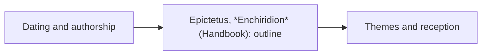

# Epictetus, *Enchiridion* (Handbook)

**Prerequisites:** [Epictetus](../thinkers/epictetus.md)

*Engraving of the Greek philosopher Epictetus by Henri Bonnart. Caption reads: "Epictete estoit un philosophe de la Secte des Stoiciens qui fut beaucoup… Credit: Henri Bonnart. License: Public domain. Source: [File:Epictetus - Henri Bonnart engraving c. 1700.png](https://commons.wikimedia.org/wiki/File:Epictetus_-_Henri_Bonnart_engraving_c._1700.png).*
## Dating and authorship

A short digest of [Epictetus](../thinkers/epictetus.md)'s teaching, compiled by his student Arrian in the early second century CE, extracted from the longer [*Discourses*](discourses.md). *Enchiridion* means a handbook, something you keep at hand. It is not a book Epictetus wrote for publication.

## Outline and key ideas

It opens with the division of what is up to us and what is not, and it never really leaves that division. Appearances are to be tested; desire and aversion are to be trained; roles are to be played fittingly; one is to remember, at a banquet or in a storm, what one's own is. The style is imperative and brief, closer to spiritual exercises than to a treatise. The *Handbook* is easier to quote than to obey, which is a danger it almost predicts.

## Reception

Copied, adapted, and even Christianized in late antiquity, it has had a continuous life as a small book of training. Always read it back into the *Discourses* and into Stoic ethics if it starts to sound like a bag of tips.

## How to read it

The *Enchiridion* (*Handbook*) is Arrian's digest of Epictetus, a short manual of rules and reminders, and it is best read after you know that it is a *digest*. The most famous opening — some things are up to us, some are not — is the gate to the whole. Read it slowly, a few chapters a day, and notice how often a practical instruction (about insult, about banquets, about preconceptions) is doing metaphysical work about what the self is.

Then read some of the longer *Discourses*, where the same thoughts have room to argue and to sting. The *Handbook* alone can make Epictetus look more like a list of coping techniques than he is. A complete, not merely "selected inspirational," translation is worth using (Oldfather, or a good recent version). Comparison with the *Meditations* and with Seneca will show a shared Stoic spine and three temperaments.

## Key ideas

- A student's digest of Epictetus, not an autograph treatise.
- What is up to us; the discipline of assent and desire.
- Best used with the *Discourses*, not as a substitute for the school.

The *Handbook* has had a reception far beyond the Stoic classroom, including Christian and modern popular uses that sometimes drop the underlying physics and the severity about what is truly good. That reception is historically important and philosophically mixed. For this encyclopedia, first read the little book as a Stoic tool, in the light of the *Discourses*, and only then watch what later readers made of it.

## Where this leads

- [*Discourses*](discourses.md), [*Meditations*](meditations.md)
- Concept: [ataraxia and apatheia](../../../../concepts/ethics/ataraxia-and-apatheia.md)
