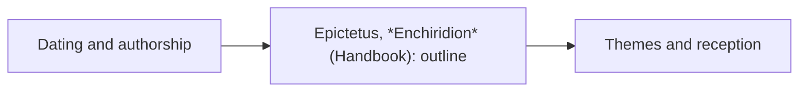

# Epictetus, *Enchiridion* (Handbook)

**Prerequisites:** [Epictetus](../thinkers/epictetus.md)

## Dating and authorship

A short digest of [Epictetus](../thinkers/epictetus.md)'s teaching, compiled by his student Arrian in the early second century CE, extracted from the longer [*Discourses*](discourses.md). *Enchiridion* means a handbook, something you keep at hand. It is not a book Epictetus wrote for publication.

## Outline and key ideas

It opens with the division of what is up to us and what is not, and it never really leaves that division. Appearances are to be tested; desire and aversion are to be trained; roles are to be played fittingly; one is to remember, at a banquet or in a storm, what one's own is. The style is imperative and brief, closer to spiritual exercises than to a treatise. The *Handbook* is easier to quote than to obey, which is a danger it almost predicts.

## Reception

Copied, adapted, and even Christianized in late antiquity, it has had a continuous life as a small book of training. Always read it back into the *Discourses* and into Stoic ethics if it starts to sound like a bag of tips.

## Key ideas

- A student's digest of Epictetus, not an autograph treatise.
- What is up to us; the discipline of assent and desire.
- Best used with the *Discourses*, not as a substitute for the school.

## Where this leads

- [*Discourses*](discourses.md), [*Meditations*](meditations.md)
- Concept: [ataraxia and apatheia](../../../../concepts/ethics/ataraxia-and-apatheia.md)
