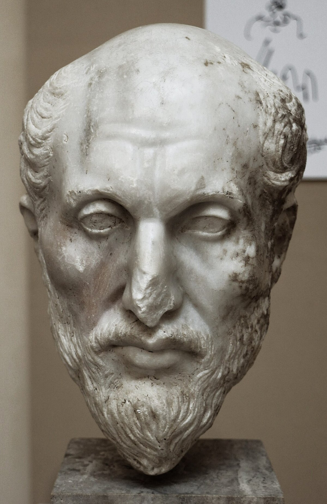

# Plotinus, *Enneads*

**Prerequisites:** [Plotinus](../thinkers/plotinus.md) and [Plato](../thinkers/plato.md)

*Ancient Roman bust in the Museo Ostiense (Ostia Antica). Marble head. Ostia Antica, Museo, inv. 1386. Neck broken along line of beard. Tip of nose and part… Credit: Sailko. License: [CC BY 3.0](https://creativecommons.org/licenses/by/3.0). Source: [File:Head of Plotinus, Museo Ostiense inv.JPG](https://commons.wikimedia.org/wiki/File:Head_of_Plotinus,_Museo_Ostiense_inv.JPG).*
## Dating and authorship

The collected treatises of [Plotinus](../thinkers/plotinus.md), arranged by Porphyry into six groups of nine (*enneads*), published after Plotinus's death (270 CE). Porphyry's order is thematic, not chronological, and he wrote a *Life* to accompany them. The treatises began as seminar discussions.

## Outline and key ideas

Across the six enneads Plotinus describes the **One**, **Intellect**, and **Soul**, the procession and return of reality, the status of the Forms in Intellect, the problem of evil and matter, providence, beauty, and the soul's ascent. He argues with materialists and with Gnostic contempt for the cosmos, which he defends as beautiful, an image of Intellect. Some treatises (I.6 "On Beauty," V.1 "On the Three Primary Hypostases," VI.9 "On the Good or the One") are better first reading than a cover-to-cover march. The writing is dense, sometimes repetitive, sometimes suddenly plain.

## Reception

The *Enneads* are the bible of Neoplatonism, and through Latin and Arabic channels one of the deep sources of medieval metaphysics and of later mystical philosophy. Read them as a late ancient system, not as a footnote to the *Republic*, even though they are a rereading of [Plato](../thinkers/plato.md).

## How to read it

The *Enneads* are Plotinus' essays as arranged by Porphyry into six groups of nine, and they are not a beginner's linear textbook. A first path should take a few central treatises rather than a vow to finish every page: for example I.6 (On Beauty), IV.8 (On the Descent of the Soul), V.1 (On the Three Primary Hypostases), V.2, and VI.9 (On the Good or the One), then add according to interest (nature, the intellect, problems of evil). The style is exploratory and often difficult; a good translation with notes (Armstrong's Loeb, or another careful version) is almost necessary.

Read a little Plato first, especially the *Republic*'s Good, the *Symposium*, the *Phaedo*, and some of the *Parmenides*, so that you can hear what is being transformed. The later Christian, Jewish, and Islamic uses of Neoplatonism are a major reception; they should not be your first key to Plotinus' own structure of One, Intellect, and Soul, procession and return. Give each treatise time; these are not aphorisms.

## Key ideas

- Porphyry's arrangement of Plotinus's seminar-treatises.
- The One, Intellect, Soul; procession and return; the soul's ascent.
- A defense of the sensible world's beauty against Gnostic rejection.

## Where this leads

- Thinker: [Plotinus](../thinkers/plotinus.md)
- Concept: [the One and emanation](../../../../concepts/metaphysics/the-one-and-emanation.md)
- Texts behind him: [*Republic*](republic.md), [*Timaeus*](timaeus.md)
