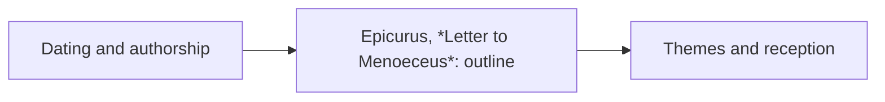

# Epicurus, *Letter to Menoeceus*

**Prerequisites:** [Epicurus](../thinkers/epicurus.md)

## Dating and authorship

A short letter of ethical instruction, preserved in Diogenes Laertius's *Lives* and widely accepted as genuinely Epicurean, almost certainly by [Epicurus](../thinkers/epicurus.md) himself (early third century BCE). It is the best first primary text of the school, far more approachable than the letter to Herodotus on physics.

## Outline and key ideas

Philosophy is urgent at every age; no one is too young or too old to care for the health of the soul. The letter then gives the "fourfold remedy" in living form: the gods are not to be feared (they are not providential meddlers); death is nothing to us (when we are, death is not; when death is, we are not); what is good (pleasure, understood as absence of pain and disturbance) is easy to get; what is terrible is easy to endure. Desires must be sorted into natural and necessary, natural but unnecessary, and vain. The wise person is not a storm of pleasures but a mind in [*ataraxia*](../../../../glossary/greek/ataraxia.md), and virtue is bound up with this life, not a rival good in a Stoic sense. "It is not possible to live pleasantly without living prudently, honorably, and justly."

## Reception

The letter has always been the antidote to the slander of Epicurean coarseness. It is also a compact philosophy of death, still readable without any other Hellenistic background — though it is richer with the [atomic physics](../../../../concepts/metaphysics/atoms-and-void.md) in view.

## Key ideas

- A short, authentic handbook of Epicurean ethics.
- The fourfold remedy: gods, death, pleasure, pain.
- Pleasure as tranquility; virtue as its companion, not its enemy.

## Where this leads

- Thinker: [Epicurus](../thinkers/epicurus.md)
- Contrast: [Enchiridion](enchiridion.md)
- Concept: [ataraxia and apatheia](../../../../concepts/ethics/ataraxia-and-apatheia.md)
