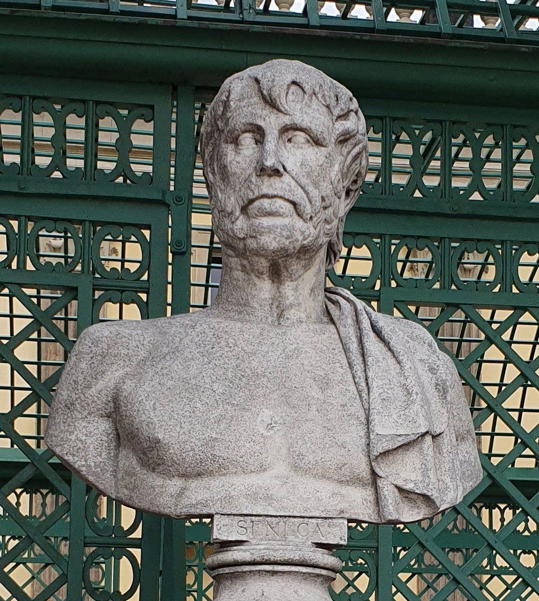
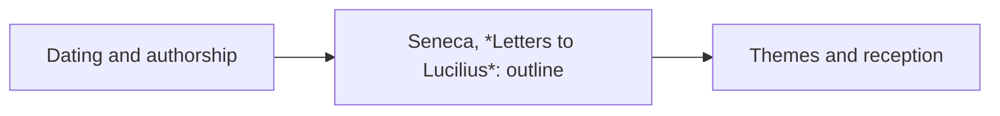

# Seneca, *Letters to Lucilius*

**Prerequisites:** [Seneca](../thinkers/seneca.md)

*Bust of Hesiod Credit: Yair Haklai. License: [CC BY-SA 4.0](https://creativecommons.org/licenses/by-sa/4.0). Source: [File:Bust of Lucius Annaeus Seneca-Busts of philosophers in Sanssouci.jpg](https://commons.wikimedia.org/wiki/File:Bust_of_Lucius_Annaeus_Seneca-Busts_of_philosophers_in_Sanssouci.jpg).*
## Dating and authorship

One hundred twenty-four moral letters addressed to Lucilius, a younger friend and official, written late in [Seneca](../thinkers/seneca.md)'s life (early 60s CE), in Latin. They are real-enough letters and also artful essays; the mix is the form. This is the most approachable large work of Roman Stoicism.

## Outline and key ideas

There is no single plot. Themes recur: the shortness of time, the daily review, the difference between making progress and talking, the use and danger of wealth, friendship, anger, grief, slavery and the shared *logos* of human beings, the nearness of death, and the borrowing of a good sentence even from [Epicurus](../thinkers/epicurus.md). Philosophy is a practice, not a display. Style itself is an ethical topic: bloated speech matches a bloated soul. The letters can be read a few at a time; they were meant that way.

## Reception

They shaped the essay as a European form (Montaigne above all) and kept Stoicism available when the early Greek sources were thinner. The tension between Seneca's life at court and the letters' advice is part of the reading, as his overview says.

## How to read it

Seneca's *Moral Letters to Lucilius* are real literary letters, whether or not every detail of the correspondence is documentary, and they should be read in stretches rather than as a stack of maxims. Seneca moves through friendship, time, grief, slavery and social rank, the fear of death, the use of philosophy, and the critique of luxury, in a Latin style that is itself part of the lesson. He is a Stoic, and also a wealthy Roman statesman; the tension is visible and should be kept visible, not used as a cheap dismissal and not ignored.

You need not read all 124 letters on a first path. Read a sequence (for example 1–24, then some of the later, more technical letters on Stoic ethics) in a complete translation with numbering. Then compare the same themes in Epictetus and Marcus. Seneca is also a window onto Roman reception of Greek philosophy, including Epicurus, whom he can quote with surprising sympathy when the ethical point allows it.

## Key ideas

- A literary, practical Stoicism in letter form.
- Time, death, wealth, and daily training are the returning subjects.
- Open to useful sentences from outside the school.

Seneca's other prose (the essays, or *Dialogues*, and *On Mercy*) and his tragedies belong to the same career and can be read later as context. They show a writer who can praise simplicity and also stage passion at a high volume. For a first path, the letters are enough, provided they are read as a sequence of ethical exercises in Latin, not as a box of detached quotations for a commonplace book.

## Where this leads

- Thinker: [Seneca](../thinkers/seneca.md)
- Kin: [*Enchiridion*](enchiridion.md), [*Meditations*](meditations.md)
