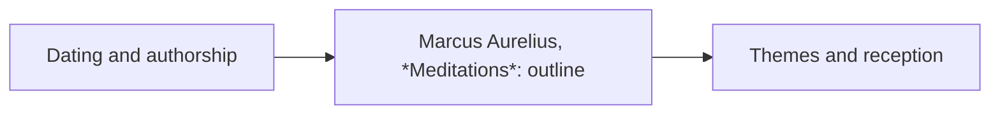

# Marcus Aurelius, *Meditations*

**Prerequisites:** [Marcus Aurelius](../thinkers/marcus-aurelius.md); helpful: the [*Enchiridion*](enchiridion.md)

## Dating and authorship

Greek notes "to himself," written by the emperor [Marcus Aurelius](../thinkers/marcus-aurelius.md) in the 170s CE, not prepared for publication. The division into twelve books is traditional; Book I, a set of thank-yous, may be a later preface in the author's life. The title *Meditations* is modern English; the Greek is closer to "to himself."

## Outline and key ideas

There is no systematic argument. The book is a set of exercises: strip the thing to its description; remember you are a part of a whole; do the present work; do not be angry; death is either atoms or providence, and in either case not an evil for a prepared mind; fame is noise. Images repeat — the river of time, the city of Zeus, the rotting of even beautiful bodies — as a man talks himself back to his school under plague and war. The honesty of fatigue is part of the text's quality.

## Reception

Perhaps the most widely read ancient philosophical book in modern times, and therefore the most quoted out of context. It is a Stoic notebook, not a starter system; pair it with Epictetus and with [Zeno of Citium](../thinkers/zeno-of-citium.md)'s school overview.

## Key ideas

- A private exercise book, not a treatise for the public.
- Cosmic citizenship, impartial description, present work, and death.
- The emperor's situation is inside the meaning, not an irony on top of it.

## Where this leads

- Thinker: [Marcus Aurelius](../thinkers/marcus-aurelius.md)
- Related practice, comparatively: [Zhuangzi](../../chinese/texts/zhuangzi.md)
