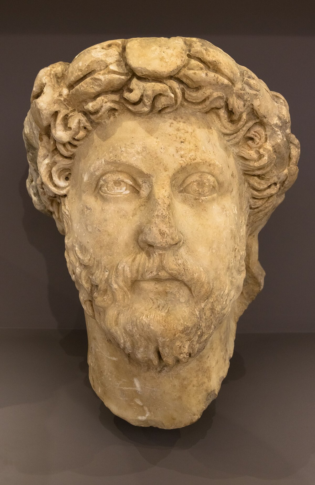

# Marcus Aurelius, *Meditations*

**Prerequisites:** [Marcus Aurelius](../thinkers/marcus-aurelius.md); helpful: the [*Enchiridion*](enchiridion.md)

*Head of Emperor Marcus Aurelius, 2nd-century. Marble Credit: Jebulon. License: [CC0](http://creativecommons.org/publicdomain/zero/1.0/deed.en). Source: [File:Head Marcus Aurelius archmus Heraklion.jpg](https://commons.wikimedia.org/wiki/File:Head_Marcus_Aurelius_archmus_Heraklion.jpg).*
## Dating and authorship

Greek notes "to himself," written by the emperor [Marcus Aurelius](../thinkers/marcus-aurelius.md) in the 170s CE, not prepared for publication. The division into twelve books is traditional; Book I, a set of thank-yous, may be a later preface in the author's life. The title *Meditations* is modern English; the Greek is closer to "to himself."

## Outline and key ideas

There is no systematic argument. The book is a set of exercises: strip the thing to its description; remember you are a part of a whole; do the present work; do not be angry; death is either atoms or providence, and in either case not an evil for a prepared mind; fame is noise. Images repeat — the river of time, the city of Zeus, the rotting of even beautiful bodies — as a man talks himself back to his school under plague and war. The honesty of fatigue is part of the text's quality.

## Reception

Perhaps the most widely read ancient philosophical book in modern times, and therefore the most quoted out of context. It is a Stoic notebook, not a starter system; pair it with Epictetus and with [Zeno of Citium](../thinkers/zeno-of-citium.md)'s school overview.

## How to read it

Marcus Aurelius' *Meditations* (*To Himself*) is a private notebook, not a treatise, and it should be read as exercises: short assaults on anger, on the fear of death, on the temptation to retreat into a private sulk, written by a man who was also an emperor. The repetitions are the point. Themes — the transience of reputation, the kinship of rational beings, the rational order of the whole, the duty to stay at one's post — return because they needed returning to. Do not mine the book only for isolated "quotes."

The work is late Stoicism, in Greek, by a Roman, and it presupposes a school already built by Zeno, Chrysippus, Epictetus. Read some Epictetus first or soon after, so that you can hear what is school doctrine and what is Marcus' particular tone (more melancholy, more cosmic, sometimes more lonely). A complete translation with book and section numbers is easy to find. The book is a source for how a philosophy of virtue and indifferents was *practiced*, not a replacement for the more systematic accounts.

## Key ideas

- A private exercise book, not a treatise for the public.
- Cosmic citizenship, impartial description, present work, and death.
- The emperor's situation is inside the meaning, not an irony on top of it.

Because the notebook is private, it can sound more original than it is and more finished than it is. Many entries are school themes in a personal voice. That is a reason to treasure the voice, not a reason to skip the school. A last pass through the book, after Epictetus, will make the borrowings and the distinctive notes (the view from above, the court weariness, the insistence on remaining kind) much easier to tell apart.

## Where this leads

- Thinker: [Marcus Aurelius](../thinkers/marcus-aurelius.md)
- Related practice, comparatively: [Zhuangzi](../../chinese/texts/zhuangzi.md)
