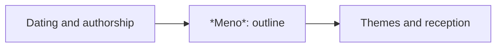

# *Meno*

**Prerequisites:** [Socrates](../thinkers/socrates.md); helpful: [*Euthyphro*](euthyphro.md)

*Plato, copy of the portrait made by Silanion ca. 370 BC for the Academia in Athens Credit: Marie-Lan Nguyen. License: [CC BY 2.5](https://creativecommons.org/licenses/by/2.5). Source: [File:Plato Silanion Musei Capitolini MC1377.jpg](https://commons.wikimedia.org/wiki/File:Plato_Silanion_Musei_Capitolini_MC1377.jpg).*
## Dating and authorship

Often placed at the transition from early to middle Plato: the first half is a classic *elenchus* about virtue, the second introduces [recollection](../../../../concepts/epistemology/anamnesis.md) and a geometry lesson with an enslaved boy, and the end offers a "true opinion" account that is not yet the full *Republic*. It is a good first long dialogue after the trial group.

## Outline and key ideas

Meno asks whether virtue can be taught. Socrates insists on the prior question: **what is virtue?** Meno's first answers (a list of virtues for man, woman, child, slave; virtue as the power to rule; virtue as desiring the noble and being able to get it) fail. Meno, stung, compares Socrates to a stingray and poses the **paradox of inquiry**: you cannot search for what you do not know, because you would not recognize it if you found it.

Socrates answers with a myth of the soul's immortality and a demonstration: by questions alone, the boy recovers a geometric result (doubling a square) that he had not been taught in this life. Learning is [recollection](../../../../concepts/epistemology/anamnesis.md). The experiment is not a modern psychology of education; it is a metaphysical claim about the soul and about why inquiry is possible.

The dialogue then returns to teachability. If virtue is knowledge, it should be teachable, but there are no acknowledged teachers of virtue (the [Sophists](../thinkers/protagoras-and-the-sophists.md) are doubted; good men have failed to teach their sons). Perhaps virtue is true opinion, a gift of the gods, not knowledge — a provisional close, not a final theory. Anytus, who will be an accuser in the *Apology*, appears and is already angry.

## Themes and reception

The *Meno* is the most approachable introduction to Platonic epistemology: definition, paradox, recollection, and the difference between knowledge and true opinion (the "statues of Daedalus" that run away unless tied down by an account). It also leaves virtue's status unsettled, which is honest to the *elenchus* and opening toward the *Republic*.

## How to read it

The *Meno* opens with a blunt question — can virtue be taught? — and immediately becomes a lesson in how not to skip definition, and then a lesson in how learning is possible at all. The geometry conversation with the slave is the center of the epistemology; the appearance of Anytus and the turn toward *theia moira* (divine allotment) at the end keep the political stakes of teaching virtue in view. Read it as one design, not as a logic bit plus a myth bit.

On a second pass, track what happens to the word "knowledge" and to "true opinion." The dialogue is a natural partner of the *Phaedo* (recollection in a different key) and of the *Protagoras* and *Gorgias* (virtue, teaching, sophists). Aristotle's later account of habit and teaching is a critique you can already feel coming. Do not let the slave-boy scene be excerpted so often that you forget Meno himself, a man who wants a transferable technique and is given, instead, a demand to start over.

## Key ideas

- The paradox of inquiry and recollection as a reply.
- The slave-boy geometry scene is a demonstration, not a side illustration.
- Virtue's teachability remains open; knowledge and true opinion are distinguished.

## Where this leads

- Next deeper: [*Phaedo*](phaedo.md), [*Republic*](republic.md)
- Concept: [anamnesis](../../../../concepts/epistemology/anamnesis.md), [knowledge and opinion](../../../../concepts/epistemology/knowledge-and-opinion.md)
