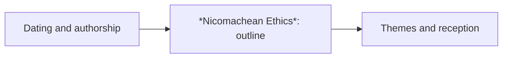

# *Nicomachean Ethics*

**Prerequisites:** [Aristotle](../thinkers/aristotle.md)

*Bust of Aristotle. Marble, Roman copy after a Greek bronze original by Lysippos from 330 BC; the alabaster mantle is a modern addition. Credit: After Lysippos. License: Public domain. Source: [File:Aristotle Altemps Inv8575.jpg](https://commons.wikimedia.org/wiki/File:Aristotle_Altemps_Inv8575.jpg).*
## Dating and authorship

Aristotle's main ethical treatise, in ten books, traditionally dedicated to or edited by his son Nicomachus (the exact reason for the title is not certain). A related *Eudemian Ethics* overlaps it in parts; the relationship of the two works is a scholarly problem. The *Nicomachean Ethics* is the standard text.

## Outline and key ideas

The good for a human being is [*eudaimonia*](../../../../glossary/greek/eudaimonia.md), often misleadingly translated "happiness": flourishing, living well over a complete life. The human function (*ergon*) is activity of the soul in accordance with reason, and therefore with virtue (*[arete](../../../../glossary/greek/arete.md)*). Ethical virtues are [means](../../../../concepts/ethics/the-mean.md) relative to us, acquired by [habit](../../../../concepts/ethics/cultivation-and-habit.md), decided by [*phronesis*](../../../../glossary/greek/phronesis.md) (practical wisdom). The famous list — courage, temperance, generosity, magnificence, greatness of soul, mildness, truthfulness, wit, justice — is a map of character, not a mechanical average. Book V treats justice at length; Books VIII–IX treat [friendship](../../../../glossary/greek/philia.md) as essential to a flourishing life, not as a luxury. Book VII analyzes [*akrasia*](../../../../glossary/greek/akrasia.md), acting against one's better judgment, a problem Socrates had seemed to deny. Book X returns to happiness and ranks a contemplative life highest, while still requiring the ethical and political conditions of a human life — a tension readers have never quite resolved.

Pleasure is not the good (against a crude hedonism) but it properly completes activity. Moral responsibility assumes that the agent could have acted otherwise in the sense relevant to praise and blame. The work ends by opening onto the [*Politics*](politics.md): we become good, for the most part, in a city that educates.

## Reception

This is the central text of virtue ethics in the European tradition, recovered again in the twentieth century (Anscombe, Foot, MacIntyre, and a large literature). It is also a book about a particular kind of free, typically male, citizen in a Greek *polis*; its silences and exclusions are part of reading it honestly. Compare, without collapsing, the Confucian work of [cultivation](../../../../concepts/ethics/cultivation-and-habit.md) in the [*Analects*](../../chinese/texts/analects.md) and [*Mencius*](../../chinese/texts/mencius.md).

## How to read it

The *Nicomachean Ethics* is a lecture-course, not a polished dialogue, and it should be read in order: the opening account of the good and of *eudaimonia*, the treatment of ethical virtue and the mean, the particular virtues, justice, the intellectual virtues (especially *phronesis*), weakness of will, friendship (two books, not a side note), and pleasure and contemplation at the end. The last book's praise of the contemplative life is a real tension with the civic and friendly life earlier, not a typo. Stay in that tension.

Use a complete translation with Bekker numbers (Ross, Irwin, Crisp, Reeve, or another careful one). The *Eudemian Ethics* and the *Magna Moralia* are related works for later study; they are not required for a first path. After this book, the *Politics* is the advertised continuation: the human good is at home in a *polis*. When you compare Confucian cultivation, compare practices and pictures of the good life, not isolated slogans about "virtue."

## Key ideas

- Flourishing is activity of the rational soul in accordance with virtue over a life.
- Virtue is a mean, habituated, guided by practical wisdom; *akrasia* is taken seriously.
- Friendship and the city are not external add-ons to the good life.

## Where this leads

- [*Politics*](politics.md)
- Concepts: [eudaimonia](../../../../concepts/ethics/eudaimonia.md) (see also the glossary entry), [the mean](../../../../concepts/ethics/the-mean.md)
