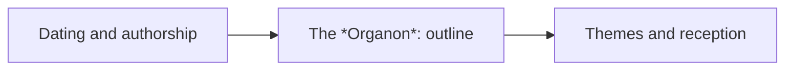

# The *Organon*

**Prerequisites:** [Aristotle](../thinkers/aristotle.md)

## Name, dating, and authorship

*Organon* ("instrument") is the later name for Aristotle's logical works, treated as the tool of the sciences rather than as a science of their own. The standard set is: *Categories*, *On Interpretation*, *Prior Analytics*, *Posterior Analytics*, *Topics*, and *Sophistical Refutations*. They were grouped and titled by later Peripatetic and ancient editors, not by Aristotle as a single book with that name. Authorship of the core is not seriously in doubt, though the order and some passages have a history of editing.

## Outline and key ideas

The *Categories* analyzes the most general ways of saying that something is: substance first, then quantity, quality, relation, and the rest. This is a theory of predication and of [substance](../../../../concepts/metaphysics/substance.md), not a random list. *On Interpretation* treats names, verbs, statements, and the square of opposition, including a famous puzzle about tomorrow's sea battle and the necessity of future events. The *Prior Analytics* is the core of the **[syllogistic](../../../../concepts/logic/syllogism-and-the-organon.md)**: which pairs of premises validly yield a conclusion. The *Posterior Analytics* asks what **demonstration** and scientific knowledge are — knowledge of causes, from first principles, in a structured science. The *Topics* and *Sophistical Refutations* treat dialectical argument and fallacies, the everyday and agonistic sides of reasoning.

This is term logic: it works with "all," "some," "none," and with subjects and predicates, not with a modern propositional or predicate calculus (though the Stoics would develop a serious propositional logic of their own). It is still the beginning of making "this follows" a public standard.

## Reception

The *Organon* was the logic textbook of the Islamic and Latin medieval worlds, and "Aristotelian logic" became, for early modern rebels, a name for scholastic method as a whole. For this path, it is the technical counterpart to the more inviting ethics and metaphysics, and the place to see why [logic](../../../../concepts/logic/syllogism-and-the-organon.md) is a branch of philosophy in the Greek tree.

## Key ideas

- A later collection of logical works, not a title Aristotle used for one book.
- Syllogism, demonstration, categories, and fallacies are the main tools.
- It is an instrument for the sciences, including the *Metaphysics* and the *Ethics*.

## Where this leads

- [*Metaphysics*](metaphysics.md), [*Nicomachean Ethics*](nicomachean-ethics.md)
- Concept: [syllogism and the Organon](../../../../concepts/logic/syllogism-and-the-organon.md)
