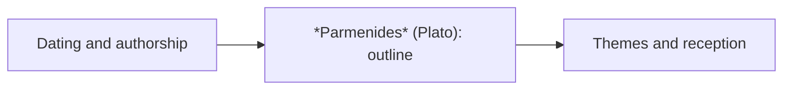

# *Parmenides* (Plato)

**Prerequisites:** [Parmenides the Presocratic](../thinkers/parmenides.md), [the Forms](../../../../concepts/metaphysics/the-forms.md), and preferably the [*Republic*](republic.md)

## Dating and authorship

A late-middle or late dialogue, and one of the hardest in the corpus. A young Socrates presents a Theory of Forms to the visiting Eleatic [Parmenides](../thinkers/parmenides.md) and to [Zeno](../thinkers/zeno-of-elea.md); Parmenides criticizes the theory, then leads a long, abstract training-exercise in deduction. Whether Plato is abandoning the Forms, refining them, or showing a necessary gymnastic is the central scholarly dispute. Do not confuse this dialogue with Parmenides' own poem.

## Outline and key ideas

The first part contains the most famous objections to the Forms, including the **third man**: if particular large things and the Form of Large require a further Form to explain their likeness, a regress begins. There are also worries about participation (does a Form split? is it a pattern?), about the range of Forms (is there a Form of hair or mud?), and about whether Forms can be known by us or can know us. Socrates, still young in the fiction, cannot answer cleanly.

The second part is a deduction about "the one" and "the others," in eight (or nine) hypotheses, generating apparently contradictory conclusions. It is often called a training in dialectic, and it looks forward to the [*Sophist*](sophist.md). It is not a bedtime read; it is Plato taking Eleatic method inside his own school.

## Themes and reception

The *Parmenides* is the reason one should not speak of "the Theory of Forms" as a single, unchanging Plato. Neoplatonists, especially [Plotinus](../thinkers/plotinus.md) and Proclus, made the second part a theology of the One. Analytic readers have treated the first part as a classic of self-critique. Both afterlives are real. For this path, the dialogue is Plato's most honest stress test of the metaphysics of the *Republic*.

## Key ideas

- Serious internal objections to the Forms, including the third-man regress.
- A long Eleatic-style training on the one and the others.
- A turning point in how we date and interpret Plato's metaphysics.

## Where this leads

- [*Sophist*](sophist.md), [*Theaetetus*](theaetetus.md)
- Thinker: [Parmenides](../thinkers/parmenides.md), [Plotinus](../thinkers/plotinus.md)
