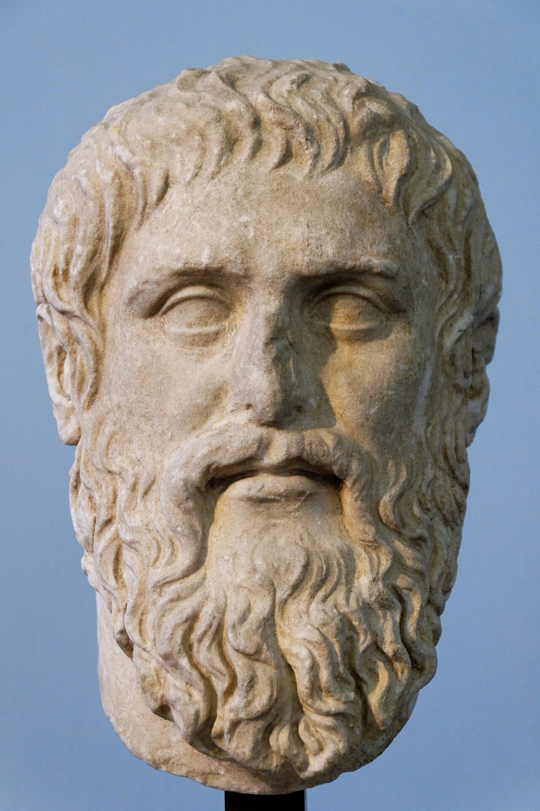

# *Phaedrus*

**Prerequisites:** [*Symposium*](symposium.md) or [Plato](../thinkers/plato.md)

*Plato, copy of the portrait made by Silanion ca. 370 BC for the Academia in Athens Credit: Marie-Lan Nguyen. License: [CC BY 2.5](https://creativecommons.org/licenses/by/2.5). Source: [File:Plato Silanion Musei Capitolini MC1377.jpg](https://commons.wikimedia.org/wiki/File:Plato_Silanion_Musei_Capitolini_MC1377.jpg).*
## Dating and authorship

Usually treated as a middle-to-late-middle dialogue, unusual for its setting (a walk along the Ilissus, outside the walls) and for joining two topics that might seem unrelated: *eros* and rhetoric, plus a famous myth of the soul and a critique of writing.

## Outline and key ideas

Phaedrus has a speech by Lysias that recommends a non-lover as a safer partner. Socrates, his head covered, first outdoes Lysias with a speech against love, then, as a palinode, offers a **myth of the soul**: a charioteer and two horses, one noble and one unruly, in a procession of gods, a fall, and a growth of wings when beauty here reminds the soul of Beauty there. Love is a form of divine madness, not only a vice. The second half turns to rhetoric as a true art: it would need knowledge of the soul, of kinds of speech, and of the truth of its subject, not merely the knack of persuasion attacked in the *Gorgias*. The dialogue ends with the **critique of writing**: a written text cannot answer back; it wanders among those who understand and those who do not; living speech in a soul is the genuine thing. The irony, of course, is that we are reading this in writing.

## Themes and reception

The charioteer image became one of the most copied pictures of the tripartite soul. The writing passage is a founding text for later worries about books, literacy, and, much later, every new medium. Together with the *Symposium*, the *Phaedrus* completes Plato's main teaching on *eros*; together with the *Gorgias*, it complicates his teaching on rhetoric — not all persuasion is flattery, but the true art is rare and philosophical.

## How to read it

The *Phaedrus* is a conversation about love, rhetoric, and writing, held outside the city, and its structure is part of its meaning: a written speech, a palinode, a myth of the soul's chariot, and a long discussion of what a genuine art of speech would be, ending with the critique of writing (and the play of a written text saying it). Do not excerpt only the palinode. The dialogue is arguing, among other things, about whether speech can be fitted to a soul, and about what philosophy does that a clever pamphlet cannot.

On a second reading, compare the account of love and madness with the *Symposium*, and the account of rhetoric with the *Gorgias*. The psychology of the chariot (charioteer and two horses) is a different image from the *Republic*'s three parts of the soul; note likeness and difference rather than forcing a single system too early. The written/oral theme has a long modern afterlife; let Plato's own terms (memory, reminding, the living word) lead before you import later media theory.

## Key ideas

- A palinode: *eros* as divine madness and recollection of Beauty.
- The chariot myth as a picture of the soul's parts and its fall and return.
- Rhetoric needs psychology and truth; writing is a drug and a reminder, not a living knower.

## Where this leads

- [*Symposium*](symposium.md), [*Gorgias*](gorgias.md), [*Republic*](republic.md)
- Concept: [anamnesis](../../../../concepts/epistemology/anamnesis.md)
