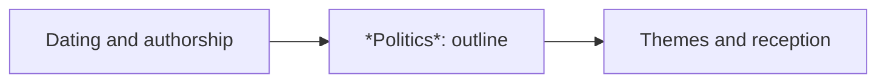

# *Politics*

**Prerequisites:** [*Nicomachean Ethics*](nicomachean-ethics.md)

*Bust of Aristotle. Marble, Roman copy after a Greek bronze original by Lysippos from 330 BC; the alabaster mantle is a modern addition. Credit: After Lysippos. License: Public domain. Source: [File:Aristotle Altemps Inv8575.jpg](https://commons.wikimedia.org/wiki/File:Aristotle_Altemps_Inv8575.jpg).*
## Dating and authorship

Aristotle's main work of political philosophy, in eight books, partly empirical (he and his school collected constitutions, of which the *Constitution of the Athenians* is the surviving example) and partly normative. The work as we have it may be composed of courses from different times; the joins show.

## Outline and key ideas

The opening claim is that the *polis* exists by nature and that the human being is a [political animal](../../../../concepts/political/the-polis-and-political-animal.md), because only humans have *logos* about the advantageous and the just. The household, the village, and the city are a developmental series; the city is the complete community aimed at living well, not only at living. Book I also contains the defense of **natural slavery** and a hierarchical account of men, women, and "barbarians" that later centuries used and that should be read as a historical and moral failure in the text, not as a side remark to skip or to swallow.

Books II–III survey and criticize schemes of the best city, including [Plato](../thinkers/plato.md)'s [*Republic*](republic.md) and [*Laws*](laws.md), and analyze citizenship, sovereignty, and the types of constitution (correct and deviant forms of rule by one, few, or many). Books IV–VI are more practical: how constitutions actually work, how they are preserved and destroyed, the importance of a middle class. Books VII–VIII sketch a best regime and the education it would require.

## Themes and reception

The *Politics* is both a founding work of comparative political science and a theory of the good city. Its naturalism about the *polis* and its exclusions (slaves, women, laborers as incomplete citizens in some sketches) have to be held in view together. Medieval and early modern readers took what they needed (mixed constitution, the common good, natural law hints); modern liberal and democratic theory both inherits and rebels. For this path, it is the necessary sequel to the *Ethics* and the great Greek alternative to the *Republic*'s more radical design.

## How to read it

The *Politics* continues the *Ethics* and should be read after it if you can. Begin with Book I (the *polis*, the household, the infamous discussions of slavery and of women) and Book III (citizenship and the classification of constitutions), then the analyses of democracy and oligarchy, the best practicable city, and education. Aristotle is an empirical collector of constitutions as well as a theorist; the tone is less utopian than the *Republic*, and more willing to talk about stability, the middle class, and mixed arrangements.

You should neither skip nor casually endorse the hierarchical passages. They are part of his picture of nature and of the household, and later political thought has had to argue with them. Use a complete translation with Bekker numbers. After this, go back to the *Republic* and the *Laws* and you will hear a conversation, not three isolated classics. The book is also the right place to ask, later, how a Confucian state centered on household and ruler differs from a *polis* of citizens.

## Key ideas

- Humans are political animals; the city exists for living well.
- Constitutions are typed, compared, and studied in their real instability.
- The treatment of slavery and of women is central to the work's historical moral problem, not marginal.

## Where this leads

- Contrast: [*Republic*](republic.md), [*Laws*](laws.md)
- Concept: [the polis and the political animal](../../../../concepts/political/the-polis-and-political-animal.md)
