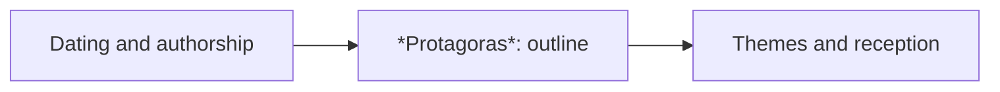

# *Protagoras*

**Prerequisites:** [Protagoras and the Sophists](../thinkers/protagoras-and-the-sophists.md)

## Dating and authorship

An early-to-middle dialogue and Plato's most generous, though still critical, portrait of [Protagoras](../thinkers/protagoras-and-the-sophists.md). It is also one of the liveliest pieces of intellectual theater in the corpus: a gathering of sophists at the house of Callias, a myth of Prometheus, and a running joke about long speeches versus short questions.

## Outline and key ideas

A young man wants to study with Protagoras. Socrates asks what Protagoras teaches. The answer is the art of good judgment in household and city — civic virtue. Can it be taught? Protagoras says yes, and tells a myth: the gods give humans technical skills unevenly, but Zeus gives justice and shame to all, for cities cannot exist otherwise. That is why we blame people for injustice but not for being born without a good ear; and why we educate. Socrates then wonders how the virtues are one or many, and the two men circle through courage, wisdom, and a surprising hedonistic calculus (the idea that the good is pleasure, rightly measured over time) that may be a dialectical tool rather than Plato's settled view. The dialogue ends with a role reversal: Socrates has been arguing as if virtue were knowledge and therefore teachable; Protagoras has become cautious. Neither position is left clean.

## Themes and reception

This is the best place to see the sophist as a serious teacher of civic life, not only as the villain of the *Gorgias*. It is also a key text on whether virtue is knowledge (the Socratic thesis) and whether the virtues are a unity. The "Great Speech" of Protagoras is a founding document of a certain democratic pedagogy: justice is a shared human allotment, and education is everyone's business. Plato lets that speech be powerful, then refuses to let the question rest.

## Key ideas

- Protagoras's myth: justice and shame as Zeus's gift, hence civic virtue is widely teachable.
- Socrates probes the unity of virtue and its status as knowledge.
- The ending is a deliberate tangle, not a victory lap.

## Where this leads

- Contrast: [*Gorgias*](gorgias.md)
- Later tightening: [*Republic*](republic.md), [*Meno*](meno.md)
