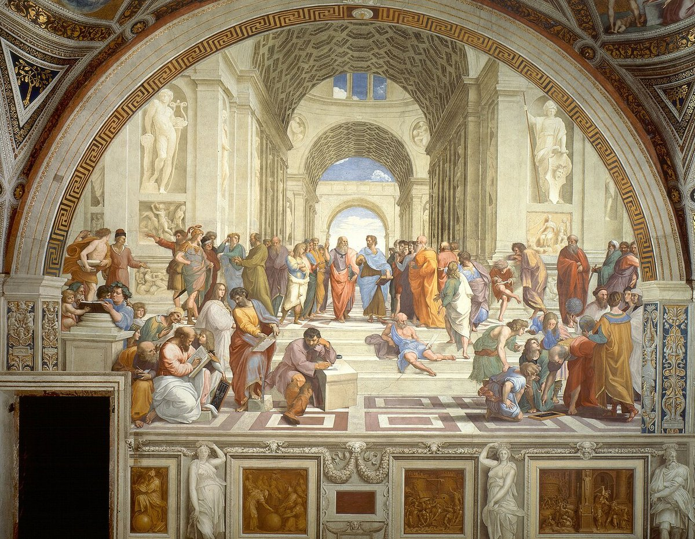
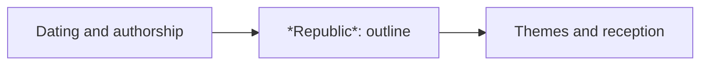

# *Republic*

**Prerequisites:** [Plato](../thinkers/plato.md); helpful: [*Gorgias*](gorgias.md)

*Scuola di AteneThe School of Athenslabel… Credit: Raphael. License: Public domain. Source: [File:"The School of Athens" by Raffaello Sanzio da Urbino.jpg](https://commons.wikimedia.org/wiki/File:"The_School_of_Athens"_by_Raffaello_Sanzio_da_Urbino.jpg).*
## Dating and authorship

Plato's largest and most influential political-ethical-metaphysical work, a middle-period dialogue in ten books. "Republic" translates *Politeia*, a city's constitution or way of life, not a modern republic. The work is a unified (if layered) argument, not a bag of detachable myths, though the myths are essential to it.

## Outline

Book I, sometimes felt as a little "Socratic" dialogue of its own, refutes Thrasymachus's claim that justice is the advantage of the stronger. Books II–IV build a city in speech, from a simple city of needs to a "feverish" city that requires guardians, and divide both city and soul into three: rulers / reason, auxiliaries / spirit, producers / appetite. Justice is each part doing its work. Books V–VII introduce the more radical proposals (women as guardians, a community of family and property among the ruling class, philosopher-rulers) and the metaphysics of the Good, the divided line, and the [Cave](../../../../concepts/metaphysics/the-forms.md). Books VIII–IX chart the decline of cities and souls (timocracy, oligarchy, democracy, tyranny) and argue that the just life is happiest. Book X criticizes imitative poetry and closes with the myth of Er, a tale of souls choosing lives after death.

## Themes and reception

The *Republic* is not only a political blueprint, and it may not be one at all. It is a book about whether justice is good for the person who has it, even without rewards; about education as a turning; about the danger of democracy's charms and of tyranny's inner slavery; and about the relation of a city to a soul. The constructive city (the "noble lie," the expulsion of certain poets, the marriage arrangements) has been read as totalitarian, as ironic, as a thought-experiment, and as a serious second sailing after Socrates' death. All of those readings have to survive the text, not replace it. For this path, it is also the central statement of the [Forms](../../../../concepts/metaphysics/the-forms.md) and of [knowledge versus opinion](../../../../concepts/epistemology/knowledge-and-opinion.md).

No later work in [political philosophy](../../../../concepts/political/philosopher-rulers.md) is quite out from under it — including [Aristotle](../thinkers/aristotle.md)'s criticisms in the *Politics*, and the very different civic visions of [Confucius](../../chinese/thinkers/confucius.md).

## How to read it

The *Republic* is too large to finish well in a hurry, and too unified to treat as a box of famous myths. A practical first path: Book I (the fight about justice), the construction of the city and the soul in II–IV, the philosopher-rulers and the images of sun, line, and cave in V–VII, and then at least a serious look at the decline of constitutions, the critique of poetry, and the closing myth of Er. Keep the "city in speech" and the soul in parallel; that is the book's own method. The more radical institutions (property, family among the guardians) are part of the argument, not optional color, and Aristotle's later criticisms in the *Politics* are worth reading after, not instead.

There is no substitute for a complete translation with book and Stephanus numbers (Grube/Reeve, Shorey, Bloom, Rowe, or another careful version). On a second pass, slow down at the places where Socrates admits the difficulty of the proposal, and at the places where the dialogue's own drama (Thrasymachus, Glaucon's challenge) sets the standard the later books must meet. The *Republic* is a beginning of political philosophy and of a metaphysics of the Good; it is also a book about education. Let it be all three.

## Key ideas

- Justice in city and soul is a harmony of parts, with reason ruling.
- The Good, the line, and the Cave are an epistemology and a picture of education.
- Whether the ideal city is a program, a critique, or a model for the soul remains a live question.

## Where this leads

- Companion late political work: [*Laws*](laws.md)
- Metaphysical sequels and tests: [*Parmenides*](parmenides.md), [*Timaeus*](timaeus.md)
- Aristotle's reply: [*Politics*](politics.md)
- Concept: [philosopher-rulers](../../../../concepts/political/philosopher-rulers.md)
