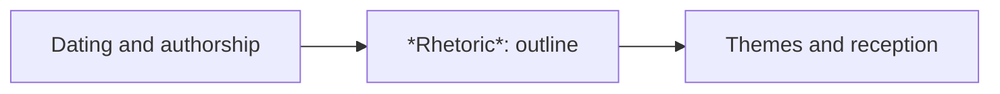

# *Rhetoric*

**Prerequisites:** [Aristotle](../thinkers/aristotle.md); helpful: the [*Organon*](organon.md) and [*Gorgias*](gorgias.md)

*Bust of Aristotle. Marble, Roman copy after a Greek bronze original by Lysippos from 330 BC; the alabaster mantle is a modern addition. Credit: After Lysippos. License: Public domain. Source: [File:Aristotle Altemps Inv8575.jpg](https://commons.wikimedia.org/wiki/File:Aristotle_Altemps_Inv8575.jpg).*
## Dating and authorship

Aristotle's treatise on the art of persuasion, in three books. It is a reply, in a way, to Plato's suspicion of rhetoric in the [*Gorgias*](gorgias.md) and [*Phaedrus*](phaedrus.md): rhetoric can be an art, if it is the counterpart of dialectic and is used with a knowledge of arguments, character, and emotion.

## Outline and key ideas

Rhetoric is the ability to see, in each case, the available means of persuasion. There are three technical pisteis (proofs): **logos** (the argument in the speech), **ethos** (the character the speaker shows), and **pathos** (the emotion produced in the audience). Speeches divide into deliberative, forensic, and epideictic (display). Aristotle analyzes common topics (*topoi*), the use of examples and enthymemes (rhetorical syllogisms), the emotions (the second book is an early psychology of anger, shame, fear, pity), style, and arrangement. Unlike a sophist's advertising, the treatise is diagnostic: it describes what actually persuades, including things a moralist might wish did not persuade.

## Reception

This is the founding systematic rhetoric of the Greek tradition, and a major source for later Roman writers (Cicero, Quintilian) and for the medieval curriculum. For this path, it also shows Aristotle as a more practical student of the city than the *Gorgias*'s war with flattery might have predicted.

## How to read it

The *Rhetoric* is a systematic art of persuasion in civic speech, not a manual of tricks and not a retraction of the *Gorgias*' moral warning. Aristotle analyzes the three pisteis (ethos, pathos, logos), the kinds of speech (deliberative, forensic, epideictic), the enthymeme and the example, style, and arrangement. Read Book I for the scope of the art, Book II for character and emotion, and Book III for style, and keep asking how this art relates to dialectic and to ethics: a speaker needs a just estimate of the good and of the audience's passions.

The book is drier than the dialogues and more useful than a stigma on "rhetoric" would suggest. Use a complete translation. Pair it with the *Gorgias* and, later, with Roman rhetoric (Cicero, Quintilian) to see what is distinctively Aristotelian: persuasion as a counterpart of dialectic, grounded in what is usually convincing, not in a mere will to win.

## Key ideas

- Rhetoric as an art of seeing the available means of persuasion.
- Logos, ethos, and pathos; the enthymeme; a psychology of the emotions.
- A counterpart to dialectic, not a simple rejection of Plato's critique.

One useful exercise, after a first reading, is to take a short stretch of public speech you already know and try to name the *ēthos*, *pathos*, and *logos* at work, then to see whether the argument is an enthymeme (a syllogism with a premise left to the audience) or an example. The *Rhetoric* was written for a world of assemblies and courts; the vocabulary still helps when the venue has changed, so long as you do not pretend it is a media-studies textbook in costume.

## Where this leads

- [*Poetics*](poetics.md), [*Politics*](politics.md), [*Nicomachean Ethics*](nicomachean-ethics.md)
- Contrast: [*Gorgias*](gorgias.md)
