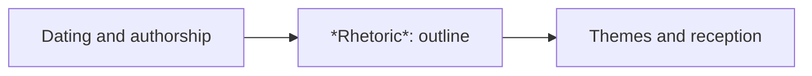

# *Rhetoric*

**Prerequisites:** [Aristotle](../thinkers/aristotle.md); helpful: the [*Organon*](organon.md) and [*Gorgias*](gorgias.md)

## Dating and authorship

Aristotle's treatise on the art of persuasion, in three books. It is a reply, in a way, to Plato's suspicion of rhetoric in the [*Gorgias*](gorgias.md) and [*Phaedrus*](phaedrus.md): rhetoric can be an art, if it is the counterpart of dialectic and is used with a knowledge of arguments, character, and emotion.

## Outline and key ideas

Rhetoric is the ability to see, in each case, the available means of persuasion. There are three technical pisteis (proofs): **logos** (the argument in the speech), **ethos** (the character the speaker shows), and **pathos** (the emotion produced in the audience). Speeches divide into deliberative, forensic, and epideictic (display). Aristotle analyzes common topics (*topoi*), the use of examples and enthymemes (rhetorical syllogisms), the emotions (the second book is an early psychology of anger, shame, fear, pity), style, and arrangement. Unlike a sophist's advertising, the treatise is diagnostic: it describes what actually persuades, including things a moralist might wish did not persuade.

## Reception

This is the founding systematic rhetoric of the Greek tradition, and a major source for later Roman writers (Cicero, Quintilian) and for the medieval curriculum. For this path, it also shows Aristotle as a more practical student of the city than the *Gorgias*'s war with flattery might have predicted.

## Key ideas

- Rhetoric as an art of seeing the available means of persuasion.
- Logos, ethos, and pathos; the enthymeme; a psychology of the emotions.
- A counterpart to dialectic, not a simple rejection of Plato's critique.

## Where this leads

- [*Poetics*](poetics.md), [*Politics*](politics.md), [*Nicomachean Ethics*](nicomachean-ethics.md)
- Contrast: [*Gorgias*](gorgias.md)
