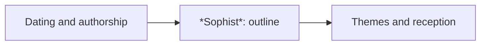

# *Sophist*

**Prerequisites:** [*Theaetetus*](theaetetus.md) or [*Parmenides*](parmenides.md)

*Plato, copy of the portrait made by Silanion ca. 370 BC for the Academia in Athens Credit: Marie-Lan Nguyen. License: [CC BY 2.5](https://creativecommons.org/licenses/by/2.5). Source: [File:Plato Silanion Musei Capitolini MC1377.jpg](https://commons.wikimedia.org/wiki/File:Plato_Silanion_Musei_Capitolini_MC1377.jpg).*
## Dating and authorship

A late dialogue, formally a sequel to the *Theaetetus*. The main speaker is now an Eleatic Visitor, not Socrates, which already signals a shift of method. The dramatic task is to define the sophist and distinguish him from the philosopher and the statesman (the *Statesman* continues the project).

## Outline and key ideas

The Visitor uses a method of **division** (repeated dichotomies) to hunt the sophist, and keeps catching something that looks like a maker of images and false appearances. That hunt runs into a metaphysical wall inherited from [Parmenides](../thinkers/parmenides.md): how can there be false speech, or images, if to speak a falsehood is to say what is not, and what is not cannot be said?

The dialogue's constructive core is an analysis of **the very large kinds** (*megista gene*): being, sameness, difference, motion, rest. The Visitor shows that "what is not" need not be absolute nothing; it can be **difference**, a real way in which one kind is not another. False speech is possible because we can weave names and verbs into a combination that says of something what is different from how it is. This is one of the most important moves in ancient ontology: a rehabilitation of not-being without simply contradicting Parmenides' poem.

## Themes and reception

The *Sophist* is a bridge between Eleatic logic and later accounts of predication, negation, and image. It also keeps the ethical-political worry of the *Gorgias*: the sophist is a producer of distorting appearances. [Aristotle](../thinkers/aristotle.md)'s logic and [Plotinus](../thinkers/plotinus.md)'s treatment of being and difference both live downstream, in different ways.

## How to read it

The *Sophist* is a late, technical dialogue in which a visiting Eleatic Stranger, not Socrates, hunts the sophist by the method of division and, along the way, confronts the problem of not-being and of false speech. The famous moment is the rehabilitation of "what is not" as the *other*, so that one can say something false without talking about sheer nothing. Read the divisions patiently; they are easy to parody and still do the work of asking what a sophist *is* (a maker of images, a kind of hunter, a wage-earner in speeches).

Pair it with the *Theaetetus* (knowledge) and the *Parmenides* (the One and the forms under pressure). A first reading can aim at the not-being section and at the concluding definition; a second can ask whether the dialogue has also, quietly, revised the theory of forms by introducing a communion of kinds (being, same, other, motion, rest). The *Statesman* continues the series; it is not required for a first pass at this problem.

## Key ideas

- Definition by division, used to trap the sophist as a maker of appearances.
- "What is not" is reinterpreted as difference, making false statement possible.
- Socrates steps back; the Eleatic Visitor leads a more technical dialectic.

## Where this leads

- [*Parmenides*](parmenides.md), [*Theaetetus*](theaetetus.md)
- Concept: [being and not-being](../../../../concepts/metaphysics/being-and-not-being.md)
