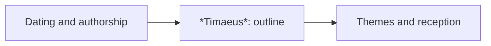

# *Timaeus*

**Prerequisites:** [Plato](../thinkers/plato.md) and the [*Republic*](republic.md)

*Plato, copy of the portrait made by Silanion ca. 370 BC for the Academia in Athens Credit: Marie-Lan Nguyen. License: [CC BY 2.5](https://creativecommons.org/licenses/by/2.5). Source: [File:Plato Silanion Musei Capitolini MC1377.jpg](https://commons.wikimedia.org/wiki/File:Plato_Silanion_Musei_Capitolini_MC1377.jpg).*
## Dating and authorship

A late dialogue, mostly a long monologue by the title character, a Pythagorean-leaning astronomer from Locri. It was, for centuries, *the* Plato of the Latin West (partly through Calcidius's incomplete translation and commentary), and so its cosmology has a reception history even larger than its place in a modern reading list.

## Outline and key ideas

A brief political preface links the work to the *Republic* and to an unfinished story of ancient Athens and Atlantis (continued in the *Critias*). Timaeus then offers a "likely story" (*eikos muthos*) of the world's making. A good craftsman god, the **Demiurge**, looks to an eternal intelligible model and orders a living cosmos out of a pre-existing, disorderly receptacle (the *chora*, a difficult third kind besides Forms and images). The world-soul is constructed with harmonic ratios; time is a moving image of eternity; the four elements are given a famously geometric construction (the platonic solids); the human body and soul are explained in a mix of teleology and physiology, including a striking account of the liver and of sense.

This is not a modern creation-from-nothing. Matter, or something like a receptacle, is already there; the Demiurge is good, not jealous, and does the best possible job with what he is given. How literally to take the "making" (a beginning in time, or an eternal dependence told as a story?) was already debated in the Academy.

## Themes and reception

The *Timaeus* is Plato's main work of [cosmology](../../../../glossary/general/cosmology.md), and the main meeting point of his Forms with Pythagorean mathematics and with natural science. Aristotle will reject a craftsman of this sort and a beginning of time. [Plotinus](../thinkers/plotinus.md) will reread the Demiurge and the world-soul inside a procession from the One. Medieval readers often fused the Demiurge with a creator God. For this path, it is also the best place to see myth and mathematics working together in late Plato, after the political climax of the *Republic*.

## How to read it

The *Timaeus* is Plato's cosmological dialogue: a likely story (*eikōs muthos*) of how a craftsman-god, looking to an eternal model, orders a world of becoming from a pre-existing, wandering "receptacle." Read the methodological warnings first. This is not the *Republic*'s dialectic, and Plato says so. Then follow the construction of the world-soul, the regular solids and the elements, time as a moving image of eternity, and the account of the human body and of sensation. The details of the science are historically dated; the philosophical claims about model, image, necessity, and intellect are not thereby emptied.

The *Timaeus* had an afterlife out of proportion to its place in a modern Plato course, especially in later antiquity and in the Latin Middle Ages (often through partial translation). Read it after you have some of the theory of forms in view, and do not skip the opening that links it, dramatically, to the *Republic*. A good edition with notes will keep you from drowning in the harmonics. The question to keep asking is what, in this "likely story," is offered as necessary and what is offered as the best account we can give of a changing world.

## Key ideas

- A likely story: a good Demiurge orders the world after an intelligible model.
- The receptacle (*chora*), the world-soul, time, and geometric elements are the technical core.
- Literal versus pedagogical readings of the "making" are ancient, not modern, problems.

## Where this leads

- Thinkers: [Pythagoras](../thinkers/pythagoras.md), [Aristotle](../thinkers/aristotle.md) (*Physics*), [Plotinus](../thinkers/plotinus.md)
- Concept: [the Forms](../../../../concepts/metaphysics/the-forms.md)
