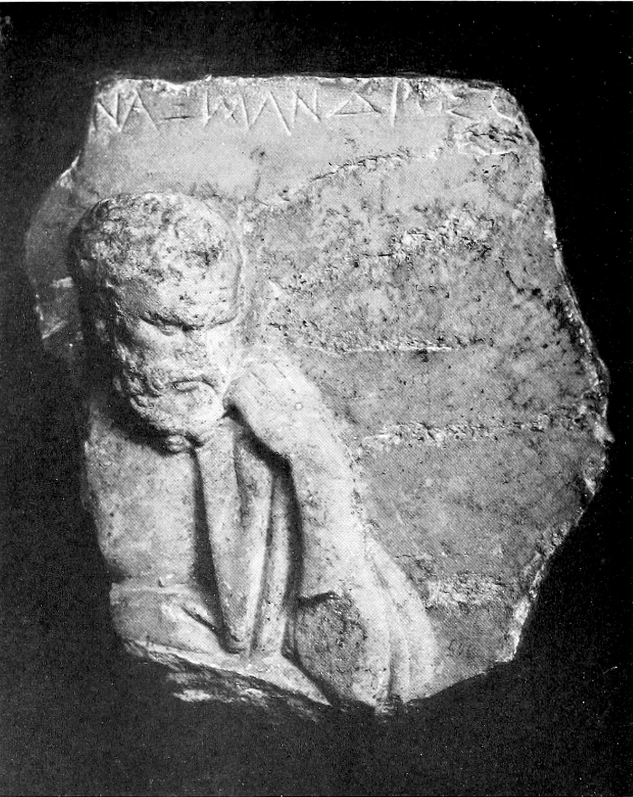

# Anaximander

**Prerequisites:** [Thales](thales.md)

*Photograph; frontispiece published in Anaximander and the Origins of Greek Cosmology (1960) by Charles Henry Kahn Credit: Charles Kahn. License: Public domain. Source: [File:Anaximander and the Origins of Greek Cosmology (1960) frontispiece.jpg](https://commons.wikimedia.org/wiki/File:Anaximander_and_the_Origins_of_Greek_Cosmology_(1960)_frontispiece.jpg).*
## Name and dates

Anaximander of Miletus (c. 610–546 BCE) is usually presented as Thales' younger associate or successor. Later sources credit him with making the first Greek world map, with a gnomon (a shadow-caster for telling time and seasons), and with a bold picture of the earth as a short cylinder floating unsupported at the center of things, because it has no reason to go one way rather than another. As with other Presocratics, biography is thin and late.

## Sources

He is said to have written a book in prose, of which one sentence — or part of one — is often treated as the earliest surviving fragment of Greek philosophical writing. The wording, preserved by Simplicius from Theophrastus, speaks of things coming to be from an indefinite source and paying penalty to one another for injustice according to the ordering of time. Even this fragment has been handled and possibly paraphrased. Most of the rest is doxography: later summaries of "what Anaximander thought."

## Thought

His *arche* is the **[*apeiron*](../../../../glossary/greek/apeiron.md)**: the indefinite, unbounded, or unlimited. Unlike water or air, it is not a familiar stuff you can point at. If the source were already one definite element, it is hard to see how the others would arise from it, or how it could fail to have been used up. The *apeiron* is inexhaustible and without a determining quality, and from it the worlds (some reports say infinitely many) are separated out.

The fragment's language of **justice and penalty** is striking. Hot and cold, wet and dry, encroach and are pushed back; cosmic order is a balance of offences over time. This is not yet a court of law, but it is already a moral-sounding vocabulary for natural process. The seasons and the cycle of coming-to-be and passing-away are made intelligible as a legal-like order, not as a god's whim.

He is also associated with a proto-evolutionary picture of living things: the first animals generated in moisture, and human beings, who need a long nursing, emerging from some other kind. Read this as a later report, not as Darwin. The impulse is the same as in his cosmology — explain the present by a process from a less differentiated past, without stopping at a finished myth.

## Reception

Anaximander is often judged the most conceptually daring of the Milesians, because he refuses to identify the source with a visible element and because he offers a reason why the earth need not fall (a symmetry argument). [Anaximenes](anaximenes.md) will return to a definite stuff (air) but add a clearer mechanism. The *apeiron* remains a landmark in the history of [first principles](../../../../concepts/metaphysics/arche-and-first-principles.md): sometimes the right source is not one of the things it is supposed to explain.

## Key ideas

- The *arche* is the *apeiron*, not a familiar element.
- Change among opposites is described as a justice over time.
- A process from the less definite to the definite organizes both cosmos and life in the reports.

## Where this leads

- Next: [Anaximenes](anaximenes.md)
- Related: [the problem of change](../../../../concepts/metaphysics/the-problem-of-change.md)
- Glossary: [*apeiron*](../../../../glossary/greek/apeiron.md), [*arche*](../../../../glossary/greek/arche.md)
