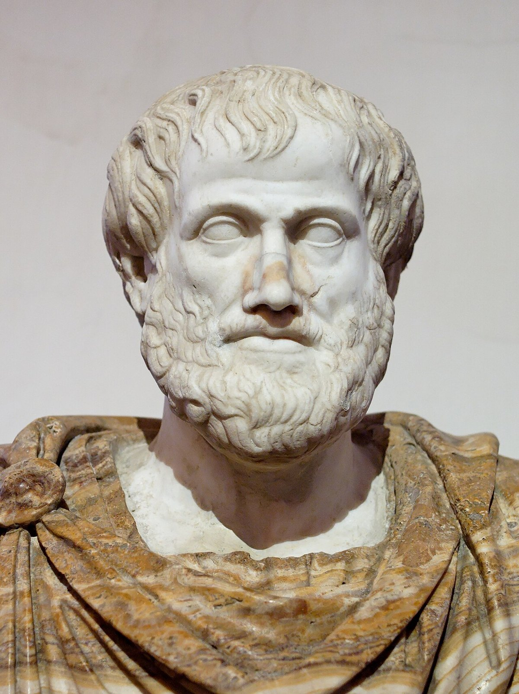
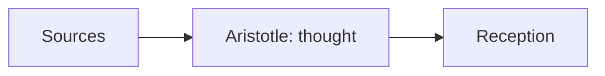

# Aristotle

**Prerequisites:** [Plato](plato.md) and the survey [Aristotle](../05-aristotle.md)

*Bust of Aristotle. Marble, Roman copy after a Greek bronze original by Lysippos from 330 BC; the alabaster mantle is a modern addition. Credit: After Lysippos. License: Public domain. Source: [File:Aristotle Altemps Inv8575.jpg](https://commons.wikimedia.org/wiki/File:Aristotle_Altemps_Inv8575.jpg).*
## Name and dates

Aristotle (384–322 BCE) was born at Stagira in the north, the son of a physician with ties to the Macedonian court. He entered [Plato](plato.md)'s Academy as a young man and stayed about twenty years. After Plato's death he left Athens, later tutored Alexander the Great, and returned to found the Lyceum, a rival research community with a library and organized inquiry into nature, constitutions, and texts. He left Athens again after Alexander's death and died at Chalcis.

## Sources

The surviving works are mainly lecture-style treatises, often dense, sometimes apparently compiled from teaching materials rather than polished for publication. Ancient lists mention more popular "exoteric" writings, now lost. What we have was organized by later editors into a corpus: the [*Organon*](../texts/organon.md) (logical works), [*Physics*](../texts/physics.md), [*Metaphysics*](../texts/metaphysics.md), [*On the Soul*](../texts/de-anima.md), biological writings, [*Nicomachean Ethics*](../texts/nicomachean-ethics.md), [*Politics*](../texts/politics.md), [*Rhetoric*](../texts/rhetoric.md), and [*Poetics*](../texts/poetics.md), among others. "Aristotle" in this encyclopedia means that corpus, with the understanding that it has a history of editing.

## Thought

He agrees with Plato that knowledge needs stable objects, and that [the problem of change](../../../../concepts/metaphysics/the-problem-of-change.md) is real. He disagrees that the stable objects must be Forms existing separately. What is primarily real is **[substance](../../../../concepts/metaphysics/substance.md)** (*ousia*): this horse, this person — a "this" that persists through change. Form and matter are principles *of* substances (the shape of a bronze statue; the bronze), not a second world. This is [hylomorphism](../../../../glossary/greek/hylomorphism.md).

Change is the actualizing of a [potential](../../../../concepts/metaphysics/potentiality-and-actuality.md) already in the thing. A seed is a tree in potential; becoming a tree is not a leap from non-being to being. That is his most direct reply to [Parmenides](parmenides.md), and it is why biology is central for him, not a hobby. To explain something fully is to give the [four causes](../../../../concepts/metaphysics/the-four-causes.md): material, formal, efficient, and final. Natural things have ends (*tele*); an explanation that omits what a heart or a city is *for* is incomplete.

The *Organon* makes valid inference a public, teachable standard: terms, propositions, [syllogisms](../../../../concepts/logic/syllogism-and-the-organon.md), definition, and fallacies. It is term logic, not a modern calculus, and it is the beginning of logic as a branch of philosophy in the Greek line.

Ethics asks what the human good is. The answer is [*eudaimonia*](../../../../glossary/greek/eudaimonia.md): flourishing over a complete life, activity of the soul in accordance with virtue and reason. Virtue is a [mean](../../../../concepts/ethics/the-mean.md) relative to us, found by practical wisdom (*[phronesis](../../../../glossary/greek/phronesis.md)*), and acquired by [habit](../../../../concepts/ethics/cultivation-and-habit.md). Knowing is not enough — a pushback against Socratic intellectualism. Because we flourish in a community, ethics opens onto politics: the human being is a [political animal](../../../../concepts/political/the-polis-and-political-animal.md), an animal with *logos* who lives in a *polis*. The *Politics* studies households, citizenship, and constitutions. Parts of it, including the defense of natural slavery and the treatment of women, are bound to his time and are rightly challenged. Read him as a resource and as a historical author.

## Reception

His influence is hard to overstate: Hellenistic schools argue with him; Islamic and Christian medieval philosophy build with and against his vocabulary of substance, cause, and soul; modern science begins, in part, as a revolt against a late Aristotelian school picture of nature. You do not have to be an Aristotelian to need to know what you are refusing.

## Key ideas

- Substances, not separate Forms, are primary; form and matter compose them.
- Change is the actualizing of potential; explanation uses four causes, including ends.
- Flourishing, habituated virtue, and the *polis* form one ethical-political project.

## Where this leads

- Survey: [Aristotle](../05-aristotle.md)
- Texts: [*Nicomachean Ethics*](../texts/nicomachean-ethics.md), [*Politics*](../texts/politics.md), [*Metaphysics*](../texts/metaphysics.md), [*Organon*](../texts/organon.md)
- Hellenistic responses: [Epicurus](epicurus.md), [Zeno of Citium](zeno-of-citium.md), [Pyrrho](pyrrho.md)
- A different systematic ethics of cultivation: [Xunzi](../../chinese/thinkers/xunzi.md)
