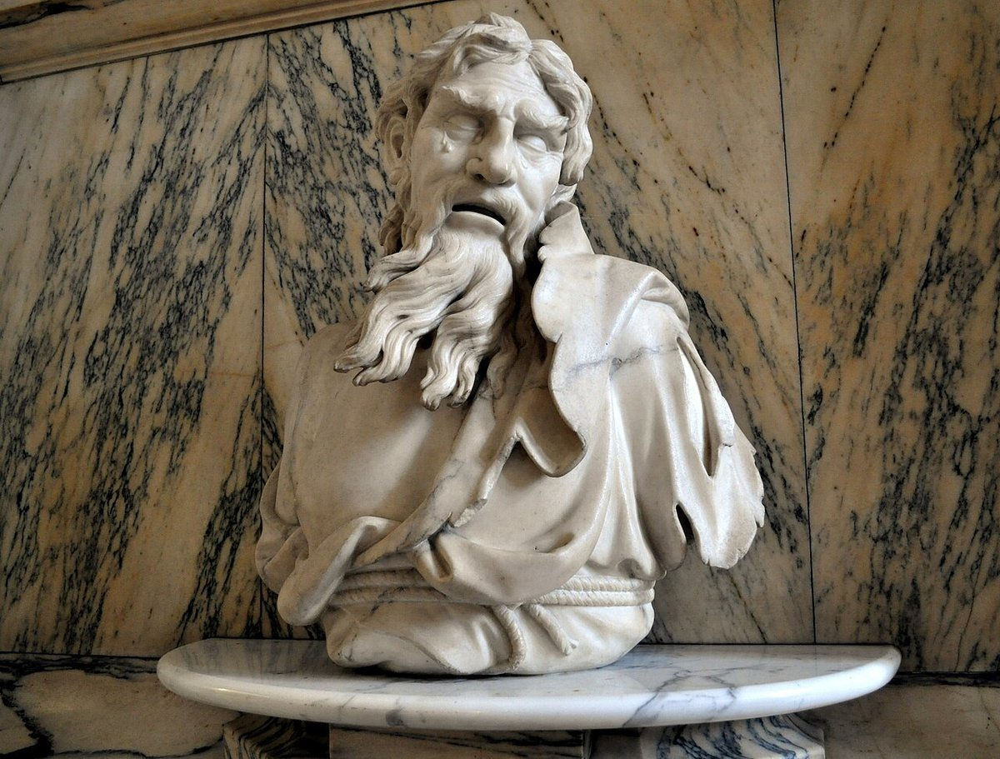
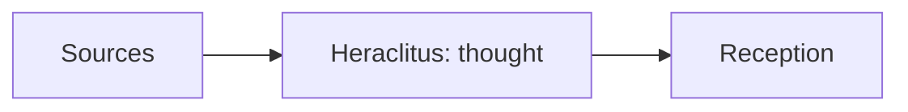

# Heraclitus

**Prerequisites:** [Foundational concepts](../01-foundational-concepts.md) and the [Presocratics survey](../02-presocratics.md)

*Carved Italian marble bust depicting Heraclitus at the Victoria and Albert Museum Knightsbridge London England. It has been dated to 1700-1750, and was… Credit: Afshin Darian. License: [CC BY 2.0](https://creativecommons.org/licenses/by/2.0). Source: [File:Bust of Heraclitus - Victoria and Albert Museum.jpg](https://commons.wikimedia.org/wiki/File:Bust_of_Heraclitus_-_Victoria_and_Albert_Museum.jpg).*
## Name and dates

Heraclitus of Ephesus (around 500 BCE) was an Ionian, from a city not far from Miletus, writing a generation or two after the Milesians. Ancient biography paints him as aristocratic, obscure, and contemptuous of the crowd and of famous poets and sages (including [Pythagoras](pythagoras.md) and [Homer](../../../../glossary/general/tradition.md) as popular teachers). The personality may be a mask inferred from the style. The style is not in doubt: short, tense, riddling sentences that later earned him the nickname "the Obscure."

## Sources

He wrote a book, perhaps deposited in the temple of Artemis, of which more than a hundred fragments survive, quoted by later authors. Because the quotations are excerpted and sometimes reshaped, the order of the book is lost and every reconstruction is a hypothesis. We are richer in his actual words than we are for the Milesians, and still not rich enough to be casual.

## Thought

The popular Heraclitus is the philosopher of flux: you cannot step into the same river twice; everything flows. The fragments do support a world in motion. They also insist on a common [*logos*](../../../../glossary/greek/logos.md) — an account, measure, or structure — that most people live as if they had never heard. The river remains a river *by* flowing. Stability, if there is any, is the stability of a pattern in change, not of a frozen thing.

**Opposition** is not a defect in this cosmos. War is called a father and king of things; the path up and the path down are one and the same; the tension in a bow or a lyre is the condition of their work. What look like contradictions from a static point of view are, for Heraclitus, the way the world holds together. Day and night, hunger and satiety, the immortal and the mortal, are paired rather than simply opposed.

**Fire** is his preferred image for the world's process: kindling and going out in measures, an ever-living fire. Whether fire is an *arche* in the Milesian sense, or a symbol of ordered change, is debated. The important idea is *measure*. Things are exchanged for fire and fire for things as goods for gold, one fragment says. This is not chaos. It is process with a ratio.

He is also a moralist of waking up. Most people, he says, are like sleepers, each with a private world. The *logos* is common. Philosophy, in this key, is not first a system of nature; it is a demand to notice the structure you already live inside.

## Reception

Plato and Aristotle already treat him as the flux philosopher, sometimes too simply. The Stoics will take up his fire and *logos* and turn them into a providential cosmology. Hegel and a long modern tradition will claim him for dialectic and becoming. Read the fragments first, on their own terms: a thinker of measured change, of conflict as structure, and of a common account that is hard to hear.

## Key ideas

- Flux is real, but it is measured; the *logos* is common.
- Opposites belong together; tension is a form of order.
- Fire is the leading image of a world that lives by changing in measures.

## Where this leads

- The great foil: [Parmenides](parmenides.md), who challenges the reality of change
- Concept: [the problem of change](../../../../concepts/metaphysics/the-problem-of-change.md), [logos as account and order](../../../../concepts/metaphysics/logos-as-account-and-order.md)
- A later use of *logos* and fire: [Zeno of Citium](zeno-of-citium.md) and the Stoics
