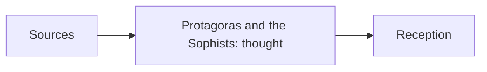

# Protagoras and the Sophists

**Prerequisites:** the [Presocratics survey](../02-presocratics.md); helpful to have [Socrates](socrates.md) nearby as a foil

## Names and dates

"Sophist" (*sophistes*) began as a word for a person of skill or wisdom and, in the fifth century BCE, came to name a set of itinerant, paid teachers of rhetoric, argument, and civic success. They belong to the same century as the later Presocratics and as [Socrates](socrates.md), and they shift the center of gravity from the cosmos to *nomos*, speech, and the city. Protagoras of Abdera (c. 490–420 BCE) is the most famous. Other major figures include Gorgias of Leontini, Prodicus, Hippias, and, in a more ambiguous place, Thrasymachus (as Plato presents him in the [*Republic*](../texts/republic.md)).

## Sources

Almost all complete works are lost. Protagoras's *Truth* (or *Refutations*) and *On the Gods* survive only in fragments and reports. Gorgias's *Helen* and *On Non-Being* are preserved in later copies or summaries. Our most vivid — and most hostile — portraits are Plato's dialogues ([*Protagoras*](../texts/protagoras.md), *Gorgias*, *Republic* I, *Theaetetus*). Aristotle, Isocrates, and later doxographers add pieces. Reading the Sophists fairly means not letting Plato's courtroom be the only witness.

## Thought

Several claims recur, with real differences among persons.

**Man is the measure.** Protagoras's most famous sentence, as reported, is that of all things the measure is a human being, of those that are, that they are, and of those that are not, that they are not. In the *Theaetetus* this is taken as a radical relativism about perception and truth: how it appears to me is true for me. Other readings soften it into a claim about human standards, or about practical knowledge in the city. Either way, it relocates authority from a Parmenidean "what-is" to the judging person or community.

**Gods and uncertainty.** Protagoras is also reported to have said that he could not know whether the gods exist or what they are like, because of the obscurity of the subject and the shortness of life. That is not necessarily atheism; it is a profession of ignorance that Athens apparently found dangerous enough that later stories have him prosecuted and his book burned. The stories may be embroidered; the tension with civic religion is plausible.

**Nature versus convention.** A central fifth-century debate is whether justice, law, and shame exist by [*physis*](../../../../glossary/greek/physis.md) (nature) or by [*nomos*](../../../../glossary/greek/nomos.md) (custom, law, convention). Some sophistic arguments treat justice as a useful agreement among the weak, or as the advantage of the stronger (the view Plato gives Thrasymachus and Callicles). Others, including the Protagoras of Plato's dialogue, defend the teachability of civic virtue and the need for law. Gorgias displays the power of speech to bewitch and to make the weaker argument appear stronger — a skill that can be advertised as liberation or as a threat.

The first-principles point is not "the Sophists were cynics." It is that they made *logos* as persuasive speech, and the city as a place of contested standards, into objects of explicit teaching. Ethics and politics could no longer be assumed as nature's obvious order.

## Reception

Plato and, to a degree, Aristotle defined the Sophists as the other of philosophy: paid, display-oriented, careless of truth. That contrast helped invent "philosophy" as a vocation. Modern scholarship has recovered sophistic fragments as serious work in language, epistemology, and political thought. [Socrates](socrates.md) shares their interest in argument and virtue and refuses their fees and, in Plato's picture, their claim to teach success. The fight between them is in the family.

## Key ideas

- Paid teachers of rhetoric and civic excellence shift inquiry from cosmos to city and speech.
- "Man is the measure" and the *physis*/*nomos* debate relocate questions of truth and justice.
- Our picture is heavily mediated by Plato; the fragments deserve a hearing of their own.

## Where this leads

- Foil and cousin: [Socrates](socrates.md)
- Texts: [Plato's *Protagoras*](../texts/protagoras.md), [*Gorgias*](../texts/gorgias.md), [*Republic*](../texts/republic.md)
- Concepts: [knowledge and opinion](../../../../concepts/epistemology/knowledge-and-opinion.md), [nature and convention](../../../../glossary/greek/nomos.md)
