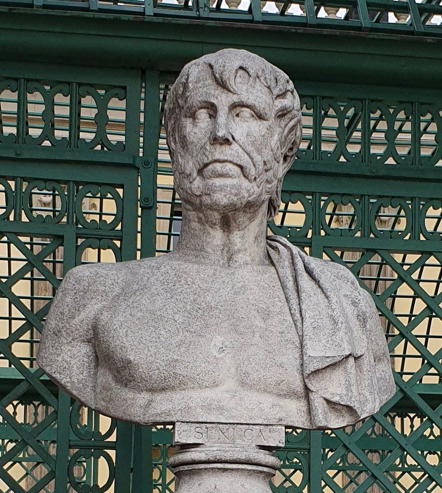

# Seneca

**Prerequisites:** [Zeno of Citium](zeno-of-citium.md)

*Bust of Hesiod Credit: Yair Haklai. License: [CC BY-SA 4.0](https://creativecommons.org/licenses/by-sa/4.0). Source: [File:Bust of Lucius Annaeus Seneca-Busts of philosophers in Sanssouci.jpg](https://commons.wikimedia.org/wiki/File:Bust_of_Lucius_Annaeus_Seneca-Busts_of_philosophers_in_Sanssouci.jpg).*
## Name and dates

Lucius Annaeus Seneca (c. 4 BCE–65 CE), often called Seneca the Younger, was a Roman senator, a writer of Latin prose and tragedy, a tutor and later adviser to the emperor Nero, and a Stoic moralist. In 65, after the Pisonian conspiracy, he was ordered to kill himself and did so. The life and the writings sit in an uncomfortable, productive tension: a man of enormous wealth and political compromise who argued for simplicity, the examination of conscience, and the equality of human beings as shares of the same *logos*.

## Sources

Unlike the early Stoics, Seneca survives in bulk. The most important moral works for this path are the [*Letters to Lucilius*](../texts/letters-to-lucilius.md) (*Epistulae Morales*), the essays collected as *Dialogues* (including *On Anger*, *On the Happy Life*, *On the Shortness of Life*), and *On Mercy*, addressed to Nero. The tragedies are a different, darker laboratory of passion and power. They should not be used as straightforward statements of doctrine, but they belong to the same author.

## Thought

Seneca is not trying to rebuild Chrysippus's logic. He is a Roman teacher of the art of living, in a Latin flexible enough to be almost conversational. The letters treat philosophy as daily training: review the day, cut needless wants, prepare for loss, test whether you are progressing or only talking. Time is a central theme — not as physics, but as the one thing we waste while thinking we own it. Anger is a failed judgment that can be anticipated and weakened, not a noble fuel. Wealth is an indifferent he knew he possessed; the honest strain of the letters is the attempt to use it without being owned by it, and the admission that this is hard.

He is more willing than a textbook "Stoic" to quote [Epicurus](epicurus.md) with approval when a saying helps, and more willing to write about mercy, grief, and the closeness of death in a personal register. The physics of a rational cosmos is still there — a god within, a world ordered by reason, a kinship of all humans, including the enslaved — but the emphasis is practical and rhetorical. That is a feature of Roman Stoicism, not a failure to be Greek enough.

## Reception

Christian readers (Tertullian, later monastic culture, and a medieval correspondence forged between Seneca and Paul) sometimes treated him as almost one of their own. Early modern essayists, especially Montaigne, found a model in the letters. Recent scholarship has also insisted on the political context: advice to a tyrant, wealth, and the limits of inner freedom under autocracy. Read the letters first, then ask how far the life and the teaching can be held together. The question is one Seneca almost invites.

## Key ideas

- A Roman, literary Stoicism: daily training, time, anger, and the use of wealth.
- The *Letters to Lucilius* are the best entry; they treat philosophy as correspondence and practice.
- The gap between courtier and moralist is part of the subject, not a reason to dismiss the work.

## Where this leads

- Text: [*Letters to Lucilius*](../texts/letters-to-lucilius.md)
- Kin: [Epictetus](epictetus.md), [Marcus Aurelius](marcus-aurelius.md)
- Concept: [ataraxia and apatheia](../../../../concepts/ethics/ataraxia-and-apatheia.md)
