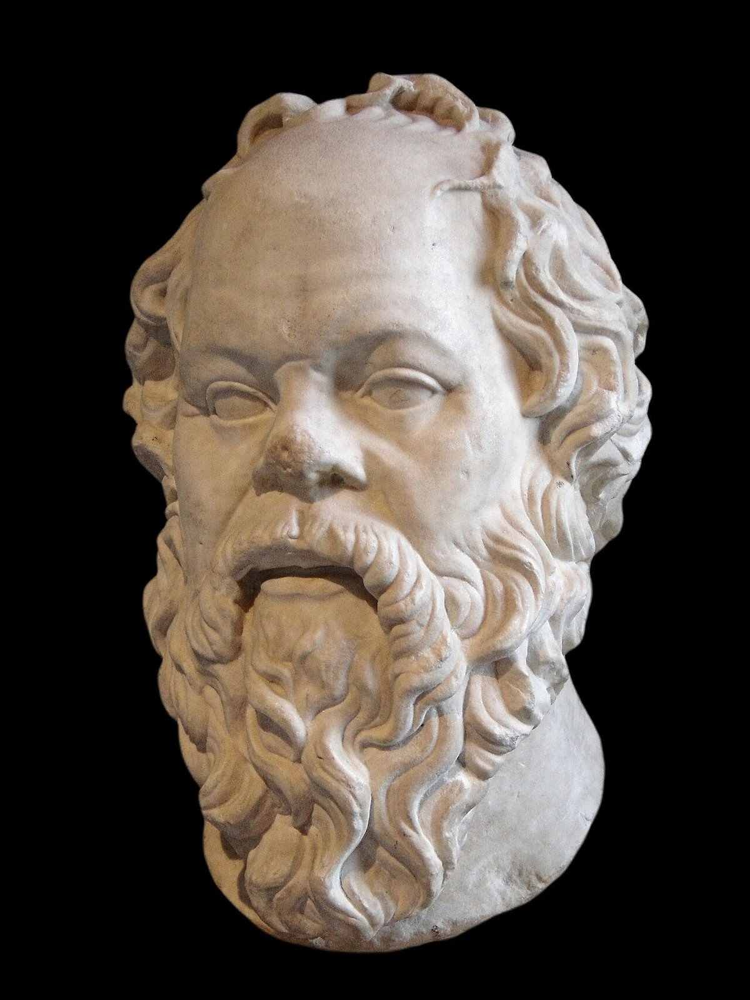
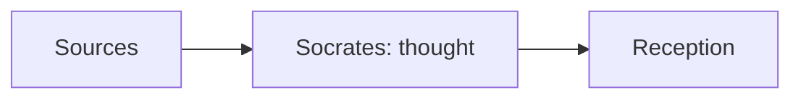

# Socrates

**Prerequisites:** [Protagoras and the Sophists](protagoras-and-the-sophists.md) and the survey [Socrates](../03-socrates.md)

*Portrait of Socrates. Marble, Roman artwork (1st century), perhaps a copy of a lost bronze statue made by Lysippos. Credit: Copy of Lysippos (?). License: [CC BY-SA 2.5](https://creativecommons.org/licenses/by-sa/2.5). Source: [File:Socrate du Louvre.jpg](https://commons.wikimedia.org/wiki/File:Socrate_du_Louvre.jpg).*
## Name and dates

Socrates of Athens (c. 470–399 BCE) is the hinge of the Greek path and a man we never hear in his own written voice. He served as a hoplite, lived in public, and spent his later years questioning fellow citizens about virtue, knowledge, and the care of the soul. In 399 he was tried on charges of impiety and of corrupting the young, and he was executed by hemlock. The trial, not a lost book, is his central documented act.

## Sources

The "Socratic problem" is the first fact. Aristophanes' *Clouds* (423 BCE) satirizes him as a Sophist-like natural philosopher and teacher of dishonest speech. Xenophon portrays a pious, practical adviser. Plato, especially in early dialogues such as the [*Apology*](../texts/apology.md), [*Crito*](../texts/crito.md), [*Euthyphro*](../texts/euthyphro.md), and [*Meno*](../texts/meno.md), gives us the restless questioner who became the image of the philosopher. Later Platonic dialogues use "Socrates" as a character for views — the Theory of Forms, recollection in its full form, the philosopher-king — that most scholars treat as Plato's. There is no neutral transcript. This overview leans on the early Platonic portrait, flagged as a portrait, and on the public fact of the trial.

## Thought

The method is the [*elenchus*](../../../../glossary/greek/elenchus.md): a cross-examination that asks for a definition of piety, courage, or justice, tests it with cases, and often ends in [*aporia*](../../../../glossary/greek/aporia.md), puzzlement. The moral of the method, as the *Apology* presents it, is **knowledge of ignorance**. The Delphic oracle is said to have called no one wiser than Socrates; he concludes that he is wiser only in not thinking he knows what he does not know. The unexamined life, in the same speech, is not worth living.

Two ethical claims usually travel with this. First, **virtue is a kind of knowledge**: if you really understood the good, you would not willingly choose the bad. Wrongdoing is ignorance, not a second, independent power in the soul (a view [Aristotle](aristotle.md) will complicate with [*akrasia*](../../../../glossary/greek/akrasia.md)). Second, **the soul is the thing to care for**. Reputation, money, and even survival rank lower than not doing injustice. In the *Crito* he refuses to escape prison; in the *Phaedo* (already more Platonic) he treats philosophy as a practice for death.

He is close to the [Sophists](protagoras-and-the-sophists.md) in his love of argument and his interest in whether virtue can be taught, and far from them, in Plato's picture, in refusing pay, in disclaiming the role of teacher, and in binding argument to a search for how one should live rather than to success in the assembly.

## The trial

Athens had lost the Peloponnesian War and lived through oligarchic coups, including the Thirty Tyrants, among them associates of Socrates. A man who questioned civic pieties, declined ordinary politics, and kept company with dubious aristocrats could be read as a threat. Plato's *Apology* makes the defense a refusal to stop philosophizing. Whether or not those words were spoken, they fixed an image: philosophy as a public risk.

## Reception

Every later Greek school claimed him. The Cynics took his austerity and independence; the Skeptics, his profession of ignorance; the Stoics, his devotion to virtue; Plato, his person as the starting point of a full metaphysics. For this encyclopedia he remains the turn from nature-philosophy to the examined life — and the reminder that the turn can end in a court.

## Key ideas

- We meet Socrates only through others; early Plato is our best, still partial, window.
- The *elenchus* tests claims to know virtue and often ends in *aporia*.
- Virtue as knowledge, care of the soul, and the trial of 399 define his afterlife.

## Where this leads

- Survey lesson: [Socrates](../03-socrates.md)
- Texts: [*Apology*](../texts/apology.md), [*Crito*](../texts/crito.md), [*Euthyphro*](../texts/euthyphro.md), [*Meno*](../texts/meno.md)
- Next thinker: [Plato](plato.md)
- Concepts: [elenchus and aporia](../../../../concepts/epistemology/elenchus-and-aporia.md), [virtue as knowledge](../../../../concepts/ethics/virtue-as-knowledge.md)
- A different teacher of recorded sayings: [Confucius](../../chinese/thinkers/confucius.md)
