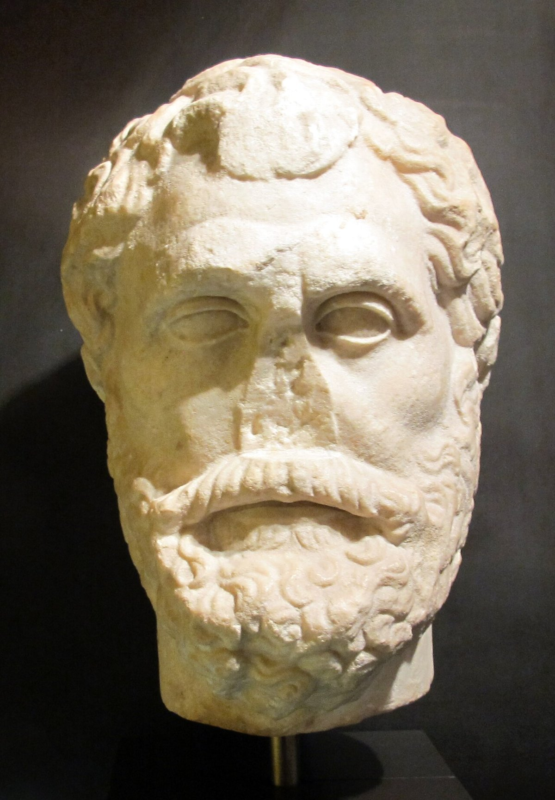

# Thales

**Prerequisites:** [Foundational concepts](../01-foundational-concepts.md) and the [Presocratics survey](../02-presocratics.md)

*Museo dei Marmi, palazzo Medici-Riccardi, Firenze Credit: Sailko. License: [CC BY-SA 3.0](https://creativecommons.org/licenses/by-sa/3.0). Source: [File:Arte romana, testa di talete di mileto, II sec..JPG](https://commons.wikimedia.org/wiki/File:Arte_romana,_testa_di_talete_di_mileto,_II_sec..JPG).*
## Name and dates

Thales of Miletus (traditionally c. 624–546 BCE) is the first name in the standard Greek philosophical lineage. Miletus was a wealthy Ionian port on the coast of Asia Minor, looking across trade routes toward Egypt and the Near East. Almost nothing about his life is certain. Later antiquity made him one of the "Seven Sages," credited him with predicting a solar eclipse (often identified with the eclipse of 585 BCE), with measuring the height of pyramids, and with diverting a river for an army. Some of these stories are possible; many are the sort of invention that gathers around a founder.

## Sources

Thales wrote nothing that survives, and it is not clear that he wrote at all. Everything we have comes from later reports, especially Aristotle's *Metaphysics* and *De Anima*, Herodotus, and still later compilers such as Diogenes Laertius. Aristotle already speaks of him at a distance, reconstructing a position from tradition. That means "Thales taught that the *arche* is water" is a later, already philosophical way of putting a claim that may have been less tidy. The honest method is to treat him as a figure seen through Aristotle's questions.

## Thought

The claim attached to him is that **water** is the originating principle (*[arche](../../../../glossary/greek/arche.md)*) of things. Aristotle offers reasons the tradition may have had in mind: nourishment is moist, seeds are moist, the earth appears to rest on water. Whether or not those were Thales' own reasons, the move is more important than the particular element. Instead of stopping at a theogony — a genealogy of gods — he looks for a natural source that can be discussed, compared, and used to explain many phenomena with one idea.

He is also reported to have said that all things are full of gods, and that the magnet has a soul because it moves iron. "Soul" here is not a later immortal self; it is a principle of motion. The remark sits awkwardly, to modern ears, next to the "naturalistic" water claim. That awkwardness is useful. Early Ionian thought does not split "science" from "religion" the way we do. A world explained by water can still be a world thick with divine powers.

## Reception

Greek tradition treated Thales as the beginning of philosophy, and that honor is itself a historical fact: later thinkers needed a first. Modern scholarship is more cautious about the details and more interested in the Milesian pattern he opens — [Anaximander](anaximander.md) and [Anaximenes](anaximenes.md) will specify other *archai* and, crucially, mechanisms of change. The question he is taken to have asked, "what is the source of the many?", remains the first metaphysical question in this path.

## Key ideas

- A single natural *arche* (water) is offered as the source of the world's variety.
- The form of the question matters more than the particular answer.
- Our "Thales" is already a reconstruction from later, especially Aristotelian, reports.

## Where this leads

- Next: [Anaximander](anaximander.md), who names an *apeiron* rather than a familiar element
- Concept: [*arche* and first principles](../../../../concepts/metaphysics/arche-and-first-principles.md)
- Glossary: [*arche*](../../../../glossary/greek/arche.md), [*physis*](../../../../glossary/greek/physis.md)
