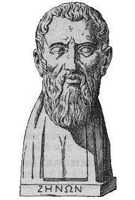

# Zeno of Elea

**Prerequisites:** [Parmenides](parmenides.md)

*Engraving depicting the marble bust of Zeno of Citium. Farnese Collection, National Archaeological Museum of Naples (cat. no. 6128). By comparison with the… Credit: http://www.uic.edu/classes/phil/phil105nh/105lectures/105lecture03.html. License: Public domain. Source: [File:Zeno of Citium, drawing.jpg](https://commons.wikimedia.org/wiki/File:Zeno_of_Citium,_drawing.jpg).*
## Name and dates

Zeno of Elea (c. 490–430 BCE) was a student and defender of [Parmenides](parmenides.md). Plato's [*Parmenides*](../texts/parmenides.md) imagines him in Athens with his teacher, reading a book of arguments against plurality and motion. The scene is dramatized, but the role is right: Zeno is not mainly offering a new first principle. He is showing what you are committed to if you reject the Eleatic one and try to live with ordinary many-things-in-motion.

## Sources

None of his book survives intact. We know the paradoxes chiefly from Aristotle's *Physics*, from Simplicius's commentary, and from later mentions. There may have been forty arguments; a handful are famous. The wording is almost always later paraphrase, so we should not treat any modern textbook sentence as a quotation from Zeno.

## Thought

The surviving arguments come in two families.

**Against plurality.** If there are many things, they must be both infinitely small (because they are divisible without limit, or because their parts have no size) and infinitely large (because parts with size, infinitely many, would sum without bound). Related arguments press on the idea that units must be both one and many. The aim is to make "there are many things" look as contradictory as Eleatic opponents claimed "there is only one" to be.

**Against motion.** The best-known paradoxes are these. In the *dichotomy* (or racetrack), to reach the end of a path you must first reach the halfway point, and before that a quarter, and so on without a first step, so the runner never begins — or, in a related form, never arrives. In *Achilles and the tortoise*, the faster runner gives a head start and must always reach the point the slower one has just left, so the gap is never closed. In the *arrow*, at any instant the flying arrow occupies a space equal to itself and is therefore at rest; if time is made of instants, the arrow never moves. In the *stadium* (or moving rows), relative motions seem to produce inconsistencies about how much time has passed.

Whether Zeno meant these as a serious metaphysics, as a challenge to the mathematics of his day, or as a dialectical defense of Parmenides is debated. What is not debated is the pressure they put on any theory of space, time, and infinity. You cannot simply say "but we see motion." You have to say how a completed infinity of tasks, or an instant of rest, is thinkable.

## Reception

Aristotle answered them with his distinctions between potential and actual infinity and with a theory of continuity; whether the answers are complete is still discussed. Modern mathematics, with convergent series and a rigorous account of the continuum, gives a different set of replies, which some philosophers still find insufficient to the *arrow*. Zeno's real afterlife is this: he made [the problem of change](../../../../concepts/metaphysics/the-problem-of-change.md) precise enough that later physics and metaphysics have to work at his level of difficulty.

## Key ideas

- The paradoxes defend Parmenides by attacking plurality and motion.
- Infinity, divisibility, and instants of time are the pressure points.
- We have the arguments mainly through later reports, especially Aristotle.

## Where this leads

- Replies in [Aristotle](aristotle.md) and in [potentiality and actuality](../../../../concepts/metaphysics/potentiality-and-actuality.md)
- A different way of saving appearance: [Democritus and Leucippus](democritus-and-leucippus.md)
- Text: [Plato's *Parmenides*](../texts/parmenides.md)
