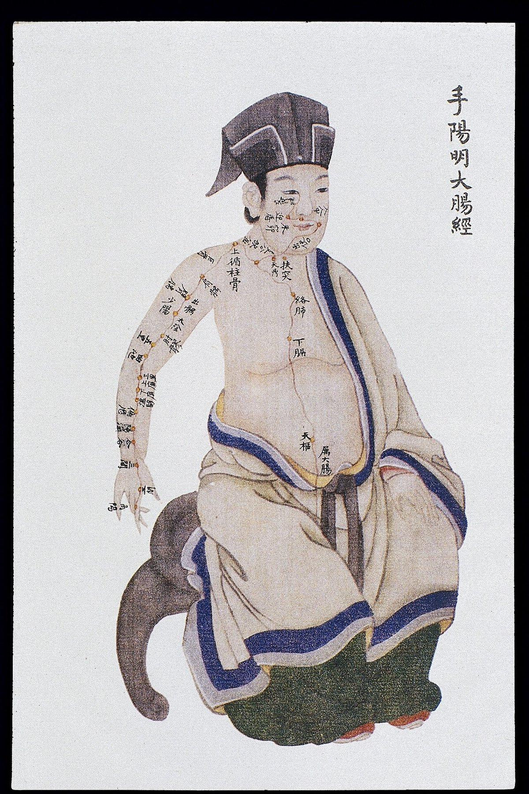
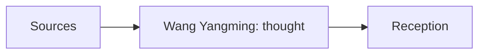

# Wang Yangming

**Prerequisites:** [Zhu Xi](zhu-xi.md)

*Illustration showing the large intestine channel of armyangmingfromRenti jingmai tu(Illustrations of the Channels of the Human Body), a manuscript text… Credit: https://wellcomeimages.org/indexplus/obf_images/64/e0/2170af32b42d3c0a584100ffe176.jpg (hi-res image) Gallery: https://wellcomeimages.org/indexplus/image/L0039964.html Wellcome Collection gallery (2018-03-30): https://wellcomecollection.org/works/m3ns2hxz CC-BY-4.0. License: [CC BY 4.0](https://creativecommons.org/licenses/by/4.0). Source: [File:Large intestine channel of arm yangming, C17-18 Chinese Wellcome L0039964.jpg](https://commons.wikimedia.org/wiki/File:Large_intestine_channel_of_arm_yangming,_C17-18_Chinese_Wellcome_L0039964.jpg).*
## Name and dates

Wang Yangming (Wang Shouren, 1472–1529) was a Ming-dynasty official, general, and philosopher, the most consequential critic of the official [Zhu Xi](zhu-xi.md) program from inside Confucianism. His life included exile, a campaign against a rebellion, and teaching that drew a large school. He is a still later bridge than Zhu Xi: not a source of the ancient texts, but a rival way of *using* them.

## Sources

The main collection is often called the *Instructions for Practical Living* (*Chuanxi lu*), together with letters and official documents, translated in Wing-tsit Chan's *Instructions for Practical Living and Other Neo-Confucian Writings*. Julia Ching's work is a standard study. The teaching is more aphoristic and situational than Zhu Xi's commentary machine, which is part of the point.

## Thought

Two slogans organize the thought. **[*Liangzhi*](../../../../glossary/chinese/liangzhi.md)**, "innate knowing" or "pure knowing," is the mind's native moral awareness, always already able to recognize the good, in a Mencian key radicalized. To look for moral pattern first in external things, as Wang understood the Zhu Xi program of *gewu*, is to start in the wrong place and to postpone action. **[*Zhixing heyi*](../../../../glossary/chinese/zhixing-heyi.md)**, the unity of knowledge and action, says that genuine knowing is already a doing: to "know" that one should be filial and not act is not really to know.

The heart-mind, in this school, is not a private theater. It is the place where Heaven's pattern is immediately present. This earned the label "Learning of the Mind" (*xinxue*), as against the "Learning of Principle" (*lixue*) associated with Zhu Xi — a later contrast that is a bit too neat, but it is useful for a first map. Wang still reads the Four Books and still talks of sagehood. He relocates the work.

The risks were noticed early: a teaching of innate knowing can become, in lesser hands, a license for unexamined impulse. Wang himself emphasizes discipline, honesty about selfish desire, and the work of extending *liangzhi* into every affair. The debate is about where investigation starts, not about whether cultivation is needed.

## Reception

His school was influential in the mid- to late Ming, controversial as "too close to Chan Buddhism" in some official eyes, and important in later East Asian Confucianism (especially in Japan). Modern readers sometimes treat him as an apostle of moral autonomy or of praxis. For this encyclopedia he is the second half of the Song-Ming bridge: if Zhu Xi explains how the ancient Confucian books became a metaphysical and examination curriculum, Wang Yangming shows the most powerful internal revolt against that curriculum's outward turn.

## Key ideas

- Innate knowing (*liangzhi*) is the starting point; investigating outer things first is a mistake.
- Real knowledge is already unified with action.
- He is a Ming reviser of the Confucian path, to be read after Zhu Xi and after Mencius.

## Where this leads

- Back to [Mencius](../../../ancient/chinese/thinkers/mencius.md) on sprouts and the heart
- Contrast: [Zhu Xi](zhu-xi.md), [investigation of things](../../../../concepts/epistemology/investigation-of-things.md)
- Glossary: [*liangzhi*](../../../../glossary/chinese/liangzhi.md), [*zhixing heyi*](../../../../glossary/chinese/zhixing-heyi.md)
