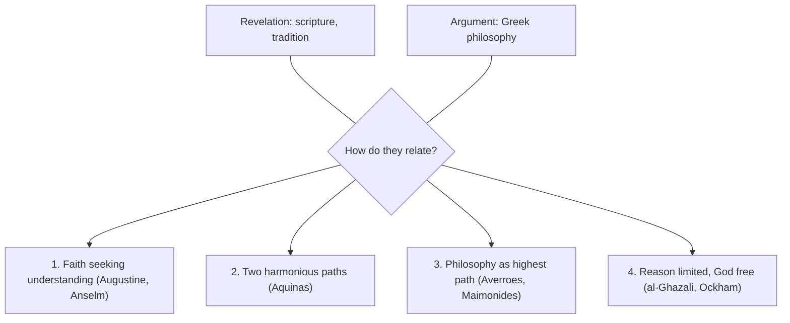

# Faith and reason: how the medieval problem was set

**Prerequisites:** [[dir:philosophy/history/ancient/greek|Ancient Greek philosophy]], especially [[gk:plato.md|Plato]], [[gk:aristotle.md|Aristotle]] and [[gk:plotinus.md|Plotinus]]; helpful: [[dir:religion/abrahamic/christianity/bible|the Bible branch]]

@@IMG@@

## Start from two sources of authority

Imagine you hold two sources of claims about the world. The first is **argument**: you accept a conclusion because premises you already accept lead to it, step by step, and anyone who follows the steps can check them. The second is **revelation**: you accept a claim because you trust that it comes from God, through a prophet, a scripture, or a community that hands it down. Both are ways of coming to believe things. They work very differently. Argument is open to anyone with a mind; revelation is received, and it asks for trust.

Now suppose both sources speak about the same subjects: whether the world had a beginning, whether the soul survives death, what the highest good is, whether there is one God. What do you do when they appear to agree, and what do you do when they appear to clash? That is the question that organizes roughly a thousand years of philosophy in the Christian, Islamic and Jewish worlds, from the late Roman Empire to the fourteenth century. Calling this period "medieval" is a European convention. The more useful description is: **philosophy practised inside religions of a revealed book**.

## The inheritance

By the fourth century CE the Greek schools had left a toolkit: [[c:metaphysics/the-forms.md|Plato's Forms]], [[c:metaphysics/form-and-matter.md|Aristotle's form and matter]], his [[c:logic/syllogism-and-the-organon.md|logic]], Stoic ethics, and above all the late Platonism of [[gk:plotinus.md|Plotinus]], with its single source of reality, [[c:metaphysics/the-one-and-emanation.md|the One]], from which everything flows. Christian, and later Muslim and Jewish, thinkers found in this toolkit language that seemed made for their own claims: an eternal, unchanging, immaterial first principle; a rational soul that is more than the body; a cosmos with order and purpose.

They also found sharp differences. Aristotle's world has no beginning; Genesis says "In the beginning". Plotinus's One produces the world by necessary overflow; the God of the scriptures creates freely. Greek philosophy prizes the self-sufficient sage; the scriptures speak of grace, sin and a God who acts in history. Every medieval synthesis is a negotiation between these.

## Four basic positions

Most medieval thinkers can be placed among four broad answers to the question "how do faith and reason relate?" The labels are modern simplifications, and real thinkers mix them.

1. **Faith seeking understanding.** Belief comes first; reason then explores what is believed, tries to see why it is true, and defends it. This is the Augustinian line, and [[anselm|Anselm]] made the phrase *fides quaerens intellectum* ("faith seeking understanding") its motto.
2. **Two harmonious paths.** Reason, working from the senses, can reach some truths about God by itself (that God exists, that God is one). Revelation adds truths that reason cannot reach (the Trinity, the Incarnation). Because both come from the same God, they cannot truly contradict. This is the position of [[thomas-aquinas|Thomas Aquinas]].
3. **Philosophy as the highest path for the few.** Demonstrative philosophy gives the clearest grasp of truth; scripture expresses the same truth in images suited to everyone. Where they seem to clash, scripture is to be interpreted. This is roughly [[averroes|Averroes]], and in another key [[maimonides|Maimonides]].
4. **Reason limited, God free.** Reason cannot prove much about God, and God's absolute power is not bound by the necessities philosophers think they see in nature. This line runs through al-Ghazali's attack on the philosophers and, differently, through [[william-of-ockham|William of Ockham]].

## Why this was philosophy and not only theology

It is easy to dismiss the period as theology in disguise. That misses what happened. Because the stakes were high, the arguments had to be precise. Questions that look narrowly religious forced general problems into the open. Asking how God can know future free choices produced careful work on time, necessity and freedom (see [[boethius|Boethius]]). Asking how the bread of the Eucharist can change in substance but not in appearance pushed thinkers to define [[c:metaphysics/substance.md|substance]] and accident with new rigour. Asking whether "God is good" means the same as "Socrates is good" led to theories of analogy and meaning. Asking whether God commands things because they are good, or whether they are good because God commands them, restated [[gt:euthyphro.md|the Euthyphro problem]] for a monotheistic world.

The period also produced institutions that philosophy still uses: the university, the commentary, the public disputation, the habit of stating an opponent's best objections before replying. Those are the subject of [[scholasticism|the next lesson]].

## The arc of the period

- **Late antiquity (c. 350–600):** [[augustine|Augustine]] fuses Platonism with Christian belief; [[boethius|Boethius]] translates Aristotle's logic into Latin and writes [[consolation-of-philosophy|the *Consolation*]].
- **Early medieval Latin West (600–1050):** schools are few; monasteries preserve texts.
- **The Islamic world (800–1200):** a translation movement brings Greek philosophy into Arabic; [[avicenna|Avicenna]] and [[averroes|Averroes]] build vast systems ([[islamic-and-jewish-philosophy|lesson 3]]).
- **The Latin revival (1050–1350):** [[anselm|Anselm]], then the recovery of the whole of Aristotle through Arabic and Greek sources, the universities, [[thomas-aquinas|Aquinas]], and the late critical turn of [[william-of-ockham|Ockham]].

## Key ideas

- Medieval philosophy is philosophy practised inside religions of revelation; its organizing problem is how argument and revealed authority relate.
- The Greek inheritance, especially Platonism and Aristotle, supplied both tools and tensions (an eternal world versus creation, necessity versus freedom).
- Four broad positions: faith seeking understanding, two harmonious paths, philosophy as the highest path, and reason limited by divine freedom.
- Theological questions forced general advances on time, freedom, substance, meaning and the nature of goodness.

## Where this leads

- Next: [[scholasticism|Scholasticism: the method of the schools]]
- The first great synthesis: [[augustine|Augustine]] and his [[augustine-confessions|*Confessions*]]
- Related: [[c:metaphysics/the-one-and-emanation.md|The One and emanation]], [[dir:religion/abrahamic/christianity/bible|the Bible]]
- Later echo: the rationalists' proofs of God in [[rationalism|early modern rationalism]]
