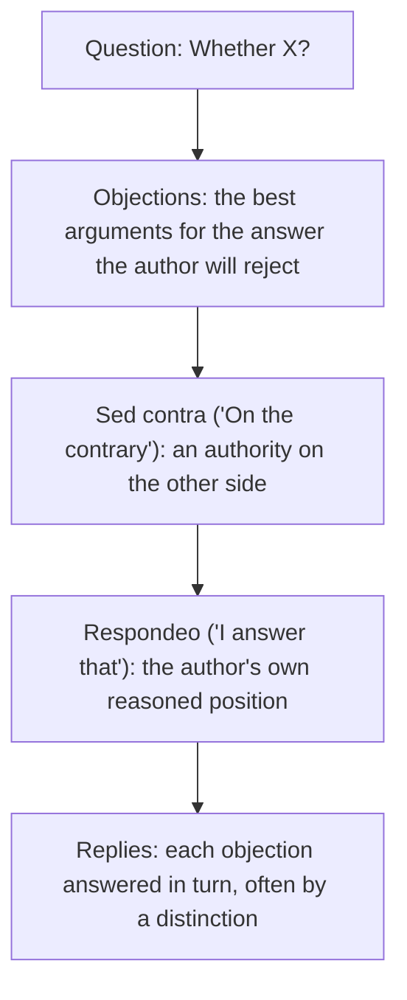

# Scholasticism: the method of the schools

**Prerequisites:** [Faith and reason](01-faith-and-reason.md); helpful: [the syllogism and the Organon](../../concepts/logic/syllogism-and-the-organon.md)

@@IMG@@

## What problem a method solves

Suppose you inherit a large library of authorities: scripture, the Church Fathers, Aristotle, legal codes. You trust each of them. Then you notice they seem to disagree. One authority says lying is always wrong; another praises a lie that saved a life. One says the world is eternal; another says it began. You cannot simply throw out an authority, because your whole intellectual world rests on them. You need a **procedure for handling disagreement**: a way to put apparently conflicting texts side by side, find the exact point of conflict, draw distinctions that dissolve it, and arrive at a defensible answer.

"Scholasticism" (from Latin *scholasticus*, "of the school") is the name later given to that procedure as it developed in the cathedral schools and universities of Latin Europe from about 1100 to 1500. It is not one doctrine. Thomists, Scotists and Ockhamists disagreed bitterly. What they shared was a way of working.

## The pieces of the method

**1. Authoritative texts.** Teaching was organized around set books. In theology the standard textbook was Peter Lombard's *Sentences* (c. 1150), a collection of passages from the Fathers arranged by topic. Every master had to lecture on it, so hundreds of commentaries survive. In the arts faculty the set books were Aristotle's works once they became available.

**2. Collecting opposed sayings.** Peter Abelard's *Sic et Non* ("Yes and No", c. 1120) lined up authorities on both sides of 158 questions without resolving them, to train students to notice conflict and to look for distinctions. That habit became central.

**3. The question (*quaestio*).** A topic is turned into a yes-or-no question: "Whether God exists." "Whether the soul is the form of the body." Framing it this way forces precision about exactly what is being asked.

**4. The disputation.** Masters held public disputations in which a question was argued, objections raised from the floor, and the master gave a determination. Written versions (*quaestiones disputatae*) preserve the shape.

**5. The article form.** The most famous result is the structure of an article in [Aquinas's *Summa Theologiae*](texts/summa-theologiae.md):

Notice what this demands. You must begin by stating your opponents' strongest case, in their terms. You must then give your own answer with reasons. And you must go back and answer every objection. A modern reader who skims to the "I answer that" misses half the point: the replies are where the distinctions that do the real work appear.

## The recovery of Aristotle

Until the twelfth century Latin readers had little of Aristotle beyond some logic, mostly through [Boethius](thinkers/boethius.md). Between about 1150 and 1270, translators working in Toledo, Sicily and elsewhere rendered his *Physics*, *Metaphysics*, *On the Soul*, *Ethics* and *Politics* into Latin, from Arabic and from Greek, together with the commentaries of [Avicenna](thinkers/avicenna.md) and [Averroes](thinkers/averroes.md). Averroes was so central as an interpreter that Latin writers simply called him "the Commentator".

This was intellectually explosive. Here was a complete, systematic account of nature, soul, ethics and politics built without revelation. Some of its claims seemed to conflict with Christian teaching: the eternity of the world, and, on Averroes' reading, a single intellect shared by all humans, which seemed to rule out personal immortality. Church authorities at Paris restricted the teaching of Aristotle's natural philosophy in 1210 and 1215. By the 1250s it was required reading anyway. In 1277 the Bishop of Paris, Étienne Tempier, condemned 219 propositions, some associated with radical Aristotelians in the arts faculty and a few apparently touching positions held by Aquinas.

## Why it mattered

The 1277 condemnation is often cited, with some debate among historians, as having encouraged thinkers to explore what God *could* have done, such as making other worlds or a vacuum, rather than what Aristotle said must be. That habit of imagining alternatives to Aristotelian necessity is one thread leading to [Ockham](thinkers/william-of-ockham.md) and, much later, to the [scientific revolution](../modern/early-modern/02-scientific-revolution-and-method.md).

Scholasticism became a byword for hair-splitting in the Renaissance; humanists mocked its Latin and its distinctions (see [Renaissance humanism](../modern/early-modern/01-renaissance-and-humanism.md)). [Descartes](../modern/early-modern/thinkers/rene-descartes.md) and [Bacon](../modern/early-modern/thinkers/francis-bacon.md) defined their projects against it. Yet both were trained in it, and the habit of stating objections and replies survives in Descartes' own [*Meditations*](../modern/early-modern/texts/meditations-on-first-philosophy.md), which were published with sets of objections and his replies.

## Key ideas

- Scholasticism is a method for reconciling conflicting authorities by questions, objections, distinctions and replies.
- Its institutions were the cathedral schools and the new universities (Paris, Oxford), with set texts like Lombard's *Sentences*.
- The article form (objections, *sed contra*, *respondeo*, replies) forces a thinker to face the strongest counterarguments.
- The recovery of Aristotle with Arabic commentaries both energized and destabilized the schools, leading to the condemnations of 1210–1277.

## Where this leads

- Next: [Islamic and Jewish philosophy](03-islamic-and-jewish-philosophy.md), the source of much of what the schools read
- The method at full stretch: [*Summa Theologiae*](texts/summa-theologiae.md)
- The late critical turn: [Universals and nominalism](04-universals-and-nominalism.md)
- The revolt against it: [Renaissance and humanism](../modern/early-modern/01-renaissance-and-humanism.md)
