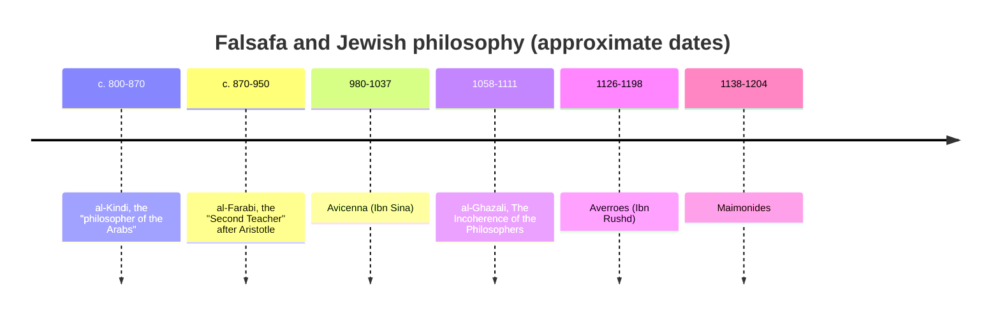

# Islamic and Jewish philosophy: falsafa and its heirs

**Prerequisites:** [Faith and reason](01-faith-and-reason.md); helpful: [Aristotle](../ancient/greek/thinkers/aristotle.md), [Plotinus](../ancient/greek/thinkers/plotinus.md)

@@IMG@@

## Why a translation movement is a philosophical event

A philosophy can only be argued with if it can be read. From the late eighth to the tenth century, under the Abbasid caliphs in Baghdad, a large and well-funded effort translated Greek science and philosophy into Arabic, often through Syriac, the language of the Christian scholars who did much of the work. Aristotle, much of Galen, Euclid, Ptolemy, and paraphrases of Plotinus and Proclus became available. A text circulated under the misleading title *Theology of Aristotle* was in fact a paraphrase of parts of Plotinus's *Enneads*. That mistake mattered: it encouraged readers to see Aristotle and Neoplatonism as one harmonious system.

Two kinds of reasoning about religion then grew up side by side in the Islamic world:

- **Kalam** ("speech", dialectical theology): argument used to defend and clarify Islamic doctrine, with its own atomistic physics and debates about God's attributes and human free will.
- **Falsafa** (from Greek *philosophia*): the project of the philosophers (*falasifa*), who took the Greek curriculum as their starting point and aimed at demonstrative knowledge.

## The main figures

**Al-Kindi** argued that philosophy and revelation pursue the same truth and that one should accept truth from whatever source. **Al-Farabi** built a political philosophy on Plato's *Republic*: the ideal ruler is a philosopher-prophet who communicates truth to the many through images and laws, a direct descendant of [Plato's philosopher-rulers](../../concepts/political/philosopher-rulers.md).

**[Avicenna](thinkers/avicenna.md)** produced the most influential system. Two of his ideas run through later Western philosophy. First, the distinction between **essence and existence**: knowing what a thing is (a triangle, a phoenix) does not tell you whether it exists. For everything except God, existence is something added to essence; God alone is the being whose essence is to exist, the "necessary existent". Second, the **floating man**: imagine a person created in mid-air, blindfolded, limbs apart, touching nothing. Avicenna argued that such a person would still be aware of his own existence without being aware of any body, which suggests the self is not identical with the body. Readers of [Descartes](../modern/early-modern/thinkers/rene-descartes.md) will hear an anticipation, though the arguments differ.

**Al-Ghazali**, a towering theologian, wrote *The Incoherence of the Philosophers*, charging them with errors, three of which he considered beyond the bounds of Islam: the eternity of the world, God's knowing only universals and not particulars, and the denial of bodily resurrection. He also challenged necessary causation: when cotton burns on contact with fire, we observe only that one follows the other; the connection is made by God, not by a power in the fire. Centuries later [Hume](../modern/early-modern/thinkers/david-hume.md) would argue, on entirely different grounds, that we never observe a necessary connection between cause and effect.

**[Averroes](thinkers/averroes.md)**, a judge in Córdoba, answered with *The Incoherence of the Incoherence* and wrote line-by-line commentaries on almost all of Aristotle. In the *Decisive Treatise* he argued that Islamic law actually requires those capable of it to study philosophy, and that where demonstration and the literal sense of scripture conflict, the text should be interpreted.

**[Maimonides](thinkers/maimonides.md)**, born in Córdoba and later a court physician in Egypt, was the leading Jewish legal authority of his age and wrote the [*Guide for the Perplexed*](texts/guide-for-the-perplexed.md) in Arabic for readers torn between the Torah and philosophy. His "negative theology" holds that we can say what God is not, but not positively what God is.

## Transmission to the Latin West

In the twelfth and thirteenth centuries, translators in Toledo and elsewhere put Avicenna and Averroes into Latin, alongside Aristotle. Latin scholastics read Aristotle through these commentators. [Aquinas](thinkers/thomas-aquinas.md) cites "Avicenna", "the Commentator" and "Rabbi Moses" (Maimonides) constantly, sometimes in agreement, sometimes in sharp disagreement. A group at Paris who followed Averroes closely, later called "Latin Averroists", provoked the condemnations described in [the previous lesson](02-scholasticism.md).

The story did not end in 1200. Philosophy continued in the Islamic world, in the illuminationist school of Suhrawardi and in later Persian thinkers such as Mulla Sadra (d. 1640). It is a Western habit, now widely criticized by scholars, to stop the narrative when the Latin West stops reading it.

## Key ideas

- The Abbasid translation movement made Greek philosophy available in Arabic and created *falsafa*, alongside the dialectical theology of *kalam*.
- Avicenna's essence–existence distinction and his "floating man" shaped later Western metaphysics and philosophy of mind.
- Al-Ghazali challenged the philosophers on the world's eternity, divine knowledge, resurrection and necessary causation.
- Averroes defended philosophy and became the Latin West's "Commentator" on Aristotle; Maimonides wrote the classic Jewish attempt to reconcile Torah and philosophy.

## Where this leads

- Next: [Universals and nominalism](04-universals-and-nominalism.md)
- Thinkers: [Avicenna](thinkers/avicenna.md), [Averroes](thinkers/averroes.md), [Maimonides](thinkers/maimonides.md)
- Text: [*The Guide for the Perplexed*](texts/guide-for-the-perplexed.md)
- Later echo of the causation debate: [Hume](../modern/early-modern/thinkers/david-hume.md) and [empiricism](../modern/early-modern/04-empiricism.md)
