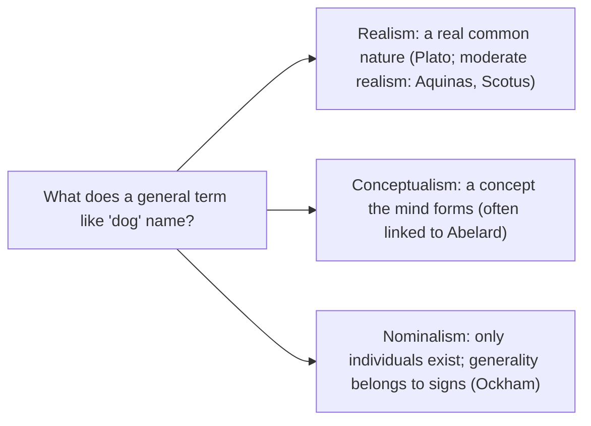

# Universals and nominalism: what general words name

**Prerequisites:** [Scholasticism](02-scholasticism.md); [The Forms](../../concepts/metaphysics/the-forms.md); helpful: [universal](../../glossary/general/universal.md), [particular](../../glossary/general/particular.md)

@@IMG@@

## The problem from scratch

Look at two dogs. They are two things, in two places, with different coats. Yet you call both "dog", and you are not wrong to. Something seems to be shared. What is it? There are three places you could look for the answer:

- **In the world, outside minds:** there is a real common nature, *dogness*, present in each dog (or existing beyond them).
- **In the mind:** the mind forms a general concept by noticing resemblances; the concept is general, the dogs are not.
- **In language:** there are only individual dogs, and "dog" is a word we apply to each of them; generality belongs to words and signs.

That is the **problem of universals**. It sounds like a puzzle about labels. It is really a question about the structure of reality and about whether our knowledge, which is always in general terms ("water boils at 100 °C"), tracks anything real.

## How the medieval debate began

Plato had answered with the [Forms](../../concepts/metaphysics/the-forms.md): dogness exists apart, and dogs share in it. Aristotle placed forms *in* things: the form of dog is real but exists only as the form of this or that dog ([form and matter](../../concepts/metaphysics/form-and-matter.md)). The neoplatonist Porphyry (3rd century) wrote an introduction to Aristotle's logic, the *Isagoge*, which raised three questions and refused to answer them: do genera and species exist, or are they only in the mind? If they exist, are they bodily or not? Are they separate from sensible things or in them? [Boethius](thinkers/boethius.md) translated the *Isagoge* and commented on it, and with that the questions were handed to every medieval logic student.

## The main answers

**Realism.** In its strong form, universals exist independently of minds and particulars. Most medieval realists were *moderate*: following Aristotle, they held that the common nature exists in things, and the intellect abstracts it. [Aquinas](thinkers/thomas-aquinas.md) held a version of this. John Duns Scotus (d. 1308) argued for a "common nature" in things that is less than numerically one but real, made individual by a principle he called "thisness" (*haecceitas*).

**Peter Abelard** (1079–1142), the brilliant and controversial Paris logician, attacked the realism of his teacher William of Champeaux. Universality, he argued, belongs to words as meaningful, not to things. His view is usually classed as nominalist or conceptualist; scholars debate the label.

**Nominalism.** [William of Ockham](thinkers/william-of-ockham.md) pushed furthest. Everything that exists is individual. A universal is a mental sign, a concept, that naturally signifies many individuals. Positing real common natures adds nothing that explanation needs. This is where the principle later called **[Ockham's razor](../../glossary/modern/ockhams-razor.md)** does its work: do not multiply entities beyond necessity. (The famous Latin wording, *entia non sunt multiplicanda praeter necessitatem*, does not appear in Ockham's surviving writings, though he states the principle in other words many times.)

## Why it mattered later

Nominalism changed the intellectual mood. If there are no real natures in things that the mind can read off, then knowledge of nature has to be built from observing individuals and their regular behaviour. Many historians see a line, though not a straight one, from the fourteenth-century "modern way" (*via moderna*) of Ockham's followers to the [empiricism](../modern/early-modern/04-empiricism.md) of [Locke](../modern/early-modern/thinkers/john-locke.md) and [Hume](../modern/early-modern/thinkers/david-hume.md) and to the experimental attitude of the [scientific revolution](../modern/early-modern/02-scientific-revolution-and-method.md). In theology, stressing that God's will is not bound by fixed natures fed into debates the Reformers inherited.

The problem never closed. Twentieth-century philosophers still argue about whether properties and numbers exist; [Wittgenstein](../modern/twentieth-century/thinkers/ludwig-wittgenstein.md)'s idea of "family resemblance", in which members of a kind share overlapping similarities with no single common feature, is a modern answer in a nominalist spirit.

## Key ideas

- The problem of universals asks whether what general words name exists in reality, in the mind, or only in language.
- Porphyry posed it, Boethius transmitted it, and medieval logicians argued it for centuries.
- Moderate realists (Aquinas, Scotus) put common natures in things; Abelard located generality in meaningful words; Ockham held that only individuals exist.
- Ockham's razor and the nominalist mood helped prepare later empiricism and the new science.

## Where this leads

- Thinkers: [William of Ockham](thinkers/william-of-ockham.md), [Thomas Aquinas](thinkers/thomas-aquinas.md)
- Forward: [Renaissance and humanism](../modern/early-modern/01-renaissance-and-humanism.md) opens the early modern period
- Forward: [Empiricism](../modern/early-modern/04-empiricism.md) and the [analytic turn](../modern/twentieth-century/02-analytic-turn.md), where the problem returns in the philosophy of language
- Back: [The Forms](../../concepts/metaphysics/the-forms.md), [Substance](../../concepts/metaphysics/substance.md)
