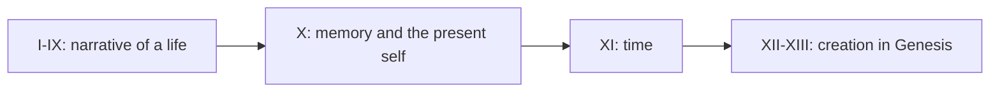

# Augustine, *Confessions*

**Prerequisites:** [Augustine](../thinkers/augustine.md); helpful: [Faith and reason](../01-faith-and-reason.md)

@@IMG@@

## Dating and authorship

Written in Latin by [Augustine](../thinkers/augustine.md) around 397–400, a few years after he became bishop of Hippo. Authorship has never been in doubt. The title *Confessiones* carries a double sense: confession of sins, and confession in the sense of praise of God. The whole book is addressed to God in the second person; the human reader overhears a prayer.

## Outline

- **Books I–IX: the narrative.** Infancy and the observation that even babies show envy; schooling and the beatings he hated; the theft of pears at sixteen, done not for the pears but for the pleasure of the forbidden shared with friends (Book II); Carthage, his unnamed companion of many years and their son Adeodatus; reading Cicero's lost *Hortensius*, which turned him toward wisdom; nine years among the Manichaeans; Milan, Ambrose, the "books of the Platonists"; the inner struggle of a divided will; the garden scene in Book VIII, where he hears a child's voice chanting "take up and read" (*tolle lege*), opens Paul's letter to the Romans (13:13–14) and is converted; baptism; the vision at Ostia shared with his mother Monica shortly before her death (Book IX).
- **Book X: memory.** Who am I now? An exploration of memory as a vast inner palace, of the desire for happiness, and of the temptations he still faces.
- **Book XI: time.** What is time? The past is no longer and the future is not yet. Time is a "distension" of the mind.
- **Books XII–XIII: creation.** An interpretation of the opening of [Genesis](../../../../religion/abrahamic/christianity/bible/old-testament/books/law-torah/genesis.md), including reflections on how many true meanings a text can bear.

## Key ideas and passages

The opening prayer sets the theme: God has made us for himself, and our heart is restless until it rests in him. The book shows a will divided against itself ("Give me chastity and continence, but not yet"), a psychology that shaped Western ideas of the self and its inner conflicts. The pear theft analyses wrongdoing as love of something for its own sake that has no worth in itself. Book XI's treatment of time is one of the most discussed passages in the history of philosophy.

## Reading the structure

Readers often wonder why an autobiography turns into treatises on memory, time and Genesis. One answer is that the narrative shows a soul scattered in time and the last books show the mind being gathered toward the eternal. Another is that Augustine moves from his own beginning to the beginning of everything.

## Reception

The *Confessions* has been read continuously since it was written. Petrarch carried a copy up Mont Ventoux in 1336. It is often called the first autobiography in the modern inward sense, and it influenced Rousseau's own *Confessions*, which deliberately echoes the title while removing God as addressee. [Wittgenstein](../../modern/twentieth-century/thinkers/ludwig-wittgenstein.md) opens the *Philosophical Investigations* with Augustine's account of learning language. Translations: Henry Chadwick (Oxford World's Classics) and Maria Boulding are widely recommended; Sarah Ruden's is a more recent, vivid version.

## Key ideas

- A prayer addressed to God that tells the story of a conversion and then reflects on memory, time and creation.
- Its analysis of the divided will and restless heart shaped Western ideas of the self.
- Book XI on time remains a classic of philosophy.

## Where this leads

- Next text: [*The City of God*](city-of-god.md)
- Thinker: [Augustine](../thinkers/augustine.md)
- Related: [Romans](../../../../religion/abrahamic/christianity/bible/new-testament/books/pauline-epistles/romans.md), the letter that converted him
- Forward: [Rousseau](../../modern/early-modern/thinkers/jean-jacques-rousseau.md); [Wittgenstein's *Investigations*](../../modern/twentieth-century/texts/philosophical-investigations.md)
