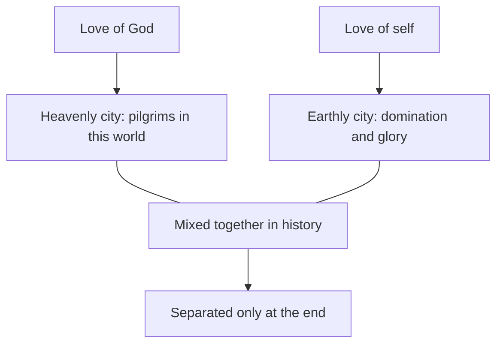

# Augustine, *The City of God*

**Prerequisites:** [Augustine](../thinkers/augustine.md), [*Confessions*](augustine-confessions.md)

@@IMG@@

## Dating and occasion

*De civitate Dei contra paganos* ("The City of God against the Pagans") was written by [Augustine](../thinkers/augustine.md) in installments between about 413 and 426. The occasion was the sack of Rome by the Visigoths under Alaric in 410, a shock throughout the Roman world. Pagans argued that Rome had fallen because it had abandoned its gods for Christianity; some Christians asked why God had allowed it. The book grew into a twenty-two-book account of history, society and destiny.

## Outline

- **Books I–V:** Rome's gods did not protect it in the past either; Roman greatness was a reward for civic virtues driven by love of glory, which Augustine admires and criticizes.
- **Books VI–X:** Against those who worship the gods for the sake of the afterlife, including a long engagement with the Platonists, whom he ranks highest among philosophers but faults for pride and for worshipping lesser spirits.
- **Books XI–XIV:** The origin of the two cities in the fall of the angels and of humanity; creation, sin and the will.
- **Books XV–XVIII:** The two cities' course through biblical and secular history.
- **Books XIX–XXII:** Their ends: the true highest good, peace, the last judgment, punishment and eternal happiness.

## Key ideas

**Two loves, two cities.** "Two loves have made two cities": love of self to the contempt of God made the earthly city, and love of God to the contempt of self made the heavenly city (Book XIV). These are not Church and state. They are two communities defined by what they love, mixed together in every institution until the end.

**Peace.** Book XIX argues that every being, even in war, seeks peace of some kind. Earthly peace, the "tranquillity of order", is a real good that the heavenly city uses during its pilgrimage, but it is never final.

**Justice and the state.** Without justice, he asks, what are kingdoms but great robber bands? He tells the story of the pirate who, asked by Alexander the Great why he troubled the sea, answered that he did it with one small ship and was called a robber, while Alexander did it with a great fleet and was called an emperor.

## Reception

The book shaped medieval political thought, including theories of the relation between spiritual and temporal power (often called "political Augustinianism", which simplified Augustine's view). Its linear view of history, moving from creation to an end, contrasted with cyclical Greek views and shaped Western philosophies of history, from medieval chronicles to [Hegel](../../modern/nineteenth-century/thinkers/georg-wilhelm-friedrich-hegel.md). Modern political "realists" such as Reinhold Niebuhr drew on Augustine's view of human pride and power. [Hannah Arendt](../../modern/twentieth-century/thinkers/hannah-arendt.md) wrote her dissertation on Augustine's concept of love. Henry Bettenson's Penguin translation and R. W. Dyson's Cambridge translation are standard.

## Key ideas

- Written after the sack of Rome to refute the charge that Christianity caused Rome's fall.
- History is the story of two cities defined by two loves, intermingled until the end.
- Earthly peace and justice are real but provisional goods.

## Where this leads

- Next text: [*The Consolation of Philosophy*](consolation-of-philosophy.md)
- Back: [*Confessions*](augustine-confessions.md)
- Forward: [Hegel](../../modern/nineteenth-century/thinkers/georg-wilhelm-friedrich-hegel.md)'s philosophy of history; [the social contract](../../modern/early-modern/05-social-contract-and-the-state.md)
- Related: [the polis and the political animal](../../../concepts/political/the-polis-and-political-animal.md)
