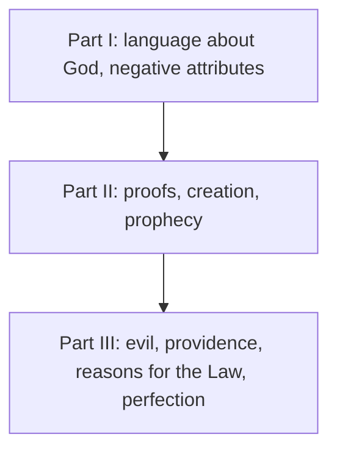

# Maimonides, *The Guide for the Perplexed*

**Prerequisites:** [Maimonides](../thinkers/maimonides.md); [Islamic and Jewish philosophy](../03-islamic-and-jewish-philosophy.md)

@@IMG@@

## Dating and language

Written by [Maimonides](../thinkers/maimonides.md) in Egypt around 1190, in Judeo-Arabic (Arabic written in Hebrew characters). The Arabic title is *Dalalat al-Ha'irin*. It was translated into Hebrew in Maimonides' lifetime by Samuel ibn Tibbon as *Moreh Nevukhim*, and later by Judah al-Harizi; a Latin version was used by thirteenth-century scholastics.

## Audience and method

The book is framed as letters to a former student, Joseph ben Judah, who had studied logic and astronomy and was perplexed: the Torah, read literally, seemed to say things about God that philosophy showed to be false. Maimonides warns in his introduction that he has deliberately scattered his points and sometimes included contradictions for various reasons, including to conceal deep matters from those not ready for them. This statement has fuelled centuries of debate about the book's hidden meaning.

## Outline

- **Part I.** Biblical terms for God (image, likeness, place, sitting, seeing) are explained one by one as figurative. Then the doctrine of divine attributes: God's attributes are best understood negatively or as descriptions of God's actions. Criticism of the *kalam* theologians' proofs.
- **Part II.** Proofs of God's existence, unity and incorporeality, drawn from Aristotle. The question of creation versus the eternity of the world: neither is demonstrable; creation is accepted. Prophecy as a perfection of intellect and imagination.
- **Part III.** Ezekiel's chariot vision (treated with deliberate reticence); the problem of evil and the book of [Job](../../../../religion/abrahamic/christianity/bible/old-testament/books/wisdom-poetry/job.md); divine providence; reasons for the commandments, which serve the welfare of body and soul; human perfection, culminating in intellectual love of God.

## Key ideas

- Scripture "speaks in the language of human beings"; anthropomorphisms are figures.
- We know that God is, but not what God is; negation brings us nearer.
- Creation cannot be demonstrated, but neither can eternity; so the Torah's view stands.
- The commandments have reasons, intelligible in terms of their historical setting and purposes.

## Reception

The *Guide* provoked the "Maimonidean controversies" in thirteenth-century Jewish communities. It shaped [Aquinas](../thinkers/thomas-aquinas.md) and Meister Eckhart, later Jewish thought, and [Spinoza](../../modern/early-modern/thinkers/baruch-spinoza.md), who criticized its way of reconciling scripture and reason. Shlomo Pines's two-volume English translation (University of Chicago Press, 1963) is the scholarly standard; M. Friedländer's older translation is freely available.

## Where this leads

- Next text: [*Summa Theologiae*](summa-theologiae.md)
- Related: [Job](../../../../religion/abrahamic/christianity/bible/old-testament/books/wisdom-poetry/job.md)
- Forward: [Spinoza](../../modern/early-modern/thinkers/baruch-spinoza.md) and his [*Ethics*](../../modern/early-modern/texts/spinoza-ethics.md)
